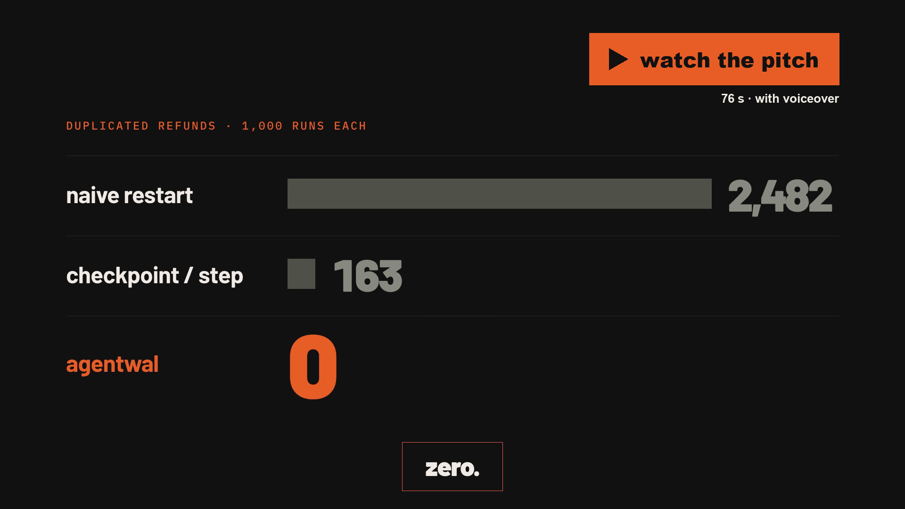

# AgentWAL

**LLM agents that touch the real world (refunds, emails, API calls) lose work or repeat side effects when they crash. AgentWAL is a small Python library for agent builders that journals every model call and tool effect, so an agent can be `kill -9`'d at any point and simply rerun: no refund issued twice, no completed step lost, no finished LLM call paid for again.**

[▶ Watch the 76-second pitch](docs/agentwal-pitch.mp4) · [Architecture](#architecture) · [Results](#results-and-evaluation) · [Quickstart](#getting-started)

[](docs/agentwal-pitch.mp4)

## At a Glance

- **Status:** working prototype; tested, chaos-tested and benchmarked. Single process, single journal file.
- **Quickstart:** `make setup && make demo` (no API key, no paid service).
- **Verification:** `make test` (54 unit, property and integration tests) and `make chaos` (5,200 fake-model runs with SIGKILLs). CI runs the tests plus a 50-run chaos smoke on every push. Full numbers in [docs/EVAL_REPORT.md](docs/EVAL_REPORT.md).

## Start Here

- **Want to try it?** [Getting Started](#getting-started), then `make demo`.
- **Want to understand it?** [Architecture](#architecture) and [docs/DESIGN.md](docs/DESIGN.md).
- **Want to verify the claims?** [Results and Evaluation](#results-and-evaluation): every number is generated from `results/` by `make report`.
- **Want to know who did what?** [Contributions](#contributions-and-acknowledgements).

## The Problem

An agent working through a batch of support tickets calls `issue_refund()` for each one. If the process dies halfway (OOM, deploy, `kill -9`), the obvious recoveries fail:

- **Restart from scratch** and every refund before the crash is paid again.
- **Checkpoint after each step** (what most frameworks do) and you still pay twice whenever the crash lands between the payment and the checkpoint save. Every completed-but-unrecorded LLM call is also billed again.

## What Makes This Different?

- **The intent is durable before the world is touched.** Each effect is two-phase: an fsynced `EFFECT_INTENT` with an idempotency key `aw:{run_id}:{seq}`, then the call, then `EFFECT_RESULT`. A crash in any window has a defined recovery path.
- **Replay, not checkpoints.** After a crash the agent code reruns from the top; completed calls return their journaled results instantly, so LLM calls are never re-billed and random/time values never change.
- **Non-determinism is detected, not ignored.** If replayed code issues a different request at the same position, `NonDeterminismError` names both requests.
- **Proved with a chaos harness, not asserted.** Over 7,000 real SIGKILLs at random moments and at targeted kill points, plus simulated power loss per fsync policy and torn-journal tests.
- **Tiny and dependency-free.** The library is stdlib-only Python.

It is a focused, single-process study of **durable execution**, the idea behind Temporal, DBOS and LangGraph checkpoints, built from first principles. It is **not** a replacement for them: Temporal replays workflow code against an event history and fails on a mismatched command; DBOS checkpoints step outputs in Postgres and retries an interrupted step; LangGraph checkpoints graph state and re-runs interrupted tasks. They offer workers, distribution, versioning and UIs; AgentWAL offers one file and a test harness. Comparison with citations: [docs/DESIGN.md](docs/DESIGN.md).

## Demonstration

The [pitch video](docs/agentwal-pitch.mp4) (76 s, synthetic voiceover generated locally with Kokoro) walks through the problem, the mechanism, the real demo output and the results ([transcript](docs/pitch_script.md)).

`make demo` runs the real thing: the refund agent is SIGKILLed right after its 3rd refund is paid but before it is journaled, then rerun.

```text
$ AGENTWAL_KILL_AT=after_effect_before_result:3 python -m demo.agent --strategy aw ...
agent exited with code 137 (137 = killed by SIGKILL, like kill -9)
3 payments in the ledger for demo-aw

$ python -m demo.agent --strategy aw ...          # same command, rerun
done: 7 refunds, 39848 cents
7 payments in the ledger for demo-aw
LLM calls billed: 10 (10 needed)

# Baseline B1 (checkpoint after each step), same kill point
8 payments in the ledger for demo-b1               # one refund paid twice
```

Full transcript: [docs/demo_transcript.txt](docs/demo_transcript.txt). Inspect any journal with `python -m agentwal.dump runs/demo/aw/journal.wal`.

## Architecture

```python
from agentwal import durable_run, ToolSpec

with durable_run("runs/demo.wal", run_id="r-42", input=task) as ctx:
    if ctx.done:                                  # finished before: return the recorded output
        return ctx.output
    llm = ctx.llm(model_adapter)                  # journaled model calls
    tools = ctx.wrap({"issue_refund": ToolSpec(pay, reconcile=lookup)})  # two-phase effects
    result = Agent(llm=llm, tools=tools).run(task)
    ctx.complete(result)
```

- **Journal** (`src/agentwal/journal.py`, `records.py`): one append-only file of `[length u32][crc32 u32][type u8][JSON]` records. On open, every record is CRC-checked from the start and a torn tail is truncated at the last valid record. fsync policy: `always`, `group:N:MS` or `none`.
- **Replay** (`replay.py`, `context.py`): each journaled call is matched by sequence number; completed calls return their recorded result, the first incomplete call runs for real. `ctx.now()`, `ctx.random()` and `ctx.uuid()` are journaled too.
- **Effects in two phases**, with the crash windows:

```mermaid
sequenceDiagram
    participant A as Agent code
    participant J as Journal
    participant P as Payments service
    A->>J: write EFFECT_INTENT(seq, args, key)
    Note over A,J: ① crash before the fsync: intent may be lost; retry uses the same key anyway
    J-->>J: fsync (barrier)
    Note over A,P: ② crash before the call: replay retries with the same key, the first real charge
    A->>P: POST /payments (Idempotency-Key: aw:run:seq)
    P-->>A: payment
    Note over A,J: ③ crash before the result: replay retries with the same key and gets the original payment back (or reconcile(key) finds it)
    A->>J: write EFFECT_RESULT + fsync
```

Checkpoint-after-step has no record before the effect, so window ③ stretches from the payment to the checkpoint and the retry carries no key: that is where its duplicates come from. Full table of windows and recovery paths: [docs/DESIGN.md](docs/DESIGN.md#4-replay-and-the-crash-windows).

## Getting Started

Free: no API key and no paid service anywhere.

```bash
make setup         # uv venv + install (Python 3.12)
make test          # unit, property (Hypothesis) and integration tests
make demo          # kill -9 the agent mid-refund, resume it, compare with checkpoint-after-step
make chaos         # every chaos suite with the fake model, then regenerate docs/EVAL_REPORT.md
make bench         # per-record and per-step overhead per fsync policy
make chaos-real    # 30 runs with a real LLM, local and free: qwen3:8b via Ollama (`ollama pull qwen3:8b`)
```

## Testing and Verification

- **Unit tests** (`tests/unit`): record encoding and CRC, torn-tail truncation, fsync policies, sequence matching, non-determinism detection, idempotency keys, reconcile paths, tool-error handling.
- **Property tests** (`tests/property`, Hypothesis): truncation at any byte recovers exactly a prefix; a corrupted byte never yields a wrong record; replay under random crashes, journal tears and fsync policies applies the same effects exactly once.
- **Integration tests** (`tests/integration`): the real agent process and payments service with real SIGKILLs at each kill point.
- **Chaos harness** (`chaos/harness.py`): every run is killed at least once (random timer or targeted kill point), restarted until done (at most 10 restarts), then checked against four invariants: exactly one payment per intended refund, output identical to an uninterrupted run, every acknowledged record survives, no `NonDeterminismError`.

## Results and Evaluation

<!-- RESULTS:START -->
| Strategy | Runs | Kills | Duplicated effects | Lost effects | Runs violating an invariant | Recovery p50 / p99 (ms) | LLM calls re-billed | Per-step overhead vs no journal (p50) |
|---|---|---|---|---|---|---|---|---|
| B0 naive restart | 1000 | 1421 | 2482 | 0 | 629 | 0.00 / 0.00 | 4265 | 0 (no journal) |
| B1 checkpoint-after-step | 1000 | 1325 | 163 | 0 | 160 | 0.09 / 0.19 | 665 | 0 (no journal) |
| AgentWAL | 1000 | 1309 | 0 | 0 | 0 | 0.37 / 0.79 | 147 | always +107 µs, group:8:5 +53 µs, none +25 µs |

Fake model, `kill -9` process crashes, 1000, 1000, 1000 runs, measured 2026-10-23. Generated by `make chaos` + `make bench`; see docs/EVAL_REPORT.md.

With a real LLM (`qwen3:8b`, local via Ollama, free): 30 runs, 46 kills, 0 invariant violations, 0 duplicated effects (2026-10-24, `make chaos-real`).
<!-- RESULTS:END -->

AgentWAL's 147 re-billed calls are exactly the calls killed mid-flight, before their result could be journaled. The report also covers simulated power loss per fsync policy, torn writes, and what happens when the receiver ignores idempotency keys: [docs/EVAL_REPORT.md](docs/EVAL_REPORT.md).

## Important Design Decisions

Full ADRs in [docs/DECISIONS.md](docs/DECISIONS.md):

- **Length + CRC32 + type + canonical JSON** per record: the length frames it, the CRC proves it is whole, JSON keeps the journal debuggable.
- **fsync barriers before effects**: correctness only needs the intent durable before the outside world is touched; LLM records can ride a group commit.
- **Deterministic idempotency keys** `aw:{run_id}:{seq}`: a retry sends the same key even if the intent record itself was lost.
- **Replay by sequence number plus a request hash**: agent loops have no stable step names.
- **Only permanent tool errors are journaled**: a connection reset may hide a successful payment, so it leaves the intent open for a same-key retry.

## Limitations and Non-Goals

| Guarantee | Holds only if |
|---|---|
| Each intended tool effect is applied exactly once | the receiver deduplicates on the idempotency key, **or** offers a lookup by key (`recovery="reconcile"`) |
| No acknowledged step is lost | under process crashes, always; under power loss, for records the fsync policy acknowledged |
| Resume reaches the same output as an uninterrupted run | the agent code is deterministic outside the journal and unchanged (`code_version`) |
| Completed LLM calls are not re-billed | always; a call interrupted mid-flight is paid again |

- The chaos suites show each assumption failing when it is removed: a receiver that ignores keys duplicates in window ③ (`aw-noidem`) unless reconcile is used; no fsync plus a sampling model under power loss breaks resume (`aw-pl-none-stoch`).
- CRC32 detects accidental corruption, not tampering; the journal is not encrypted, so do not journal secrets.
- A corrupt record in the middle of the journal discards everything after it.
- **Non-goals:** multi-worker or distributed execution, a general workflow engine, cross-machine replication, matching Temporal or DBOS features.

## Project Structure

```text
src/agentwal/   library (stdlib only): records, journal, replay, durable context, errors, dump
demo/           refund agent (strategies aw / b1 / b0), fake model, local-LLM adapter, payments service
chaos/          harness, kill points, invariants, benchmark, report generator, real-model runner
tests/          unit, property (Hypothesis), integration
results/        raw chaos and benchmark results (source of every number)
docs/           design, decisions, evaluation report, learning notes, pitch video
```

## Roadmap

- Segment rotation and compaction for long-running agents.
- An `asyncio` variant of the durable context.
- A lease-based single-writer lock so two workers can never append to the same journal.

## Contributions and Acknowledgements

Design, failure model, implementation and chaos experiments by Varad Rajiv Pandare. Implemented with Claude Code as a pair programmer. The pitch video was made with HyperFrames, with a synthetic voiceover generated locally by the open Kokoro TTS model and a music bed synthesized in code.

## License

MIT, see [LICENSE](LICENSE).
