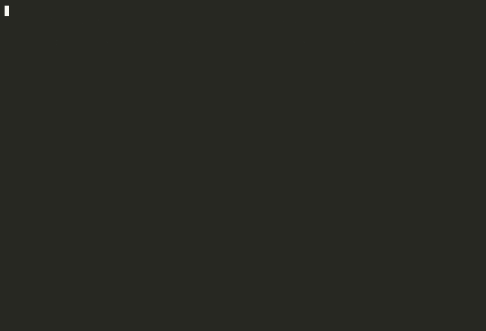

# AgentWAL

**Crash-safe LLM agent runs from a write-ahead journal: `kill -9` an agent at any point, rerun the same command, and it resumes. No refund is issued twice, no completed step is lost, and no completed LLM call is paid for twice.**



> The GIF still has to be recorded (`asciinema rec -c "make demo"`, or `vhs`). A text transcript of the same demo is in [docs/demo_transcript.txt](docs/demo_transcript.txt).

## Results

<!-- RESULTS:START -->
_Run `make chaos bench report` to fill this table from `results/`._
<!-- RESULTS:END -->

Full numbers, including power loss per fsync policy, torn writes, the receiver assumption and the overhead benchmark: [docs/EVAL_REPORT.md](docs/EVAL_REPORT.md).

## How it works

```python
from agentwal import durable_run, ToolSpec

with durable_run("runs/demo.wal", run_id="r-42", input=task) as ctx:
    if ctx.done:                                  # finished before: return the recorded output
        return ctx.output
    llm = ctx.llm(model_adapter)                  # journaled model calls
    tools = ctx.wrap({"issue_refund": ToolSpec(pay, reconcile=lookup)})  # two-phase effects
    result = Agent(llm=llm, tools=tools).run(task)
    ctx.complete(result)
```

- **Journal**: one append-only file of `[length u32][crc32 u32][type u8][JSON]` records. On open, every record is CRC-checked from the start and a torn tail is truncated at the last valid record. fsync policy: `always`, `group:N:MS` or `none`.
- **Replay**: after a crash the agent code runs again from the top. Each journaled call is matched by sequence number; completed calls return their recorded result instantly, the first incomplete call runs for real.
- **Non-determinism detection**: each call stores a hash of its request. If replayed code issues a different request at the same position (changed code, or an un-journaled `random()`/`time()`), `NonDeterminismError` names both requests. `ctx.now()`, `ctx.random()` and `ctx.uuid()` are journaled.
- **Effects in two phases**: intent → effect → result, with the idempotency key `aw:{run_id}:{seq}`:

```mermaid
sequenceDiagram
    participant A as Agent code
    participant J as Journal
    participant P as Payments service
    A->>J: write EFFECT_INTENT(seq, args, key)
    Note over A,J: ① crash before the fsync: intent may be lost; retry uses the same key anyway
    J-->>J: fsync (barrier)
    Note over A,P: ② crash before the call: replay retries with the same key, the first real charge
    A->>P: POST /payments (Idempotency-Key: aw:run:seq)
    P-->>A: payment
    Note over A,J: ③ crash before the result: replay retries with the same key and gets the original payment back (or reconcile(key) finds it)
    A->>J: write EFFECT_RESULT + fsync
```

Checkpoint-after-step (B1) has no record before the effect, so window ③ stretches from the payment to the checkpoint and the retry carries no key: that is where its duplicates come from. Full table of windows and recovery paths: [docs/DESIGN.md](docs/DESIGN.md#4-replay-and-the-crash-windows).

## Guarantees and their assumptions

| Guarantee | Holds if |
|---|---|
| Each intended tool effect is applied exactly once | the receiver deduplicates on the idempotency key, **or** offers a lookup by key (`recovery="reconcile"`) |
| No acknowledged step is lost | under process crashes, always; under power loss, for records the fsync policy acknowledged |
| Resume reaches the same output as an uninterrupted run | the agent code is deterministic outside the journal (all model calls, effects, time, randomness go through `ctx`) and unchanged (`code_version`) |
| Completed LLM calls are not re-billed | always; a call interrupted mid-flight is paid again |

The chaos suites show where each assumption matters: a receiver that ignores keys duplicates in window ③ (`aw-noidem`) unless reconcile is used; no fsync with a sampled model under power loss breaks resume (`aw-pl-none-stoch`).

## How this relates to Temporal, DBOS and LangGraph

AgentWAL is a focused, single-process study of **durable execution**, built from first principles. It is **not** a replacement for these systems.
- **Temporal** replays workflow code against an event history and fails on a mismatched command with a nondeterminism error; activities are retried and should be idempotent. AgentWAL borrows the replay-and-compare model.
- **DBOS** checkpoints each step's output in Postgres and retries an interrupted step on recovery. AgentWAL's results are the same idea; the intent record and automatic key target that step's retry window.
- **LangGraph** checkpoints graph state (durability modes `exit`/`async`/`sync`) and re-runs interrupted tasks; side effects should be wrapped in tasks and made idempotent. AgentWAL journals inside a step, per call.

They offer workers, distribution, versioning, timers, signals and UIs; AgentWAL offers one file and a test harness. Comparison with citations: [docs/DESIGN.md](docs/DESIGN.md).

## Quickstart (no API key needed)

```bash
make setup         # uv venv + install
make test          # unit, property (Hypothesis) and integration tests
make demo          # kill -9 the agent mid-refund, resume it, compare with checkpoint-after-step
make chaos         # every chaos suite with the fake model, then regenerate docs/EVAL_REPORT.md
make bench         # per-record and per-step overhead per fsync policy
make chaos-real    # 30 runs with a real model: runs a pilot, prints the cost, asks first
```

Inspect a journal: `python -m agentwal.dump runs/demo/aw/journal.wal`.

Layout: `src/agentwal/` (library, stdlib-only), `demo/` (agent, fake model, payments service), `chaos/` (harness, kill points, invariants, benchmark, report), `tests/`, `docs/`.

## How it was built

Implemented with Claude Code as a pair programmer; design, failure model and chaos experiments by me.
