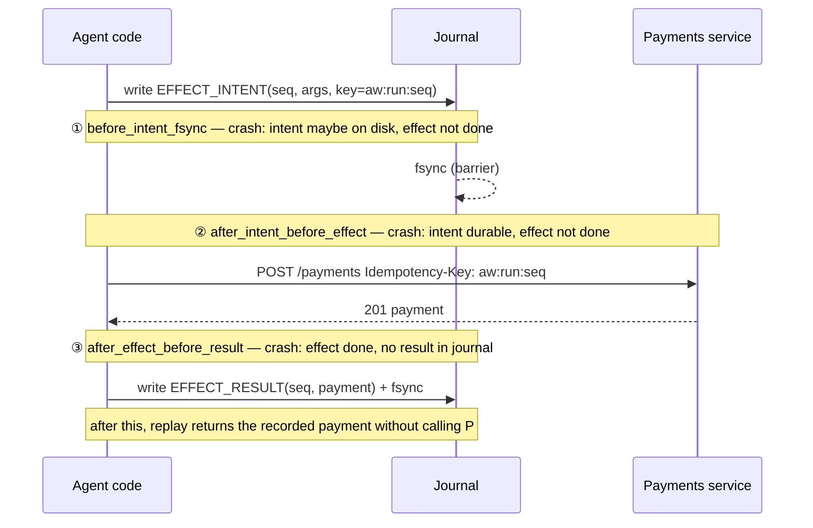

# AgentWAL design

## 1. How existing systems handle crashes and side effects

Read on 2026-10-23 from the official docs linked below. Where a doc page did not say something, this table says so rather than filling the gap from memory.

| | Temporal | DBOS | LangGraph | AgentWAL |
|---|---|---|---|---|
| What is persisted | An **event history**: every state transition of a workflow execution is an event, saved to a persistence store [T1]. | Workflow inputs and **each step's output**, checkpointed to Postgres (a step costs one write, a workflow two) [D1]. | **Checkpoints** of graph state per thread, written by a checkpointer [L1]. | An append-only **journal** of LLM calls/results, effect intents/results and journaled values, CRC-checked. |
| How a crashed run resumes | **Replay**: the workflow code reruns and the commands it emits are checked against the history; execution "resumes from the latest state" [T1]. | Detect `PENDING` workflows at startup, restart each with its checkpointed inputs, skip steps whose output is checkpointed, run the first step without one [D1]. | The runtime picks a starting point and replays from there to where it stopped; tasks' recorded results are read back instead of re-run [L2]. | The agent reruns from the top; each journaled call is matched by sequence number; completed calls return their recorded results, the first incomplete one runs for real. |
| Determinism requirement | Workflow code must make the same API calls in the same sequence given the same input; random/time must go through replay-safe APIs [T2]. | The workflow function must be deterministic; random numbers, time, API calls belong in steps [D1]. | Wrap non-deterministic operations and side effects in tasks so resume reads them from persistence [L2]. | Same rule: all non-determinism goes through `ctx.llm`, `ctx.wrap`, `ctx.now/random/uuid`. |
| Detecting a violation | A command that does not match the expected event fails the execution with a **nondeterminism error** (e.g. ScheduleActivityTask where TimerStarted was expected) [T2]. | Not described on the page read [D1]. | Not described on the pages read. | `NonDeterminismError` names the journaled request and the new one (request hash per call, call type, call count, code version). |
| A side effect interrupted mid-way | Activities are retried under a retry policy; activity code "should be idempotent, so retries can be processed without duplicate side effects" [T3]. | A step interrupted mid-execution is **retried during recovery**; steps should be idempotent so retrying is safe; a checkpointed step is never re-executed [D1]. | A task that started but did not complete is **re-run**; use idempotency keys or check for existing results [L2]. Durability modes `exit` / `async` / `sync` trade checkpoint latency for crash safety [L2]. | Two-phase effect: durable `EFFECT_INTENT` with key `(run_id, seq)` → call → durable `EFFECT_RESULT`. An intent without a result is retried with the **same key**, or resolved with `reconcile(key)`. |
| Idempotency keys | The pages read do not name a specific key scheme [T3]. | Not specified on the page read. | Recommended, scheme left to the user [L2]. | Derived automatically and deterministically from `(run_id, seq)`, so every retry of an effect sends the same key. |

**Takeaways that shaped AgentWAL**

1. All three systems are *at-least-once* for side effects and make it *effectively once* by asking the effect to be idempotent. AgentWAL does the same, but derives the key itself and records the intent before calling, so the ambiguous window is explicit and testable.
2. Temporal's replay-and-compare is the right model for an agent loop whose control flow depends on LLM outputs: the code reruns, but every non-deterministic input is read back from the log. AgentWAL copies that, with a much smaller surface.
3. DBOS shows the cost model: one durable write per step. AgentWAL measures it (`make bench`).
4. LangGraph's `sync` vs `async` durability modes are the same trade-off as AgentWAL's fsync policies; AgentWAL adds a barrier so that the record that matters (the intent) is always durable before the outside world is touched.

Unverified: the claim (from the original spec and a secondary source) that LangGraph re-runs an interrupted graph *node* from its beginning. The official durable-execution page available on 2026-10-23 described re-running interrupted *tasks* and a replay starting point, but the "starting points" section did not load, so this is not stated as fact here.

**Sources**
- [T1] Temporal, Workflow Execution — https://docs.temporal.io/workflow-execution
- [T2] Temporal, Workflow Definition (deterministic constraints) — https://docs.temporal.io/workflow-definition
- [T3] Temporal, Activities — https://docs.temporal.io/activities
- [D1] DBOS, Architecture — https://docs.dbos.dev/architecture
- [L1] LangGraph, Persistence — https://docs.langchain.com/oss/python/langgraph/persistence
- [L2] LangGraph, Durable execution — https://docs.langchain.com/oss/python/langgraph/durable-execution

AgentWAL is a focused study of these ideas, not a replacement for any of them: one process, one journal file, no workers, no versioning beyond a `code_version` check.

## 2. Failure model

- **Process crash** (`kill -9`, OOM): user-space state is lost; anything already passed to `write()` survives in the page cache.
- **OS crash / power loss**: anything not fsynced may be lost. Simulated with `PowerLossJournal`.
- **Torn write**: the last record may be partially written or garbage. Detected by length + CRC32; the tail is truncated.
- **Receiver**: the payments service may have applied an effect whose response never reached the agent. It honours `Idempotency-Key` (or is queried via `GET /payments?key=`).
- Out of scope: disk corruption in the middle of the log (it is treated like a torn tail: everything after the first bad record is dropped), multiple concurrent workers on one journal, Byzantine receivers.

## 3. The journal

```
[length u32 LE][crc32 u32 LE][type u8][payload: canonical JSON]
```
CRC covers type + payload. Types: `RUN_START`, `LLM_CALL`, `LLM_RESULT`, `EFFECT_INTENT`, `EFFECT_RESULT`, `VALUE`, `RUN_END`. Recovery scans from offset 0 and stops at the first record that is short, has an absurd length, a bad CRC, an unknown type or bad JSON; the file is truncated there and the truncation fsynced. See `src/agentwal/records.py`, `src/agentwal/journal.py`.

fsync policies: `always`, `group:N:MS`, `none`. Effect intents and results are **barriers**: they force an fsync under `always` and `group` (not under `none`, which exists to measure what happens without fsync). See DECISIONS.md ADR-2.

## 4. Replay and the crash windows



| Crash at | What the journal holds after recovery | What replay does | Why it is exactly-once |
|---|---|---|---|
| before the intent is written | nothing for this seq | runs the effect fresh | it never ran |
| ① intent written, not fsynced | intent or nothing (process crash: intent survives; power loss: lost) | retry with the same key, or run fresh with the same key | the key is a function of `(run_id, seq)`, so it is the same either way |
| ② intent durable, before the call | intent, no result | retry with the same key | the receiver never saw it, so this is the first application |
| ③ effect done, result not written | intent, no result | retry with the same key → receiver returns the original payment; or `reconcile(key)` finds it | receiver deduplicates / lookup |
| after the result | intent + result | return the recorded result | no call at all |
| mid LLM call (`llm_mid`) | `LLM_CALL` without `LLM_RESULT` | re-issue the same request (paid twice) | no effect involved; the next effect only depends on the journaled response |

Why B1 (checkpoint-after-step) still duplicates: its only record is written *after* the step, so window ③ spans the whole gap between the payment and the checkpoint, and the retry carries no key. Why exactly-once *delivery* is impossible: the agent cannot distinguish "request lost" from "response lost" (window ③) without asking; it can only make the *effect* idempotent.

## 5. Non-determinism detection

Each `LLM_CALL`, `EFFECT_INTENT` and `VALUE` stores a 64-bit hash of its canonical request. On replay the call at the same seq must have the same record type and hash; otherwise `NonDeterminismError(seq, journal, now)`. Also detected: code making fewer calls than the journal recorded (`complete()`), a changed `RUN_END` output, and a different `code_version` in `RUN_START`.

## 6. Demo, baselines and harness

- `demo/agent.py`: refund batch agent (10 tickets), strategies `aw`, `b1`, `b0`.
- `demo/payments_service.py`: separate process, SQLite, `Idempotency-Key`, `GET /payments?key=`, `--no-idempotency`.
- `chaos/harness.py`: kills (timer or targeted), restarts (≤10), invariant checks, suites for power loss × fsync policy, torn writes and the receiver assumption.
