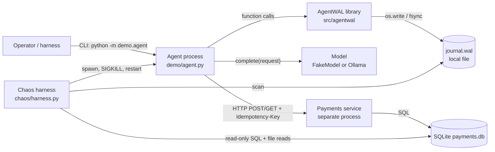
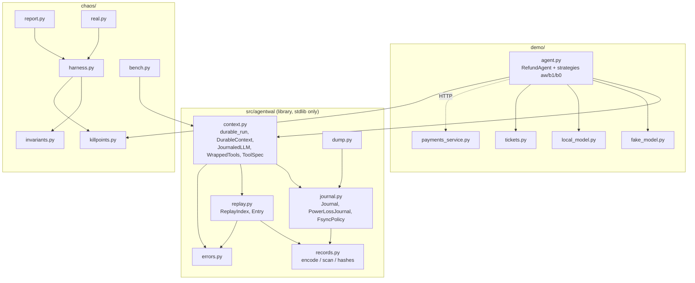
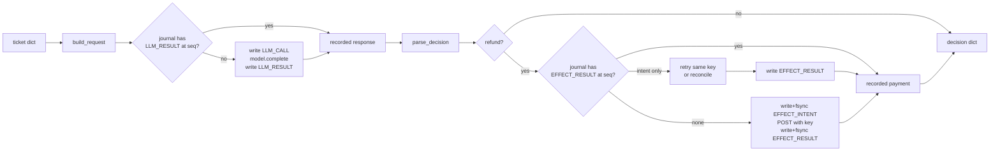
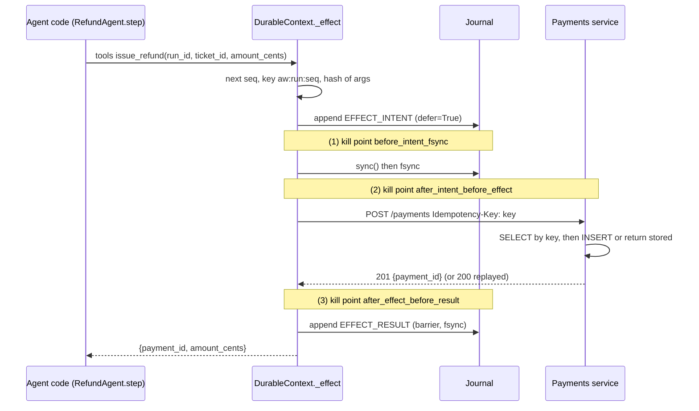
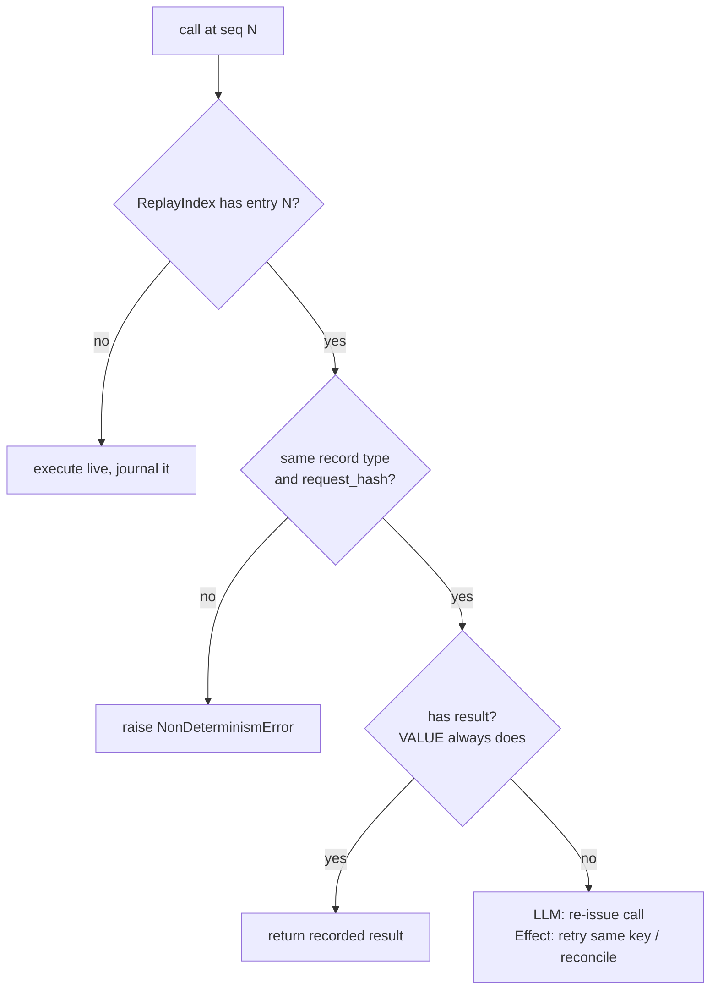

# AgentWAL — An Engineering Textbook and Interview Preparation Booklet

*Crash-safe LLM agent runs from a write-ahead journal, taught from first principles*

Repository: `varad-oss/agentwal` · Written against commit `6416524` (2026-10-24) · Author of the code: Varad Rajiv Pandare

---

## How to use this booklet

This booklet teaches one real codebase. It is not a general tutorial on agents or databases: every concept appears because AgentWAL needs it, and every mechanism is tied to a file and line range in the repository.

Read it in order the first time. Part I builds vocabulary, Part II the map, Part III the code, Part IV the evidence, Part V engineering judgment, Part VI the interview, Part VII revision. Answer the questions at the end of each chapter aloud before moving on.

### Evidence labels

| Label | Meaning |
|---|---|
| **[V] Verified** | Directly supported by source code, a test assertion, a saved result in `results/`, or a command run while writing this booklet. |
| **[D] Documented** | Stated in the repository's documentation (`README.md`, `docs/*.md`) but not independently re-derived here. |
| **[I] Inference** | A plausible explanation that the evidence does not prove was the original reason. |
| **[L] Limitation** | Something missing, untested, weaker than it sounds, or contradicted by other evidence. |

Code references look like `src/agentwal/context.py:176-223 (DurableContext._effect)`. Line numbers refer to commit `6416524`. Excerpts marked *(shortened)* omit lines; all others are verbatim.

### What was actually run while writing this booklet [V]

- `pytest`: 54 tests collected and passed (43 unit, 4 property-based, 7 integration) in about 3.4 s.
- `bash demo/kill_resume_demo.sh`: AgentWAL ended with 7 payments and 10 billed LLM calls; the checkpoint baseline ended with 8 payments.
- Read-only analysis scripts over the saved chaos results in `results/chaos_*.jsonl`. No chaos suite was re-run, so the committed results were not overwritten.

No paid service, API key or network model was used.

---

## Table of contents

**Part I — Understand the project before understanding the code**
1. The project in plain English
2. Build the mental model

**Part II — Learn how the complete system works**
3. Architecture from the top down
4. Repository and source-code map
5. A complete execution, step by step

**Part III — Understand the code and the engineering decisions**
6. Detailed source-code walkthrough
7. The decisions behind the design
8. Terminology and concepts, taught in context

**Part IV — Learn how to run, test and improve the project**
9. Reproduce the project from a clean environment
10. Testing, measurement and benchmarks
11. Failure modes, debugging and security
12. Performance and scalability

**Part V — Think like an engineer**
13. Reconstruct the implementation from scratch
14. What would happen if we changed something?

**Part VI — Interview preparation**
15. The two-minute project explanation
16. Interview question bank with answers
17. Mock technical interviews
18. Hands-on exercises and oral examination

**Part VII — Consolidation and revision**
19. Revision sheets
20. Final mastery test

**Appendices** — A. Claims audit · B. File index · C. External references

---

# Part I — Understand the project before understanding the code

# Chapter 1: The project in plain English

## 1.1 Start with a story

Imagine a small online shop. Every morning a program reads the overnight support tickets ("my blender arrived cracked", "I was charged twice", "the package never came") and decides, ticket by ticket, whether the customer deserves a refund and how much. For each ticket it asks a large language model (LLM) to judge the complaint, and if the answer is "refund" it calls the payment provider and sends the money.

The program is halfway through the batch. It has just told the payment provider to refund $89.00. The provider did it. Before the program could write down "ticket T04: refunded", the machine restarted for a deployment.

When the program comes back, what should it do?

- If it starts the batch again from the top, it refunds every customer it already refunded. Real money leaves twice.
- If it saved a note after each ticket ("finished ticket 3"), it resumes at ticket 4 and refunds T04 *again*, because the crash came after the money moved but before the note was saved.
- Either way, every LLM call it repeats is billed again.

AgentWAL is a small Python library that makes this program **crash-safe**: you can kill the process at any instant, run the same command again, and it carries on so that no refund is paid twice, no finished step is lost, and no finished LLM call is paid for twice. [D: `README.md` line 3]

## 1.2 The real problem

The problem is not "programs crash". An **agent**, a program that uses an LLM to decide what to do and then acts, mixes three kinds of work that behave differently under a crash:

1. **Thinking** (LLM calls): slow, costly and *non-deterministic*; ask twice and you may get a different answer.
2. **Acting** (tool calls with side effects): sending money, emails or API requests that change the outside world. Restarting your program cannot undo them.
3. **Bookkeeping** (your program's memory of what it has done): lives in RAM and disappears when the process dies.

A crash destroys (3) while (2) has already happened in the world. The difficulty is reconciling the two afterwards.

## 1.3 Who would use it

An engineer building an LLM agent that performs real side effects (refunds, ticket updates, emails, database writes, cloud API calls) and runs long enough, or at large enough scale, that crashes, deploys, OOM kills or timeouts happen mid-run. [I] In the repository the only user is the demo refund agent, `demo/agent.py` [V].

## 1.4 Why it is hard

Three facts, each explained in Chapter 2:

- **You cannot know whether a remote action happened if you crashed while waiting for its answer.** The request may have been lost, or only the response. From the crashed program these look identical.
- **Writing a note to a file does not mean it is safely on disk.** The OS may hold it in memory for a while. What survives depends on *how* the program crashed.
- **Re-running an LLM can change its mind.** Re-run the thinking after a crash and the agent may decide a different amount, so its later actions no longer match its earlier ones.

## 1.5 What a basic implementation looks like

The naive agent is a loop:

```python
for ticket in tickets:
    decision = llm.complete(prompt_for(ticket))
    if decision["refund"]:
        payments.issue_refund(ticket, decision["amount"])
```

The repository implements this as baseline **B0** (`demo/agent.py:202-207, run_b0`) [V]. After a crash you rerun it and it starts from the first ticket.

A better version saves progress after each ticket:

```python
state = load_checkpoint() or {"next": 0}
for i in range(state["next"], len(tickets)):
    do_ticket(tickets[i])          # LLM call + refund
    state["next"] = i + 1
    save_checkpoint(state)         # atomically, fsynced
```

This is baseline **B1** (`demo/agent.py:180-199, run_b1`) [V], and it is what many agent frameworks do in spirit: save state *between* steps.

## 1.6 Why the basic implementations are insufficient

- B0 repeats every side effect before the crash: 2,482 duplicated refunds in 1,000 chaos runs [V: `results/chaos_b0_summary.json`].
- B1 repeats the side effect of the step in progress whenever the crash lands between the refund and the checkpoint save: 163 duplicated refunds in 1,000 runs [V: `results/chaos_b1_summary.json`]. Chapter 10 explains why this number reflects the *test's* kill mix rather than a real-world rate, an important honesty point.
- Both re-bill LLM calls: B0 4,265 extra calls, B1 665 [V].

## 1.7 How AgentWAL attempts to solve it

AgentWAL keeps a **journal** (an append-only file on disk) and changes the order of operations:

1. Before calling the model, write "about to ask question #N". After the model answers, write the answer.
2. Before a side effect, write and force to disk an **intent**: "about to refund $89 for T04; the request carries the label `aw:run-42:9`." Only then call the payment service, passing that label as an **idempotency key**. After it returns, write the result.
3. After a crash, the same agent code runs again from the top. Each journaled call is matched to the journal by position. If the journal has its result, the recorded result is returned instantly (no model call, no payment); the first call with no result runs for real.
4. If the journal shows an intent with no result, AgentWAL cannot know whether the refund happened. It sends the request again *with the same key*; the payment service remembers processed keys and returns the original payment instead of paying twice. Alternatively it asks "did a payment with this key happen?" (`reconcile`).

This is the idea behind **durable execution** systems such as Temporal and DBOS, rebuilt from first principles at small scale [D: `docs/DESIGN.md` §1].

## 1.8 What it demonstrably achieves [V]

- In 1,000 runs of the demo agent, each killed at least once with `SIGKILL` and restarted until done (1,309 kills), AgentWAL produced **0 duplicated refunds, 0 lost refunds, and 0 runs violating any of the harness's invariants** (`results/chaos_aw_summary.json`).
- Across all suites, 5,230 runs and 7,118 `SIGKILL`s were executed (`docs/EVAL_REPORT.md`, generated from `results/`).
- With a real local LLM (qwen3:8b via Ollama), 30 runs and 46 kills produced 0 violations (`results/chaos_real_summary.json`).
- Journaling cost about 107 µs per agent step with an fsync per record on the author's Mac (`results/bench.json`).

## 1.9 What it does not solve [L]

- No duplicate *effects* only if the receiver deduplicates by idempotency key or offers a lookup by key. Suite `aw-noidem` shows 45 duplicates when it doesn't.
- It assumes the agent code is deterministic apart from what goes through the journal. Code that branches on an un-journaled clock or random number is detected after a crash (`NonDeterminismError`) but not repaired.
- Single process, single file: no concurrent workers, no distributed coordination, no compaction.
- Durability is only as strong as `fsync` on the machine; on macOS plain `fsync` does not flush the drive's write cache (§2.3).
- Most results use a fake model; the real-model suite is small (30 runs), and in it the real model never changed a money decision (Chapter 10).

## 1.10 One complete execution, from the user's point of view

```text
$ AGENTWAL_KILL_AT=after_effect_before_result:3 python -m demo.agent --strategy aw --run-id demo-aw ...
agent exited with code 137                         <- killed right after the 3rd refund was paid
3 payments in the ledger for demo-aw

$ python -m demo.agent --strategy aw --run-id demo-aw ...    <- the same command again
done: 7 refunds, 39848 cents
7 payments in the ledger for demo-aw               <- the 3rd refund was NOT paid again
LLM calls billed: 10 (10 needed)                   <- no model call was paid twice
```

(Verified by running `demo/kill_resume_demo.sh`; transcript in `docs/demo_transcript.txt`.) [V]

Inside: the first run wrote 16 journal records and died between "the payment service answered" and "write the result". The second run read those records, replayed the first 8 journaled calls from the file in well under a millisecond, found the open intent for the third refund, re-sent it with the same key `aw:demo-aw:9`, received the original payment back, recorded it, and continued live from ticket T05. Chapter 5 follows this record by record.

### Check your understanding

1. In one sentence, what does AgentWAL do, and for whom?
2. Why does saving a checkpoint after every ticket still pay a refund twice?
3. What two pieces of information does the payment service need to avoid a duplicate?
4. Name two things AgentWAL explicitly does not solve.

---

# Chapter 2: Build the mental model

Concepts are taught in dependency order: each section uses only ideas from earlier sections. For each: the problem, an analogy, a definition, the mechanism, an example, how AgentWAL uses it, alternatives, and a common misconception.

## 2.1 Processes and volatile memory

**Problem.** A running program keeps its variables in RAM, which belongs to the *process*, the OS's container for one running program. When the process ends, its RAM is reclaimed.

**Analogy.** A whiteboard in a meeting room: when the meeting ends, the cleaners wipe it.

**Definition.** A *process* is an instance of a running program with its own address space. *Volatile state* exists only in that address space.

**Mechanism.** On Unix, `kill -9 <pid>` sends `SIGKILL`, which a process cannot catch or ignore. The kernel stops it at once: no `finally` blocks, no `atexit` handlers, no flushing of Python buffers. A parent sees the exit status as `-9` through Python's `subprocess`, or `137` (128 + 9) in a shell.

**Example.** The demo agent kills itself with `os.kill(os.getpid(), signal.SIGKILL)` inside a fault hook (`chaos/killpoints.py:31-37`) [V]; the shell prints exit code 137.

**In AgentWAL.** Everything the agent must remember across a crash is written to the journal; the in-memory `DurableContext` (`src/agentwal/context.py:81-93`) is rebuilt from the file on every start.

**Alternatives.** Keep state in a database or remote service (Temporal, DBOS); see Chapter 7.

**Misconception.** "`try/finally` will save my state on crash." Not for `SIGKILL`, OOM kills or power loss, which is why the harness uses `SIGKILL` rather than `SIGTERM`.

## 2.2 Files, the page cache and what survives which crash

**Problem.** Writing to a file feels permanent, but disks are slow, so operating systems take a shortcut.

**Analogy.** You hand a letter to the office mailroom. The clerk says "done" immediately, but the letter sits in an out-tray until the van comes. If *you* go home, it still leaves. If the building burns down, the out-tray burns too.

**Definition.** When a program calls `write()`, the kernel copies the bytes into the **page cache** (kernel memory) and returns. The bytes reach the storage device later.

| Event | Written, not fsynced (page cache) | Fsynced |
|---|---|---|
| Process crash (`kill -9`, exception, OOM kill of the process) | **Survive**: the kernel still owns them | Survive |
| OS crash, kernel panic, power loss | **May be lost** | Survive (if the device honours flushes) |

**In AgentWAL.** The journal uses raw `os.write` (`src/agentwal/journal.py:166-170`), so nothing waits in a Python buffer: once `append` returns, the record survives a process crash [V]. This is why a plain `kill -9` test tells you nothing about `fsync`, a point the project makes explicitly [D: `docs/learning/M1.md`].

**Misconception.** "My `kill -9` chaos test proves my data is durable." It proves survival of a *process* crash only.

## 2.3 `fsync`: making bytes durable

**Problem.** For some records, above all "I am about to send money", we need certainty that they are on stable storage before continuing.

**Definition.** `fsync(fd)` asks the kernel to write a file's dirty data (and needed metadata) to the device and returns only when the device reports completion (`os.fsync` in Python).

**Mechanism and caveats.**
- It is slow (tens of microseconds to milliseconds) because it waits for the device.
- A newly *created* file also needs its directory entry made durable; AgentWAL fsyncs the parent directory when it creates a journal (`journal.py:77-85 _fsync_dir`, called at line 131) [V].
- On macOS, `fsync` hands data to the drive but does not force the drive to flush its own volatile cache; `fcntl(fd, F_FULLFSYNC)` does. AgentWAL offers it as the policy suffix `+full` (`journal.py:68-74`) [V]. The macOS fact comes from Apple's `fsync(2)` man page [External, Appendix C].
- Measured on the author's machine: plain fsync per record p50 ≈ 42 µs; `F_FULLFSYNC` p50 ≈ 3.8 ms (`results/bench.json`) [V]. The default policy is plain `always`, so on macOS the default durability is weaker than "survives power loss" [L].

**Policies** (`journal.py:26-65, FsyncPolicy`):
- `always`: fsync after every record.
- `group:N:MS`: fsync after N records or MS milliseconds since the last fsync, checked only when a record is appended; there is no background timer [V: docstring lines 31-32, code 210-216].
- `none`: never fsync.
- **Barriers**: whatever the policy, `append(..., barrier=True)` forces an fsync (except under `none`). Effect intents and results use them.

**Misconception.** "Fsync after the action is as good as before." Order matters: the intent must be durable *before* the payment, or a power cut can erase the evidence that the payment was attempted.

## 2.4 Append-only logs and the write-ahead rule

**Problem.** We want a file that records history and can be recovered after any crash, without in-place updates that might be half-done.

**Analogy.** A lab notebook in pen: you only add lines at the bottom and never erase. If interrupted mid-sentence, at worst the last line is incomplete.

**Definition.** An *append-only log* only grows at the end. A *write-ahead log* (WAL) adds the rule "durably write what you are about to do before you do it", so after a crash you can see what was in progress.

**Mechanism.** Recovery reads from the start and stops at the first incomplete or invalid record; everything before it is trusted.

**In AgentWAL.** `Journal` is a single append-only segment (`journal.py:105-253`). The write-ahead rule is applied to side effects: `EFFECT_INTENT` is fsynced before the tool is called (`context.py:185-192`) [V]. For LLM calls, `LLM_CALL` is written (not necessarily fsynced) before the model call (`context.py:161-162`).

**Alternatives.** A database (SQLite, Postgres) with transactions; a key-value store; per-step checkpoint files (Chapter 7).

**Misconception.** "A WAL logs what happened, afterwards." It is *ahead*: the record precedes the action.

## 2.5 Records, framing and checksums

**Problem.** A log file is just bytes. After a crash, where does each record start and end, and is the last one complete?

**Definitions.**
- *Framing*: each record carries its length so a reader can find its end.
- A *checksum* is a short number computed from data; change any byte and it almost certainly changes. **CRC32** is a 32-bit cyclic redundancy check designed to catch accidental corruption (bit flips, truncation), not deliberate tampering.

**Mechanism** (`src/agentwal/records.py:23-25, 59-65`) [V]:

```text
 0      4      8  9                       9+length
 +------+------+--+------------------------+
 |length|crc32 |ty| payload (canonical JSON)|
 | u32  | u32  |u8|      length bytes       |
 +------+------+--+------------------------+
 little-endian; crc32 covers the type byte + payload
```

- `length` counts payload bytes only. The header is 9 bytes (`struct.Struct("<IIB")`).
- The CRC covers the type byte *and* the payload, so a flipped type byte is caught too (`tests/unit/test_records.py:25-33`).
- Payloads are *canonical JSON*: sorted keys, no spaces (`records.py:50-51`). The same data always gives the same bytes, which stable hashes need (§2.10).
- A length above 16 MiB is treated as garbage, so a corrupted length field cannot make the reader allocate gigabytes (`records.py:25, 96-98`).

**Worked example.** `VALUE {"seq":1}`: the payload `{"seq":1}` is 9 bytes; header = `09 00 00 00` (length), 4 CRC bytes, then `06` (type VALUE). Total 18 bytes.

**Misconception.** "A CRC makes the file secure." An attacker can recompute a CRC trivially. It detects accidents only [L].

## 2.6 Torn writes and recovery by truncation

**Problem.** A crash or power cut during a write can leave a *torn write*: only part of a record reached the file, or garbage follows the last good record.

**Mechanism.** `scan()` (`records.py:80-119`) walks the buffer from offset 0 and stops at the first of: fewer than 9 bytes left (`short_header`), an absurd length (`bad_length`), payload cut short (`short_payload`), CRC mismatch (`bad_crc`), unknown type (`bad_type`), undecodable JSON (`bad_json`). It returns the valid records and `valid_length`. On open, `Journal.__init__` truncates the file to `valid_length` and fsyncs the truncation (`journal.py:132-137`), so new appends never follow garbage [V].

**Verified properties.** Truncating a valid journal at *any* byte recovers exactly a prefix of the records (`tests/property/test_props.py:26-36`, Hypothesis), and flipping any single byte never yields a wrong record, only a shorter prefix (`test_props.py:39-48`) [V].

**Limitation [L].** Corruption in the *middle* of the file also truncates everything after it. Real storage can reorder writes or corrupt earlier sectors; the tests model only a clean prefix loss and single-byte flips.

## 2.7 Side effects and why retries are dangerous

**Definition.** A *side effect* is any change outside your program: a payment, an email, a row in someone else's database. A *pure* computation has none.

**The ambiguity.** Your program sends `POST /payments`. Before it dies: (a) the request never arrived, (b) it arrived and was processed but the response was lost, or (c) the response arrived but you crashed before recording it. After restart these look identical. Retrying is right for (a) and wrong for (b) and (c).

**The two-generals problem in miniature.** No finite exchange of messages over an unreliable channel lets both sides be certain the other received the last message. So *exactly-once delivery* of a request across a crash is impossible in general.

## 2.8 Idempotency and idempotency keys

**Definition.** An operation is *idempotent* if doing it twice has the same effect as once. "Set the balance to 100" is idempotent; "add 100" is not.

**Idempotency key.** Make a non-idempotent operation safe to repeat by labelling each logical request uniquely. The receiver stores processed labels; a repeat with the same label returns the stored result instead of acting again. Payment APIs such as Stripe use an `Idempotency-Key` header [External: Stripe docs, Appendix C].

**In AgentWAL.**
- Key derivation: `idempotency_key(run_id, seq) = f"aw:{run_id}:{seq}"` (`context.py:40-42`) [V]. Because `seq` is the call's position in the run, every retry of the same logical effect has the same key, even if the intent record itself was lost in a power cut.
- The demo receiver (`demo/payments_service.py:55-70, PaymentsDB.charge`) looks up the key: same key and identical parameters → stored payment with `"replayed": true` (HTTP 200); same key, different parameters → HTTP 409, like Stripe; otherwise insert (HTTP 201) [V].
- `--no-idempotency` disables the lookup but still stores the key, so reconciliation (`GET /payments?key=`) works (`payments_service.py:58`, docstring lines 9-12) [V].

**Exactly-once effects = at-least-once delivery + deduplication.** The client may send a request several times; the receiver applies it once; the *effect* happens exactly once. This is the precise meaning of AgentWAL's "no duplicated side effects", and it holds only when the receiver cooperates [L].

**Misconception.** "Idempotency keys make my client exactly-once." They make the *receiver's effect* exactly-once. A receiver that ignores the key gets duplicates (`aw-noidem`: 45) [V].

## 2.9 Reconciliation

**Definition.** Instead of re-sending, ask the receiver "is there already a payment with key K?" If yes, record it; if no, perform the effect.

**In AgentWAL.** `ToolSpec.reconcile` (`context.py:45-57`) and `recovery="reconcile"` (`context.py:194-205`); the demo implements it as `GET /payments?key=` (`demo/agent.py:66-69`). Suite `aw-reconcile-noidem`: 0 duplicates even though the receiver does not deduplicate [V].

**Limitation [L].** A race: if the original request is still being processed when the restarted agent reconciles, the lookup can say "not found" and the agent pays again. Locally the service finishes in milliseconds and a restart takes 100 ms or more, so the race is unlikely but not excluded; no test targets it.

## 2.10 Determinism, hashing and replay

**Problem.** After a crash the agent's code reruns from the top. To reuse recorded results safely, it must ask the same questions in the same order.

**Definition.** Here, code is *deterministic* if, given the same inputs and the same results from every journaled call, it makes the same sequence of journaled calls with the same arguments.

**Mechanism.**
- Every journaled operation takes the next sequence number `seq` (`context.py:137-139`).
- Each call stores a `request_hash`: the first 16 hex characters (64 bits) of SHA-256 over the canonical JSON of the request (`records.py:54-56`) [V].
- On replay, `ReplayIndex.match` (`src/agentwal/replay.py:59-75`) checks that the journal's record at that `seq` has the same type and hash; a mismatch raises `NonDeterminismError` naming both requests.
- Non-determinism the agent needs (time, randomness, UUIDs) goes through `ctx.now()`, `ctx.random()`, `ctx.uuid()` (`context.py:251-259`), which journal their values as `VALUE` records.

**Worked example.** The agent calls `ctx.uuid()`: seq 1, journaled value `"53e4…"`. After a crash the rerun calls `ctx.uuid()`: seq 1 again, same type and hash, so the *same* UUID comes back. Had the code put Python's `random.random()` straight into a prompt, the prompt would differ on rerun, the LLM call's hash would mismatch, and `NonDeterminismError` would be raised (`tests/unit/test_context.py:132-145`) [V].

**This is the model Temporal uses**: replay workflow code against an event history and fail on a mismatched command [D: `docs/DESIGN.md` §1, citing Temporal docs].

**Misconception.** "Replay re-runs the LLM." Completed LLM calls are not re-run; their recorded responses are returned. Only a call that started but was never recorded runs again.

## 2.11 LLM calls, tool calls and agents

**Definitions.** An *LLM call* sends a prompt and receives generated text. A *tool call* invokes a function, possibly with side effects (here `issue_refund`). An *agent* is a program in which an LLM's output decides which actions to take.

**The demo agent** (`demo/agent.py:86-102, RefundAgent`) is a fixed loop over 10 tickets: one LLM call per ticket, whose JSON answer decides whether to call `issue_refund`. It is a *workflow with an LLM decision step*, not an open-ended tool-choosing agent [V]. Be honest about this in interviews: the mechanism is general (any sequence of journaled calls), but the evaluated agent is simple [L].

**Models.** `demo/fake_model.py`: deterministic keyword rules plus a 15 ms sleep, logging every call to a "billing" file (`fake_model.py:20-67`); optional `stochastic=True` samples amounts. `demo/local_model.py`: qwen3:8b served locally by Ollama, free (`local_model.py:19-46`) [V].

## 2.12 Fault injection and chaos testing

**Definition.** *Fault injection* causes failures at chosen points; *chaos testing* runs a system many times under injected failures and checks invariants.

**In AgentWAL.**
- Named kill points: `before_intent_fsync`, `after_intent_before_effect`, `after_effect_before_result`, `llm_mid` (`context.py:28-33`). The context calls `self._fault(name)` at each (`context.py:133-135`).
- `AGENTWAL_KILL_AT="<point>:<n>"` makes the agent `SIGKILL` itself on the n-th hit (`chaos/killpoints.py`).
- The harness also kills at random moments with a timer (`chaos/harness.py:117-121`).
- `PowerLossJournal` (`journal.py:255-293`) keeps un-fsynced records in user-space memory, so a `SIGKILL` loses exactly what a power failure would: a *simulation* of power loss.

## 2.13 Property-based testing

**Definition.** A property-based test states a rule that must hold for *all* inputs; a library (Hypothesis) generates many random inputs and shrinks any failure to a minimal example.

**In AgentWAL.** `tests/property/test_props.py` generates random record sequences, truncation points, byte corruptions, and random "programs" of LLM/effect/value/read operations under random crash schedules, journal tears and fsync policies, and checks that the effects equal an uninterrupted run's, each applied once (`test_props.py:93-115`, 150 examples) [V].

**Misconception.** "150 random examples prove correctness." They raise confidence within the generated input space (≤10 operations, ≤4 crashes); they are not a proof [L].

## 2.14 Durable execution, putting it together

*Durable execution* means a program's progress is stored durably, so a crash loses the process but not the progress. Temporal stores an event history and replays code; DBOS checkpoints each step's output in Postgres; LangGraph checkpoints graph state [D: `docs/DESIGN.md` §1]. AgentWAL is a single-file, single-process study of the same idea with an explicit intent record before every effect.

### Check your understanding

1. Which survives `kill -9`: bytes passed to `os.write`, bytes in a Python `BufferedWriter`, or both? Why?
2. Why must the intent be fsynced *before* the payment?
3. Explain exactly-once delivery versus exactly-once effects.
4. Why does the idempotency key use the call's sequence number rather than a random UUID?
5. What does CRC32 protect against, and what not?
6. What happens on replay if the code now builds a different prompt for the third LLM call?

---

# Part II — Learn how the complete system works

# Chapter 3: Architecture from the top down

## 3.1 System context



**Walking the arrows** [V unless noted]:

1. *Operator → Agent*: a process launch with CLI flags (`demo/agent.py:223-259, main`): strategy (`aw`, `b1`, `b0`), run id, run directory, service URL, fsync policy, power-loss simulation, recovery mode, model.
2. *Agent → AgentWAL*: in-process Python calls: `durable_run(...)`, `ctx.llm(...)`, `ctx.wrap(...)`, `ctx.now()` and friends.
3. *AgentWAL → journal*: binary records appended with `os.write` and made durable with `os.fsync` per the policy (`journal.py:166-234`).
4. *Agent → Model*: a method call `complete(request) -> response`. For the fake model, a local function with a sleep; for Ollama, an HTTP POST to `127.0.0.1:11434/api/chat` (`local_model.py:28-46`).
5. *Agent → Payments service*: HTTP over loopback (`demo/agent.py:44-69, PaymentsClient`): `POST /payments` with a JSON body and optional `Idempotency-Key` header; `GET /payments?key=` for reconciliation.
6. *Payments service → SQLite*: SQL `SELECT`/`INSERT` under a process-wide lock (`payments_service.py:55-70`).
7. *Harness → Agent*: `subprocess.Popen`, an optional `AGENTWAL_KILL_AT` environment variable, a timer that calls `proc.kill()` (SIGKILL), and restarts (`chaos/harness.py:110-128, 145-188`).
8. *Harness → SQLite / journal*: read-only inspection after the run (`chaos/invariants.py:21-30, 55-64`).

**Why a separate payments process?** A `kill -9` of the agent must not kill "the outside world". A real payment provider keeps running and may have applied a request whose response the agent never read. A separate process reproduces that ambiguity faithfully [D: `docs/learning/M3.md`; I: that this is the design reason].

## 3.2 Components and modules



| Component | Owns state? | Makes decisions? | Side effects? | Handles failures? |
|---|---|---|---|---|
| `records.py` | No | Validity of bytes | No | Reports bad data, never raises on it |
| `journal.py` | Journal file, in-memory record list | When to fsync | Writes, fsync, truncation | Truncates torn tails on open |
| `replay.py` | Index built from records | Does a call match the journal? | No | Raises `NonDeterminismError`, `RunMismatchError` |
| `context.py` | Seq counter, stats, index | Replay vs execute; retry vs reconcile | Calls model and tools | Decides how to recover open intents |
| `demo/agent.py` | In memory only (B1: checkpoint file) | Refund or not (via model) | Through tools | Exit codes 3/4 |
| `payments_service.py` | SQLite ledger | Deduplicate or not | Inserts payments | 400/409 responses |
| `chaos/harness.py` | Result files | When and where to kill | Kills processes, tears journals | Retries timer misses, caps restarts |

## 3.3 Data flow of one refund under AgentWAL



Every arrow carries a Python value: a ticket `dict`; a request `dict` with `system`, `max_tokens`, `messages` (`demo/agent.py:72-77`); a response `dict` with `text` and `usage`; a decision `dict` with `refund`, `amount_cents`, `reason` (`demo/agent.py:80-83`); a payment `dict` with `payment_id`, `amount_cents` (`demo/agent.py:58-64`).

## 3.4 The most important sequence: an effect, with the crash windows



Step by step (`context.py:176-223`) [V]:

1. The agent calls the wrapped tool with keyword arguments; `WrappedTools.__getitem__` (`context.py:286-290`) returned a lambda that forwards to `_effect`.
2. `_effect` takes the next seq, derives the key and hashes `{"tool": name, "args": args}`.
3. It asks the replay index whether that seq is already journaled (§3.5).
4. If not: it appends `EFFECT_INTENT` with `defer=True` (written, not fsynced), fires kill point ①, then calls `sync()`. The fsync therefore comes after a fault-injection point that simulates dying between write and fsync.
5. Kill point ② fires. Then the tool runs: `PaymentsClient.issue_refund(..., idempotency_key=key)` sends the HTTP request.
6. The service deduplicates by key and answers.
7. Kill point ③ fires. Then `EFFECT_RESULT` is appended with `barrier=True` (fsync under `always`/`group`).
8. The payment dict goes back to the agent.

## 3.5 The replay decision



The decision lives in `ReplayIndex.match` (`replay.py:59-75`) plus the `if entry is not None and entry.result is not None` branch of each call type (`context.py:156-159, 180-183, 235-241`) [V].

## 3.6 Boundaries, and why the pieces are separate

- **Library vs demo.** The library knows nothing about refunds, HTTP or SQLite; only "calls", "effects" and "values". This keeps `src/agentwal` dependency-free (`pyproject.toml:7`, `dependencies = []`) [V].
- **records vs journal.** `records.py` is pure (bytes in, records out), so it is easy to property-test; `journal.py` adds the file, fsync and recovery side effects [I: reason inferred from structure].
- **journal vs replay vs context.** The journal stores, the replay index interprets, the context decides. Another storage backend could feed the same `ReplayIndex` [I].
- **Fault hook injected as a function.** The library calls `fault_hook(point)` without knowing what it does; the chaos package supplies the killing (`chaos/killpoints.py`). Without a hook the cost is one `if self.fault_hook is not None` check (`context.py:133-135`) [V].

## 3.7 External dependencies

| Dependency | Where | Why |
|---|---|---|
| Python ≥ 3.11 standard library (`os`, `struct`, `zlib`, `json`, `hashlib`, `sqlite3`, `http.server`, `urllib`) | everywhere | `requires-python = ">=3.11"` (`pyproject.toml:6`) [V] |
| `pytest`, `hypothesis` | tests only | `[dependency-groups] dev` (`pyproject.toml:10-11`) [V] |
| Ollama + qwen3:8b | `demo/local_model.py`, `make chaos-real` only | free local model server [V] |
| HyperFrames, Kokoro | the pitch video only, outside the library | not part of the code under study |

### Check your understanding

1. Which component decides "replay or execute"? Which decides "fsync now or later"?
2. Why is the payments service a separate process?
3. What exactly crosses the boundary between `_effect` and `PaymentsClient.issue_refund`?
4. Where would you add a kill point for "the request reached the server but the response never arrived"? Is it different from ③ from the agent's point of view?

---

# Chapter 4: Repository and source-code map

The tour follows execution order: command line, agent, library, bytes, then the evaluation tooling.

## 4.1 Top level

| Path | Role |
|---|---|
| `Makefile` | Command surface: `setup`, `test`, `demo`, `chaos`, `chaos-smoke`, `chaos-real`, `bench`, `report`, `clean-runs` [V] |
| `pyproject.toml`, `uv.lock` | Metadata; no runtime dependencies; dev deps pytest + hypothesis [V] |
| `.github/workflows/ci.yml` | CI: `make setup`, `make test`, `make chaos-smoke` on every push [V] |
| `README.md` | Overview; its results block is regenerated by `chaos/report.py` [V] |
| `docs/` | Design, ADRs, generated report, spec, plan, progress, learning notes, pitch video [V] |
| `results/` | Raw chaos rows (`chaos_*.jsonl`), summaries, `bench.json`: the source of every number [V] |
| `runs/` | Scratch output of runs (gitignored) [V] |

## 4.2 The entry point: `demo/agent.py`

The executable agent and its three crash-handling strategies.

- `main(argv)` (`demo/agent.py:223-259`): parses flags, creates the run directory, opens an `Events` sidecar log, builds the model and `PaymentsClient`, runs the strategy, and maps exceptions to exit codes: `NonDeterminismError` → 3, any other exception → 4, success → 0 plus `output.json` written atomically (`write_output`, lines 149-153) [V].
- `RefundAgent` (lines 86-102): `step(ticket)` builds the request, calls `llm.complete`, parses the JSON decision, and if refunding calls `tools["issue_refund"](...)`; `run(tickets)` maps `step` over all tickets. It is strategy-agnostic: it receives journaled or plain `llm`/`tools` [V].
- `run_aw` (lines 156-177): opens `durable_run` with the journal path, input `{"tickets": TICKETS}`, `code_version="refund-agent-v1"`, the fsync policy, the ack log and the fault hook; returns immediately if the run already finished (`ctx.done`); otherwise journals a batch UUID and start time, runs the agent with `ctx.llm(model)` and `ctx.wrap(tools_spec)`, and records the output with `ctx.complete`.
- `run_b1` (lines 180-199): loads `checkpoint.json` if present, runs remaining tickets, and after each one writes the state to a temp file, flushes, fsyncs and atomically renames it.
- `run_b0` (lines 202-207): runs every ticket every time.
- `HookedLLM` and `hooked_tool` (lines 121-146): give the baselines the *same* kill points as AgentWAL, so all strategies are killed at comparable moments [V].
- `PaymentsClient` (lines 44-69): `urllib` HTTP client; `issue_refund` raises `RuntimeError` on HTTP ≥ 400; `reconcile` returns the stored payment or `None`.

**Callers:** the shell, `demo/kill_resume_demo.sh`, the harness (`chaos/harness.py:99-108, agent_cmd`), the integration tests (`tests/integration/test_demo.py:24-31`). **If removed:** nothing in `src/agentwal` breaks; all demos, integration tests and chaos results become unreproducible.

## 4.3 The library entry: `src/agentwal/context.py`

The heart of the project (367 lines): `KILL_POINTS`, `idempotency_key`, `ToolSpec`, `RunStats`, `DurableContext` (`_llm_call`, `_effect`, `_read`, `_value`, `now`, `random`, `uuid`, `complete`), `JournaledLLM`, `WrappedTools`, and the `durable_run` context manager. Called by `demo/agent.py`, `chaos/bench.py` and the tests; calls `journal.py`, `replay.py`, `records.py`, `errors.py`. Chapter 6 walks through it.

## 4.4 `src/agentwal/journal.py`

`FsyncPolicy` (parse, validate), `_fsync` (with macOS `F_FULLFSYNC`), `_fsync_dir`, `read_records` (read-only scan used by the harness and dump tool), `RecoveryInfo`, `Journal`, `PowerLossJournal`. In: record type + payload. Out: `Record` objects, the file, the optional ack sidecar. A careless change here breaks durability silently, hence 13 unit tests.

## 4.5 `src/agentwal/records.py`

The byte format (`HEADER`, `MAX_PAYLOAD`), `RecordType` (7 types), immutable `Record`, `canonical_json`, `request_hash`, `encode`, `ScanResult`, `scan`. Pure functions, no I/O; every other module depends on it.

## 4.6 `src/agentwal/replay.py`

`CALL_TYPES`, `RESULT_FOR`, `Entry`, `ReplayIndex` (`build`, `match`, `max_seq`). Turns a flat record list into "what happened at each sequence number" and enforces structure: one RUN_START, one call per seq, results matching their call type.

## 4.7 `src/agentwal/errors.py`

`AgentWALError` base; `NonDeterminismError(seq, expected, got, reason)`; `RunMismatchError`; `ToolError` (raised for a journaled permanent failure); `PermanentToolError` (raised *by a tool* to mean "definitely not applied"). `CorruptJournalError` is defined but **never raised** [V: `git grep`], a leftover: corruption is handled by truncation instead [L].

## 4.8 `src/agentwal/dump.py`

`python -m agentwal.dump <journal>` prints offsets, types, abbreviated payloads and any torn bytes. A debugging tool used by the demo script.

## 4.9 `demo/payments_service.py`

A stdlib `ThreadingHTTPServer` with `PaymentsDB` over SQLite in WAL mode. Routes: `POST /payments`, `GET /payments?key=`, `GET /payments?run_id=`, `GET /health`. Prints `READY <port>` when listening (`main`, lines 137-157). One threading lock serialises all database access. It ignores `BrokenPipeError` when a killed client disappears mid-response, which is crash window ③ itself [V].

## 4.10 `demo/fake_model.py`, `demo/local_model.py`, `demo/tickets.py`

- `tickets.py`: 10 fixed tickets; 7 qualify for refunds under the fake model's rules [V: `fake_model.py:20-26` and demo output].
- `fake_model.py`: `extract_ticket` parses the ticket JSON embedded in the prompt; `decide` applies keyword rules; `FakeModel.complete` sleeps (default 15 ms, `AGENTWAL_FAKE_LATENCY_MS`), optionally samples the amount, appends a billing line, returns `{"text", "usage", "model"}`.
- `local_model.py`: `OllamaModel.complete` posts to Ollama's `/api/chat` with `format: "json"`, `think: false`, `num_predict: 128`, and logs zero-cost billing lines.

## 4.11 `chaos/`: the evaluation machinery

- `killpoints.py`: parses `AGENTWAL_KILL_AT`; returns a hook that `SIGKILL`s on the n-th hit (a named point or `any`).
- `harness.py`: `Config` and the 13 suites in `CONFIGS`; `start_service`; `agent_cmd`; `run_attempt` (spawn, timer kill, timeout); `plan_kill` (50% timer at uniform(0.25, 1.0) × reference duration, 50% targeted point with uniform n); `run_one` (kill, restart up to 10 times, ack check, optional tearing, invariants); `reference_run`; `summarize`; `run_config` (thread pool); `main`.
- `invariants.py`: `payments_for_run`, `comparable`, `check_effects` (duplicates, lost, wrong), `acked_records_survive`, `events`, `check_run`.
- `bench.py`: raw append latency per policy; per-step overhead in-process.
- `report.py`: builds `docs/EVAL_REPORT.md` and the README results block from `results/`.
- `real.py`: pilot plus 30 runs with the local LLM.

## 4.12 `tests/`

| File | Count | Focus |
|---|---|---|
| `tests/unit/test_records.py` | 9 | byte layout, CRC, short reads, hash stability |
| `tests/unit/test_journal.py` | 13 | reopen, torn and garbage tails, fsync policies, defer, power-loss journal, ack log |
| `tests/unit/test_context.py` | 21 | replay, crash windows, retry/reconcile, non-determinism, values, reads, tool errors |
| `tests/property/test_props.py` | 4 | round trip, truncation prefix, corruption, replay under random crashes |
| `tests/integration/test_demo.py` | 7 | real processes, real SIGKILL, real HTTP service |
| `tests/helpers.py` | — | `SimulatedCrash`, `crash_at`, in-memory `Ledger`, `CountingModel` |

### Check your understanding

1. Trace the import chain from `python -m demo.agent --strategy aw` to `zlib.crc32`.
2. To store the journal in SQLite, which module changes, and which should not?
3. Which error class is defined but never used?

---

# Chapter 5: A complete execution, step by step

We trace the canonical demo: AgentWAL, killed at the third `after_effect_before_result` hit, then rerun. All values come from an actual run captured while writing this booklet [V] (`runs/demo/aw/journal.wal`; UUIDs and timestamps differ per run).

## 5.1 Attempt 1: startup

| # | Trigger | Code | Input → output | State / side effect | Can fail? |
|---|---|---|---|---|---|
| 1 | shell runs the command with `AGENTWAL_KILL_AT=after_effect_before_result:3` | `demo/agent.py:223 main` | argv → `args` | creates run dir; `events.jsonl` gets `start` | bad flags → argparse exit 2 |
| 2 | `main` | `chaos/killpoints.py:40 from_env` | env var → hook killing on 3rd hit | none | malformed spec → `ValueError` |
| 3 | `run_aw` | `context.py:304 durable_run` | path, run_id, input, policy | `Journal.__init__` creates `journal.wal`, fsyncs the directory, scans 0 bytes | permission error → exit 4 |
| 4 | `durable_run` | `replay.py:36 ReplayIndex.build` | `[]` → empty index | none | — |
| 5 | no RUN_START | `context.py:334-341` | → `RUN_START{run_id, code_version, input_hash}` | 94-byte record at offset 0, fsynced (barrier) | disk full → `OSError` |

## 5.2 Attempt 1: values and the first tickets

The journal after attempt 1 (offset, size, type) [V]:

```text
    0   94 RUN_START      run_id=demo-aw code_version=refund-agent-v1 input_hash=cd8a945c3ef76c5e
   94  113 VALUE          seq=1 kind=uuid  value=2d49e2b1-...       (ctx.uuid -> batch_id)
  207   92 VALUE          seq=2 kind=now   value=1792797703.307...  (ctx.now -> started_at)
  299  349 LLM_CALL       seq=3 request_hash=70b8f9441fabbbfc       (ticket T01)
  648  184 LLM_RESULT     seq=3 text={"refund": true, "amount_cents": 2499, ...}
  832  173 EFFECT_INTENT  seq=4 tool=issue_refund args={T01, 2499} key=aw:demo-aw:4
 1005   90 EFFECT_RESULT  seq=4 result={payment_id: pay_1}
 1095  349 LLM_CALL       seq=5 (T02)
 1444  186 LLM_RESULT     seq=5 refund=false
 1630  349 LLM_CALL       seq=6 (T03)
 1979  182 LLM_RESULT     seq=6 refund 1299
 2161  173 EFFECT_INTENT  seq=7 key=aw:demo-aw:7
 2334   90 EFFECT_RESULT  seq=7 result={pay_2}
 2424  349 LLM_CALL       seq=8 (T04)
 2773  180 LLM_RESULT     seq=8 refund 8900
 2953  173 EFFECT_INTENT  seq=9 key=aw:demo-aw:9          <- no EFFECT_RESULT: killed here
```

Following ticket T01 through the code:

1. `RefundAgent.step` calls `build_request(ticket)` (`demo/agent.py:72-77`), producing `{"system": SYSTEM, "max_tokens": 1024, "messages": [{"role": "user", "content": "TICKET_JSON: {...}\n"}]}`.
2. `JournaledLLM.complete` → `DurableContext._llm_call` (`context.py:152-169`): `seq=3`; hash of `{"llm": request}` is `70b8f9441fabbbfc`; the index has nothing; `mark_caught_up()` records the recovery time (≈0.27 ms) and emits the `recovered` event; `LLM_CALL` is appended (and fsynced, since the policy is `always`); `FakeModel.complete` sleeps 15 ms, appends a billing line and returns the decision; kill point `llm_mid` fires (not our target); `LLM_RESULT` is appended.
3. `parse_decision` extracts `{"refund": True, "amount_cents": 2499, "reason": "item arrived damaged"}`.
4. `tools["issue_refund"](run_id="demo-aw", ticket_id="T01", amount_cents=2499)` → `_effect` (`context.py:176-223`): `seq=4`, key `aw:demo-aw:4`; intent written with `defer=True`; kill point ① fires (not our target); `sync()`; kill point ②; HTTP `POST /payments` with `Idempotency-Key: aw:demo-aw:4`; the service inserts row 1 and returns `201 {"payment_id": "pay_1", ...}`; kill point ③ fires: **hit 1** of `after_effect_before_result`; `EFFECT_RESULT` is appended with a barrier.

T02 makes only an LLM call. T03 repeats the T01 pattern: ③ hit 2. T04: the LLM decides 8900; the intent at `seq=9` is fsynced; the service inserts `pay_3`; ③ **hit 3** → `os.kill(getpid(), SIGKILL)`. The process dies with the payment made and no `EFFECT_RESULT`.

**State at the crash.** Journal: 16 records, 3,126 bytes. Ledger: 3 payments. Billing log: 4 LLM calls. The shell reports exit code 137.

## 5.3 Attempt 2: recovery

| Step | Code | What happens | Values |
|---|---|---|---|
| Open | `Journal.__init__` (`journal.py:118-153`) | reads 3,126 bytes; `scan` validates 16 records; nothing torn | `records_recovered=16`, `truncated_bytes=0` |
| Index | `ReplayIndex.build` | entries for seq 1–9; seq 9 has a call but no result | `max_seq=9` |
| Identity | `durable_run` (`context.py:342-352`) | RUN_START matches run id, input hash, code version | — |
| `ctx.done`? | `context.py:96-99` | no RUN_END, so continue | — |
| `ctx.uuid()` | `_value` seq 1 | entry exists, hash matches → recorded UUID | batch id unchanged (events show the same `2d49e2b1…`) |
| `ctx.now()` | `_value` seq 2 | replayed | same `started_at` |
| T01 LLM | `_llm_call` seq 3 | entry with result → response returned, **no model call, no billing** | `llm_replayed=1` |
| T01 refund | `_effect` seq 4 | entry with result → `pay_1` returned, **no HTTP call** | `effects_replayed=1` |
| T02, T03 | seq 5–7 | replayed | — |
| T04 LLM | seq 8 | replayed → same decision, 8900 | `llm_replayed=4` |
| T04 refund | `_effect` seq 9 | entry exists, **no result**; recovery `retry` → `effects_retried=1`; `mark_caught_up()` (≈0.23 ms); POST again with key `aw:demo-aw:9` | service finds the key with identical parameters → `200 {"payment_id": "pay_3", "replayed": true}` |
| Record | `context.py:218-222` | `EFFECT_RESULT{seq 9, result: pay_3, recovered_by: "retry"}` (93 bytes at offset 3126) | — |
| T05–T10 | live | 6 more LLM calls, 4 more refunds (`pay_4`–`pay_7`) | `llm_live=6`, `effects_live=5` (including the retry) |
| Complete | `context.py:109-130` | no journal entries beyond seq 19; appends `RUN_END{output}` (1,210 bytes) and fsyncs | journal: 38 records, 8,710 bytes |
| Exit | `main` | writes `output.json`; prints `done: 7 refunds, 39848 cents` | ledger 7 rows; billing log 10 lines |

The second attempt's stats event, verbatim from `events.jsonl`: `llm_live 6, llm_replayed 4, effects_live 5, effects_replayed 2, effects_retried 1` [V].

## 5.4 What the same crash does to B1

B1's kill point ③ sits in `hooked_tool` after the payment returns (`demo/agent.py:137-146`) and before the checkpoint write in `run_b1` (lines 191-198). The last checkpoint says `next = 3` (T01–T03 done). On restart B1 redoes T04: a new LLM call and a new `POST /payments` **without any key**, so the service inserts a second T04 payment. The demo prints 8 payments [V].

## 5.5 Failure behaviour at each stage

| Stage | Failure | Current behaviour | Safe? |
|---|---|---|---|
| Journal open | torn or garbage tail | truncated to the last valid record, fsynced | yes, for tail corruption |
| Journal open | journal from another run | `RunMismatchError` → exit 4 | yes |
| Journal open | code version changed | `NonDeterminismError` → exit 3 | yes (fails closed) |
| LLM call | model raises (e.g. Ollama down) | exception propagates; `LLM_CALL` stays without result; next attempt re-issues | yes; costs a retry |
| LLM output | not valid JSON | `parse_decision` raises → exit 4. The `LLM_RESULT` is already journaled, so every rerun replays the same bad output and fails identically [V by reading `demo/agent.py:80-83`, `context.py:165-169`] | **fails closed but stuck** [L] |
| Effect | service returns 409 or 5xx | `RuntimeError` (not `PermanentToolError`) → intent left open, exit 4; rerun retries with the same key | yes for 5xx; a 409 stays stuck [L] |
| Effect | connection reset after the server applied it | intent open → rerun retries with the same key → deduplicated | yes, if the receiver deduplicates |
| Complete | fewer calls than the journal | `NonDeterminismError` | yes |

### Check your understanding

1. Why does attempt 2 not call the model for ticket T01?
2. Which payment id does the retried T04 refund return, and why not a new one?
3. When exactly does `mark_caught_up()` fire in attempt 2, and so what does `recovery_ms` measure?
4. What would happen on every rerun if the stored model answer for T04 were malformed JSON?

---

# Part III — Understand the code and the engineering decisions

# Chapter 6: Detailed source-code walkthrough

Bottom-up: bytes, then the file, then interpretation, then decisions. For each block: the algorithm in words, the code, line notes, an example, edge cases, likely bugs, and the tests that pin it down.

## 6.1 Encoding a record: `records.encode`

**Algorithm.** Serialise the payload canonically; refuse oversized payloads; CRC32 over type byte + payload; prepend length, CRC and type.

```python
# src/agentwal/records.py:50-65
def canonical_json(obj: Any) -> bytes:
    return json.dumps(obj, sort_keys=True, separators=(",", ":"), ensure_ascii=False).encode()

def request_hash(obj: Any) -> str:
    """Stable 64-bit hash of a JSON-able request, used to detect non-determinism."""
    return hashlib.sha256(canonical_json(obj)).hexdigest()[:16]

def encode(rtype: RecordType, payload: dict[str, Any]) -> bytes:
    body = canonical_json(payload)
    if len(body) > MAX_PAYLOAD:
        raise ValueError(f"record payload too large: {len(body)} bytes")
    tbyte = bytes([int(rtype)])
    crc = zlib.crc32(tbyte + body) & 0xFFFFFFFF
    return HEADER.pack(len(body), crc, int(rtype)) + body
```

- `sort_keys=True, separators=(",", ":")`: the same dict always yields the same bytes regardless of insertion order or whitespace. Without it, two equal requests could hash differently and raise false `NonDeterminismError`s (`test_request_hash_is_order_independent_for_dict_keys`, `tests/unit/test_records.py:42-44`).
- `ensure_ascii=False`: non-ASCII text stays UTF-8 instead of `\uXXXX` escapes.
- `hexdigest()[:16]`: 16 hex characters = 64 bits. An accidental collision between two different requests at the same seq has probability about 2⁻⁶⁴, negligible for drift detection; it is not a security property [I/L].
- `& 0xFFFFFFFF`: normalises the CRC to unsigned 32 bits (a Python 2 habit, harmless in Python 3).
- `HEADER = struct.Struct("<IIB")`: little-endian, two unsigned 32-bit integers and one byte, 9 bytes.

**Edge cases.** A non-JSON-serialisable value (e.g. a `datetime`) raises `TypeError` from `json.dumps`, so tool results and model responses must be JSON-able [V by code; L: not documented in a type signature]. Floats use Python's repr, which round-trips exactly.

**Tests.** `test_roundtrip`, `test_layout_is_length_crc_type_payload` (`test_records.py:8-23`); Hypothesis `test_encode_scan_roundtrip` (`test_props.py:19-23`).

## 6.2 Decoding and recovery: `records.scan`

**Algorithm.** From offset 0, repeatedly: need 9 header bytes; read length, CRC, type; reject an absurd length; need the full payload; verify the CRC; decode type and JSON; append; advance. Stop at the first failure and report why. (Code: `src/agentwal/records.py:80-119`, described in §2.6.)

- **It never raises on bad data.** Garbage is information ("the log ends here"), not an error, which is why `CorruptJournalError` is never used [V].
- **Order of checks.** The CRC is checked *before* the type is decoded, so a flipped type byte is reported as `bad_crc`.
- **Return value.** `ScanResult(records, valid_length, total_length, stop_reason)`, with `torn_bytes = total_length - valid_length`.

**Worked example.** Two records of 94 and 113 bytes, cut at byte 150: the first iteration validates bytes 0–93; the second reads a header at 94 announcing a 104-byte payload, needs bytes up to 207, has only 150 → `short_payload`, `valid_length=94`, `torn_bytes=56`.

**Likely bug.** Leaving the type byte out of the CRC would let a corrupted type byte change a record's meaning undetected (exercise in Chapter 18).

**Tests.** `test_crc_detects_any_flipped_byte` (5 positions), `test_short_header_and_short_payload`, and the two Hypothesis properties (any truncation → exact prefix; any single-byte corruption → a correct prefix).

## 6.3 Opening the journal: `Journal.__init__`

```python
# src/agentwal/journal.py:124-145 (shortened)
self.path = Path(path)
self.policy = FsyncPolicy.parse(fsync)
self.path.parent.mkdir(parents=True, exist_ok=True)
existed = self.path.exists()
self._fd = os.open(self.path, os.O_RDWR | os.O_CREAT, 0o644)
if not existed:
    _fsync_dir(self.path)            # make the new directory entry durable
buf = self._read_all()
res = scan(buf)
if res.torn_bytes:
    os.ftruncate(self._fd, res.valid_length)
    _fsync(self._fd, self.policy.full)   # the truncation itself must be durable
os.lseek(self._fd, res.valid_length, os.SEEK_SET)
self.records = list(res.records)
self.written_count = len(self.records)
self.synced_count = len(self.records)  # everything recovered is on disk by definition
```

- `os.open` gives a raw file descriptor, not Python's buffered `open()`: every later `os.write` goes straight to the kernel, so a process crash cannot lose bytes waiting in a Python buffer.
- `_fsync_dir` on creation: on POSIX file systems a file's name is metadata of its directory; without fsyncing the directory, a power cut can lose the whole new file even if its data was fsynced. Done only on first creation [V].
- The truncation is fsynced so the garbage cannot reappear after a power failure right after recovery.
- `lseek` to `valid_length`: later writes append after the last good record.
- `synced_count = len(records)` "by definition": **subtle**. After a process crash, recovered records may still be only in the page cache, not on the device. Calling them synced is an approximation that matters only if power fails during recovery [L].

## 6.4 Appending and syncing: `Journal.append`, `Journal.sync`

**Algorithm.** Encode → write → bookkeeping → apply the policy. `defer` skips the policy; `always`, or a barrier under `group`, fsyncs now; `group` fsyncs when N records are pending or MS ms have passed; `none` never fsyncs. After an unsynced write or an fsync, emit an acknowledgement line to the sidecar.

```python
# src/agentwal/journal.py:198-219
data = encode(rtype, payload)
rec = Record(rtype, payload, offset=self._size, size=len(data))
self._write(data)
self._size += len(data)
self.records.append(rec)
self.written_count += 1
self._pending += 1
mode = self.policy.mode
if defer:
    self._emit_ack()
elif mode == "always" or (mode == "group" and barrier):
    self.sync()
elif mode == "group":
    if self._pending >= self.policy.group_n or (
        (time.monotonic() - self._last_sync) * 1000 >= self.policy.group_ms
    ):
        self.sync()
    else:
        self._emit_ack()
else:
    self._emit_ack()
return rec
```

- `time.monotonic()`, not the wall clock, so a clock change cannot break group-commit timing.
- Under `none`, `sync()` returns immediately (`journal.py:223-224`), so barriers are ignored, deliberately, to measure what fsync buys [D: ADR-2].
- **Group-commit subtlety.** The time trigger is evaluated only when the *next* record arrives. If the agent then waits 10 s for a slow model, pending records stay un-fsynced for 10 s, until the next barrier (an effect intent) flushes them. Safety holds (everything an effect depends on is flushed before the effect); "at most MS ms of exposure" does not [V by code; L].

**Tests.** `test_fsync_always_syncs_every_record`, `test_fsync_none_never_syncs_even_on_barrier`, `test_group_commit_syncs_every_n_and_on_barrier`, `test_group_commit_time_trigger`, `test_defer_skips_policy_until_sync` (`tests/unit/test_journal.py:48-81`).

## 6.5 Simulating power loss: `PowerLossJournal`

**Idea.** You cannot cut a laptop's power thousands of times. Instead, make the *process* hold un-fsynced data, so killing it loses exactly the un-fsynced suffix.

```python
# src/agentwal/journal.py:279-293 (shortened)
def _write(self, data: bytes) -> None:
    self._buf += data                       # stays in user space

def _do_fsync(self) -> None:
    if self._buf:
        Journal._write(self, bytes(self._buf))   # only now reaches the file
        self._buf.clear()
    super()._do_fsync()

def close(self, crashed: bool = False) -> None:
    if not self._closed and not crashed and self._buf:
        Journal._write(self, bytes(self._buf))   # clean exit: the OS would write it out
        self._buf.clear()
    super().close(crashed)
```

- `ack_count` returns `synced_count` (`journal.py:272-274`): in this mode only fsynced records count as acknowledged.
- `durable_run` passes `crashed=True` only for `BaseException`s that are not `Exception`s (such as the test helper `SimulatedCrash`) and `crashed=False` for ordinary exceptions (`context.py:359-367`): an ordinary exception is not a crash, and the OS keeps written data [V].

**Not modelled [L].** Real power loss can lose a *non-prefix* subset of un-fsynced writes, tear one record across sectors, or, on devices that ignore flushes, lose fsynced data. The simulation models only "everything after the last fsync disappears".

**Tests.** `test_power_loss_journal_drops_unsynced_on_crash`, `..._none_policy_loses_everything_on_crash`, `..._clean_close_writes_buffer`, `test_ack_log_tracks_acknowledged_records` (`test_journal.py:89-121`).

## 6.6 Interpreting records: `ReplayIndex.build` and `match`

**Algorithm.** Walk the records once. Remember RUN_START (exactly one) and RUN_END. Call records (`LLM_CALL`, `EFFECT_INTENT`, `VALUE`) create an `Entry` keyed by `seq`; a duplicate seq raises `RunMismatchError`. Result records attach to the entry with the same seq and must be the right kind (`RESULT_FOR`), otherwise `RunMismatchError` (`replay.py:36-57`).

`match(seq, rtype, rhash, describe)` returns `None` if nothing is journaled at seq; otherwise it checks type and hash and raises `NonDeterminismError` on mismatch (`replay.py:59-75`).

**Why `VALUE` has no result record.** A value is produced and recorded in one step (`context.py:243-248`); there is no in-flight window to recover, so `Entry.complete` treats VALUE as always complete (`replay.py:20-22`).

**Invariant relied on.** One writer appends records in seq order and recovery removes only a suffix, so "result without call" can only come from a bug or tampering, and is treated as a mismatch.

## 6.7 Opening a run: `durable_run`

```python
# src/agentwal/context.py:327-367 (shortened)
jcls = PowerLossJournal if power_loss else Journal
journal = jcls(path, fsync=fsync, ack_log=ack_log)
crashed = True
try:
    index = ReplayIndex.build(journal.records)
    ihash = request_hash({"input": input})
    if index.run_start is None:
        if journal.records:
            raise RunMismatchError("journal has records but no RUN_START")
        index.run_start = journal.append(RecordType.RUN_START,
            {"run_id": run_id, "code_version": code_version, "input_hash": ihash}, barrier=True)
    else:
        p = index.run_start.payload
        if p["run_id"] != run_id: raise RunMismatchError(...)
        if p["input_hash"] != ihash: raise RunMismatchError(...)
        if p["code_version"] != code_version: raise NonDeterminismError(0, ..., reason="code version changed; ...")
    ctx = DurableContext(journal=journal, run_id=run_id, ..., _index=index, _t_open=t0)
    yield ctx
    crashed = False
except Exception:
    crashed = False
    raise
finally:
    journal.close(crashed=crashed)
```

- **Identity checks.** A journal is bound to one run id, one (hashed) input and one code version. Reusing it for a different input or a newer agent version fails closed instead of replaying old answers into new code.
- **The code version is a manual string.** Nothing derives it from the code; if a developer changes the agent and forgets to bump `CODE_VERSION`, replay proceeds and relies on hash mismatches to catch drift [V: `demo/agent.py:34`; L].
- **Context manager.** `yield` inside `try/finally` closes the file descriptor on normal exit and on exceptions (nothing runs on SIGKILL, by design).

## 6.8 Journaled LLM calls: `_llm_call` (`context.py:152-169`)

1. `seq = self._next_seq()`: positions are assigned in call order.
2. `h = request_hash({"llm": request})`: wrapping in `{"llm": ...}` namespaces the hash so an LLM request and a value with identical content cannot collide.
3. `preview` (first 240 characters of canonical JSON) is stored for debugging and error messages; the full prompt is not [V]. This bounds journal size, but the exact prompt cannot be reconstructed from the journal [L].
4. If the entry has a result, return it (`llm_replayed`).
5. Otherwise mark caught-up; append `LLM_CALL` if absent, or count `llm_reissued` if a previous attempt crashed mid-call.
6. Call the model; increment `llm_live`; fire `llm_mid`, *after* the response arrived (and was billed) and *before* it is journaled: the paid-but-not-recorded window.
7. Append `LLM_RESULT` (not a barrier: under `group` it may wait for the next fsync).

**Edge case.** A model exception leaves an `LLM_CALL` without result; the next attempt re-issues the identical request, which must hash the same, so prompts must not include un-journaled time or randomness (`test_unjournaled_randomness_is_detected`).

## 6.9 Journaled effects: `_effect`, the core mechanism (`context.py:176-223`)

| Journal state at this seq | Recovery mode | Action | Stats |
|---|---|---|---|
| nothing | any | write intent → fsync → call tool with key → write result | `effects_live` |
| intent + result | any | return the recorded result (or raise `ToolError` if it recorded an error) | `effects_replayed` |
| intent only | `retry` | call the tool again with the **same key** → write result, `recovered_by: "retry"` | `effects_retried`, `effects_live` |
| intent only | `reconcile`, `reconcile(key)` finds it | write result, `recovered_by: "reconcile"`, no tool call | `effects_reconciled` |
| intent only | `reconcile`, not found | as `retry` | `effects_retried` |

**Error handling (ADR-6).** Only a `PermanentToolError` is journaled as the effect's result, and re-raised as `ToolError` (also on replay, via `_unwrap`, `context.py:262-265`). Any other exception propagates with the intent left open, so the next attempt retries with the same key [V: `test_transient_tool_errors_leave_the_intent_open_and_retry_with_same_key`, `test_context.py:202-217`]. Reason: a connection reset may hide a successful payment [D: `docs/DECISIONS.md` ADR-6].

**Invariant.** For every effect, the intent is durable (under `always`/`group`) before the tool is called, and the key depends only on `(run_id, seq)`. Those two facts make retry safe with an idempotent receiver.

**A consequence [L].** The demo's `PaymentsClient.issue_refund` raises `RuntimeError` for *any* HTTP ≥ 400, including a 409 "key reused with different parameters" that definitely did not charge. Because it is not a `PermanentToolError`, the intent stays open and every rerun hits the same 409. That is exactly how `aw-pl-none-stoch` fails (118 runs stuck on a 409) [V].

## 6.10 Values and reads: `_value`, `now`, `random`, `uuid`, `_read`

`_value(kind, produce, request)` (`context.py:232-249`) assigns a seq, hashes `{"value": kind, "request": request}`, returns the recorded value if present, otherwise produces it, journals a `VALUE`, and returns it. `now`, `random`, `uuid` are one-liners over it. Read-only tools (`ToolSpec(effect=False)`) are journaled as `VALUE` records of kind `read:<name>` unless `journal_reads=False`, in which case they run live every time and consume no seq (`context.py:225-229`) [V: `test_read_only_tools_journaled_or_not`].

**Why journal reads?** If the agent reads "current balance" and decides on it, replay must see the same balance or later calls will differ. Without journaled reads the agent must tolerate different read results on replay.

## 6.11 Finishing: `complete` (`context.py:109-130`)

Three checks: (1) journal entries beyond the current seq mean the code made *fewer* calls than before → `NonDeterminismError`; (2) if RUN_END exists, the new output must equal the recorded one (canonical JSON); (3) otherwise append RUN_END with a barrier and `sync()`. The demo checks `ctx.done` first and returns `ctx.output` directly (`demo/agent.py:169-171`), so rerunning a finished run does no work [V: `test_rerunning_a_finished_run_does_nothing`].

**Not detected [L].** Code that makes *more* calls than the journal: new calls simply run live. Correct for resuming, but appending steps to an agent without bumping `code_version` is silently accepted.

## 6.12 The receiver: `PaymentsDB.charge` (`demo/payments_service.py:55-70`)

```python
def charge(self, key, run_id, ticket_id, amount_cents):
    cols = "id, idempotency_key, run_id, ticket_id, amount_cents"
    with self.lock:
        if self.idempotent and key:
            row = self.conn.execute(f"SELECT {cols} FROM payments WHERE idempotency_key=? ORDER BY id LIMIT 1", (key,)).fetchone()
            if row:
                p = row_to_payment(row)
                if (p["run_id"], p["ticket_id"], p["amount_cents"]) != (run_id, ticket_id, amount_cents):
                    return 409, {"error": "idempotency key reused with different parameters", "original": p}
                return 200, {**p, "replayed": True}
        cur = self.conn.execute("INSERT INTO payments (idempotency_key, run_id, ticket_id, amount_cents) VALUES (?,?,?,?)", ...)
        row = self.conn.execute(f"SELECT {cols} FROM payments WHERE id=?", (cur.lastrowid,)).fetchone()
        return 201, {**row_to_payment(row), "replayed": False}
```
*(signature and the INSERT arguments shortened)*

- **The lock.** `ThreadingHTTPServer` serves requests on threads; the lock makes check-then-insert atomic within the process. There is no `UNIQUE` constraint on `idempotency_key` (`SCHEMA`, lines 28-39), so correctness depends on the lock [V; L: a second service process on the same DB could double-insert].
- **SQLite durability.** `PRAGMA journal_mode=WAL` with default synchronous settings; the harness kills only the agent, never the service, so service durability is untested [L].

## 6.13 The harness core: `run_one` (`chaos/harness.py:145-223`)

For run *i*: a deterministic RNG seeded with `f"{seed}:{config}:{i}"`; up to 5 tries if a timer kill missed the first attempt (new run id each try); at most 11 attempts (10 restarts). Attempt 0 always gets a kill plan, later attempts with probability `rekill = 0.3`. On exit code -9 it records the kill, checks the ack invariant (AgentWAL only), records where a timer kill landed, and optionally tears the journal; otherwise it stops. Then `check_run` evaluates the invariants and violations are listed.

**Reproducibility.** Seeds make kill *plans* reproducible; timer kills land at scheduling-dependent instants, so outcomes are not bit-reproducible [I/L].

## 6.14 The invariant checker: `check_effects` (`chaos/invariants.py:37-52`)

`intended` = tickets with a positive refund decision; `duplicates` = extra rows per ticket plus rows for tickets not intended; `lost` = intended tickets with no row; `wrong` = the first row's amount differs, or the output's `payment_id` is not among that ticket's rows. For incomplete runs with the deterministic model, the intended decisions come from the reference run; for incomplete *sampled* runs, only same-ticket extra rows are counted (`check_run`, lines 80-110) [V].

**Gaps [L].**
- `batch_id_stable` is computed in `check_run` but never turned into a violation (`harness.py:205-222`). Saved data show unstable batch ids where acknowledged-only durability allows it: `aw-pl-group` 7/300, `aw-torn` 29/300, `aw-pl-none` 196/300, `aw-pl-none-stoch` 130/200; 0 in `aw` [V: analysis of `results/chaos_*.jsonl`]. These are not bugs under the stated semantics (an un-fsynced or torn-away value may be regenerated), but "same output as an uninterrupted run" holds only because the comparison excludes `batch_id` and `started_at` (`comparable`, lines 32-34).
- Invariant 3 (`acked_records_survive`, lines 55-64) compares *counts* (recovered ≥ acknowledged), not record contents.

### Check your understanding

1. Why is the intent appended with `defer=True` plus an explicit `sync()`, rather than `barrier=True`?
2. What does `RunStats.llm_reissued` count, and when is it non-zero?
3. Why does `scan` not raise on a bad CRC?
4. Give a journal state for which `_effect` writes an `EFFECT_RESULT` without calling the tool.
5. What property of the payments service makes "retry with the same key" safe, and which line implements it?

---

# Chapter 7: The decisions behind the design

Reasons are labelled **[D]** documented (`docs/DECISIONS.md` or other docs), **[I]** inferred from code, **[?]** unknown.

## 7.1 Decision table

| Decision | Problem | Chosen approach | Alternatives | Why it may fit | Trade-offs | Evidence |
|---|---|---|---|---|---|---|
| One append-only file | Durable progress across crashes | Single-segment binary journal | SQLite/Postgres table; key-value store; per-step checkpoints | Simple, dependency-free, linear-scan recovery, easy fault injection | No compaction; whole file read on open; single writer | `journal.py`; ADR-1 [D] |
| Record framing | Find boundaries, detect torn tails | `[len u32][crc32 u32][type u8][JSON]` | Newline JSON; protobuf; fixed pages | Length frames, CRC detects partial records, JSON debuggable | ~860 B per step; CRC not tamper-proof | `records.py:23-65`; ADR-1 [D] |
| Payload format | Debuggable, stable hashing | Canonical JSON | msgpack, protobuf | Readable via `agentwal.dump`; same bytes for same data | Larger; values must be JSON-serialisable | `records.py:50-51` [V]; ADR-1 [D] |
| Corruption handling | What to do with bad bytes | Truncate at the first invalid record | Skip bad records; refuse to start | Right for tail tears, the common case | Mid-file corruption loses all later records | `records.py:80-119`; ADR-1 [D] |
| Fsync policy | Durability vs latency | `always` / `group:N:MS` / `none`, default `always` | Always only; leave to OS | Lets the cost of durability be measured | Config surface; `none` unsafe under power loss with sampling models | `journal.py:26-65`; ADR-2 [D] |
| Barriers before effects | Evidence of an attempted effect must survive | Intents/results force fsync (except `none`) | Fsync everything; nothing | Output commit: only externally visible actions need prior durability | LLM records may lag under group commit | `context.py:186-192, 218-222`; ADR-2 [D] |
| Key = `aw:{run_id}:{seq}` | Same key on every retry, even if the intent was lost | Deterministic, derived | Random UUID stored in the intent | Survives loss of the intent record | Drift moving an effect to another seq reuses a key with new params (→ 409) | `context.py:40-42`; ADR-3 [D] |
| Replay by position + hash | Match re-executed calls to entries | seq counter + 64-bit hash | Named steps; content-addressed lookup | Agent loops lack stable names; Temporal works similarly | Reordering calls breaks replay | `replay.py`; ADR-4 [D] |
| Detect, don't repair, non-determinism | Changed code or un-journaled randomness | `NonDeterminismError` naming both requests | Silently re-execute; versioned branches | Fails closed; makes the bug visible | Stuck runs need manual action | `replay.py:59-75` [V] |
| Recovering open intents | "Did it happen?" | `retry` with same key, or `reconcile(key)` | Ask a human; give up | Covers receivers with dedup or with lookup | Retry unsafe if receiver ignores keys; reconcile has a race | `context.py:193-205`; DESIGN §4 [D] |
| Journal only permanent tool errors | Transient errors may hide a success | `PermanentToolError` journaled; others leave intent open | Journal every exception | Never records "failed" for an effect that happened | Tools must classify errors; misclassified 4xx stays stuck | `context.py:207-215`; ADR-6 [D] |
| Stdlib-only library | Easy adoption | No runtime dependencies | SQLite, pydantic, etc. | Minimal footprint | Framing and recovery hand-built | `pyproject.toml:7` [V]; ADR-5 [D] |
| Receiver as separate HTTP process | Realistic "remote world" | Stdlib HTTP server + SQLite | In-process fake; FastAPI | Reproduces the lost-response ambiguity; starts fast thousands of times | Not a real payment API; single process | `payments_service.py`; ADR-5 [D] |
| Baselines share kill points | Fair comparison | `HookedLLM`, `hooked_tool` fire the same names | Kill baselines only at random | Same windows targeted for all strategies | Aimed windows dominate duplicate counts (Ch. 10) | `demo/agent.py:121-146` [V] |
| Fake model for most results | Free, fast chaos at scale | Keyword rules + sleep | Real model everywhere | 5,200 runs at $0 in about 12.5 min of harness time on 8 workers [V: sum of `harness_seconds`] | Determinism makes invariant 2 easy; small real-model coverage | `fake_model.py`; `harness.py` CONFIGS [V] |
| Power loss by simulation | Cannot cut power thousands of times | `PowerLossJournal` user-space buffer | VM resets; dm-flakey/LazyFS | Cheap, deterministic, CI-friendly | Models clean suffix loss only | `journal.py:255-293` [V] |
| Local free model for real runs | No paid APIs | Ollama + qwen3:8b | Hosted API | $0 | Slow (≈1.8 s/call uncontended); small sample | `local_model.py` [V]; budget constraint stated by the author [D] |

## 7.2 Deep dives on the five decisions an interviewer will probe

### Decision A: a file-based WAL instead of a database

1. **Problem.** Progress must survive process crashes and, ideally, power loss.
2. **Without it.** All progress is in RAM: B0 behaviour.
3. **Approach.** Append records, fsync when required, recover by scanning.
4. **Alternatives.** SQLite in WAL mode gives atomic transactions, fsync handling and corruption detection for free; Postgres (DBOS's choice) adds multi-process access and remote durability.
5. **Advantages.** Zero dependencies; full control over *when* fsync happens (needed for barrier experiments and for injecting faults between write and fsync); the format itself is the object of study.
6. **Disadvantages.** Reinvents what databases do; no concurrency; no compaction; recovery reads the whole file.
7. **Constraint.** A learning project about durability itself [D: SPEC, "built from first principles"].
8. **Better elsewhere.** Multi-worker production systems should use a database or Temporal/DBOS.
9. **Reason status.** Documented (ADR-1, SPEC).

### Decision B: deterministic idempotency keys

1. **Problem.** After a crash, the retry must carry the *same* key as the original request.
2. **Without it.** A random key per attempt means the receiver sees two different requests: duplicate.
3. **Approach.** `aw:{run_id}:{seq}`, a pure function of the run and the call's position.
4. **Alternative.** A random key stored in the intent. Under power loss with no fsync, the intent and its key can vanish, and the retry would generate a new key. The derived key survives even that, which is why `aw-pl-none` with a deterministic model still had 0 violations [V: `results/chaos_aw-pl-none_summary.json`].
5. **Cost.** If code drift places a *different* effect at the same seq, the receiver sees a reused key with different parameters; the demo receiver answers 409 rather than silently returning the wrong payment.
6. **Reason status.** Documented (ADR-3).

### Decision C: replay instead of checkpoints

1. **Problem.** Restore the agent's in-memory state after a crash.
2. **Checkpointing** serialises state between steps; **replay** re-executes the code and feeds it recorded results.
3. **Why replay here.** It records inside each step (per call), so the gap between "acted" and "recorded" shrinks to the instant between the tool returning and the `EFFECT_RESULT` write, and an intent precedes the act. It needs no serialisable agent state. LLM results are reused, never re-billed or re-sampled.
4. **Cost.** Code must be deterministic outside the journal; replay time grows with history (negligible here, ~0.4 ms).
5. **Reason status.** Documented intent (DESIGN §1 takeaways) [D].

### Decision D: barriers only before effects (group commit)

Measured: overhead per step ≈107 µs with `always`, ≈53 µs with `group:8:5`, ≈25 µs with `none` [V: `results/bench.json`]. Safety: under simulated power loss, `always` and `group` both had 0 violations, even with a sampling model (`aw-pl-always-stoch` 0/200; `aw-pl-group` 0/300) [V]. Reason: ADR-2 [D].

### Decision E: fail closed on non-determinism

Replaying recorded results into code that now asks different questions would apply answers to the wrong questions, e.g. pay ticket T04's amount for T05. Raising an error stops the run and leaves the decision to the operator (start a new run id, or fix the code). Temporal makes the same choice [D: DESIGN §1, citing Temporal docs].

### Check your understanding

1. Argue for SQLite instead of the custom journal. What would you gain and lose?
2. Why does `aw-pl-none` (no fsync, simulated power loss) still have zero violations with the fake model?
3. When would checkpointing beat replay?

---

# Chapter 8: Terminology and concepts, taught in context

Organised by topic. "Ch. n" points to the main explanation.

## 8.1 Operating system and storage

| Term | Plain meaning | Precise definition | In AgentWAL | Confused with | Typical interview question |
|---|---|---|---|---|---|
| Process | A running program | OS container with its own address space | Agent, payments service, harness | Thread (shares memory) | What survives when a process is SIGKILLed? |
| SIGKILL / `kill -9` | Instant, uncatchable stop | Signal 9; no handlers run | `killpoints.py:31-37`, `harness.py:121` | SIGTERM (catchable) | Why test with SIGKILL, not SIGTERM? |
| Page cache | OS memory holding file data before disk | Kernel cache; `write()` returns once copied here | Why `kill -9` cannot test fsync (Ch. 2.2) | The drive's own write cache | What does `write()` guarantee? |
| fsync | "Really put it on disk" | Flush a file's dirty data/metadata to the device and wait | `journal.py:68-74, 221-234` | `flush()` (Python buffer → OS only) | Flush vs fsync? |
| F_FULLFSYNC | macOS's stronger fsync | Also flushes the drive's volatile cache | Policy suffix `+full` | Plain fsync | Why is macOS fsync weaker? |
| Directory fsync | Make a new file's name durable | fsync of the parent directory | `_fsync_dir`, `journal.py:77-85` | File fsync | Can a fsynced file vanish after power loss? |
| Torn write | Half-written record | Partial or garbled final write | Truncated on open (Ch. 2.6) | Mid-file corruption | How does recovery detect it? |
| Atomic rename | Replace a file in one step | `os.replace` is atomic on POSIX within one FS | B1 checkpoint, `demo/agent.py:193-198` | Atomic write of contents | How does B1 avoid a half-written checkpoint? |

## 8.2 Logging and recovery

| Term | Plain meaning | Precise definition | In AgentWAL | Confused with | Interview question |
|---|---|---|---|---|---|
| Write-ahead log | Write your plan before acting | Durable record precedes the change it describes | Journal; intent before effect (Ch. 2.4) | Audit log (after the fact) | What does "ahead" mean? |
| Record / framing | Entry with known boundaries | Length-prefixed, checksummed unit | `records.py` | Line-delimited logs | How do you find a record's end? |
| CRC32 | Fingerprint for accidental damage | 32-bit cyclic redundancy check | Over type + payload | Cryptographic hash/MAC | Can an attacker forge it? |
| Recovery | Rebuild state after a crash | Scan, validate, truncate, index | `Journal.__init__`, `ReplayIndex.build` | Rollback | Cost as the log grows? |
| Group commit | One fsync for many writes | Batch durability to amortise fsync | `group:N:MS` | Batching network calls | What does it risk? |
| Barrier | "Must be durable now" | Forced fsync regardless of batching | `append(barrier=True)` | CPU memory barrier | Which records need barriers? |
| Acknowledged record | What the system promised is safe | Written (real journal) or fsynced (power-loss mode) | Ack sidecar; invariant 3 | Committed transaction | What does invariant 3 check? |

## 8.3 Distributed-systems ideas

| Term | Plain meaning | Precise definition | In AgentWAL | Confused with | Interview question |
|---|---|---|---|---|---|
| Side effect | Change outside your program | Observable external state change | `issue_refund` | Return value | Why are effects the hard part? |
| At-least-once | May happen more than once | Retry until acknowledged | Retry with the same key | Exactly-once | Why no exactly-once delivery? |
| Exactly-once effect | Happens once even if sent twice | At-least-once delivery + idempotent receiver | Payments dedup by key | Exactly-once delivery | State AgentWAL's precise guarantee. |
| Idempotency | Repeating is harmless | Applying twice = applying once | Receiver behaviour | Pure function | Is "add $10" idempotent? |
| Idempotency key | Label to recognise repeats | Client-chosen request id deduplicated by the receiver | `aw:{run_id}:{seq}` | The payment's primary key | Why derive it? |
| Reconciliation | "Did that already happen?" | Lookup by key before acting | `recovery="reconcile"` | Retry | What race does it have? |
| Two generals problem | Never sure the last message arrived | Impossibility of agreement over lossy links | Why window ③ is ambiguous | Byzantine faults | Explain window ③ simply. |
| Output commit | Durable before visible | Make state durable before externally visible output | Intent fsync before the effect | Write-back caching | Why is fsync before an effect enough? |

## 8.4 Replay and determinism

| Term | Plain meaning | Precise definition | In AgentWAL | Confused with | Interview question |
|---|---|---|---|---|---|
| Durable execution | Progress survives crashes | Persisted execution state, resumable | The library (Ch. 2.14) | Checkpointing | How is it like Temporal? |
| Replay | Re-run code, reuse old answers | Re-execution with journaled results returned | `context.py` lines 1-8 | Re-running everything | Does replay call the LLM? |
| Sequence number | Position of a call | Monotonic per-run counter | `_next_seq`, `context.py:137-139` | Timestamp | What breaks if calls reorder? |
| Request hash | Fingerprint of the question | 64-bit truncated SHA-256 of canonical JSON | `records.py:54-56` | CRC | Why not compare full requests? |
| Non-determinism | Different behaviour on rerun | A different call at the same seq | `NonDeterminismError` | Model sampling | Name two sources in agent code. |
| Journaled value | A remembered random/time value | `VALUE` record reused on replay | `ctx.now/random/uuid` | Constant | Why not call `time.time()`? |
| Code version | Label of the agent's logic | Stored in RUN_START, checked on resume | `CODE_VERSION` | Package version | What if you forget to bump it? |

## 8.5 Agents and LLMs

| Term | Plain meaning | Precise definition | In AgentWAL | Confused with | Interview question |
|---|---|---|---|---|---|
| LLM call | Ask the model | Prompt in, generated text out | `JournaledLLM.complete` | Tool call | Why is it non-deterministic? |
| Tool call | The program acts | Function invocation, possibly with effects | `WrappedTools` | LLM function-calling API | Where does the agent decide? |
| Agent | LLM decides actions | Control flow depends on model output | `RefundAgent` (fixed loop) | Autonomous planner | Is the demo really an agent? |
| Structured output | Parseable model output | JSON text parsed by `parse_decision` | `demo/agent.py:80-83` | Schema-validated tool input | What if the JSON is invalid? |
| Ollama | Local model server | Runs open-weights models over HTTP | `local_model.py` | Hosted API | Why a local model? |

## 8.6 Testing and evaluation

| Term | Plain meaning | Precise definition | In AgentWAL | Confused with | Interview question |
|---|---|---|---|---|---|
| Fault injection | Break it on purpose | Trigger failures at chosen points | Kill points, `AGENTWAL_KILL_AT` | Mocking | Why targeted plus random kills? |
| Chaos testing | Many runs under failures | Statistical testing with injected faults and invariants | `chaos/harness.py` | Load testing | What does 0/1,000 establish? |
| Invariant | Must always hold | Property checked after each run | 4 invariants, `chaos/invariants.py` | In-code assertion | Which invariant is weakest? |
| Property-based test | Rule checked on random inputs | Generator + shrinking (Hypothesis) | `tests/property/test_props.py` | Fuzzing | What input space is covered? |
| Baseline | Comparison point | B0 naive, B1 checkpoint-after-step | `demo/agent.py` | Control group | Is B1 strong? |
| Rule of three | Bound after zero failures | 95% upper bound ≈ 3/n | Ch. 10 | Point estimate | What can 1,000 clean runs exclude? |

---

# Part IV — Learn how to run, test and improve the project

# Chapter 9: Reproduce the project from a clean environment

## 9.1 Prerequisites

| Requirement | Version / note | Evidence |
|---|---|---|
| Python | ≥ 3.11 (`requires-python`); the Makefile creates a 3.12 venv | `pyproject.toml:6`, `Makefile` `setup` [V] |
| `uv` | used by `make setup` | `Makefile` [V] |
| `make`, `bash`, `curl` | Makefile and demo script | `demo/kill_resume_demo.sh` [V] |
| OS | Developed and measured on macOS arm64; CI on `ubuntu-latest` | `results/bench.json`, `.github/workflows/ci.yml` [V] |
| Ollama + `qwen3:8b` | only for `make chaos-real` | `demo/local_model.py` [V] |
| API keys | **none**: no paid service anywhere | [V: no secret configuration in the repo] |

## 9.2 Install and test

```bash
git clone https://github.com/varad-oss/agentwal.git
cd agentwal
make setup        # uv venv --python 3.12 .venv && uv pip install -e . pytest hypothesis
make test         # .venv/bin/python -m pytest
```

Expected: `54 passed` in a few seconds [V]. Integration tests start a real payments service on a random free port (`chaos/harness.py:87-96`); macOS may show a firewall prompt the first time.

## 9.3 Run the demo

```bash
make demo         # bash demo/kill_resume_demo.sh
```

The script starts the payments service on **port 8765**, runs AgentWAL with a targeted kill, prints the journal tail, reruns, then repeats for B1. Expected output (verified):

```text
agent exited with code 137 (137 = killed by SIGKILL, like kill -9)
3 payments in the ledger for demo-aw
done: 7 refunds, 39848 cents, batch <uuid>
7 payments in the ledger for demo-aw
LLM calls billed: 10 (10 needed)
agent exited with code 137 (137 = killed by SIGKILL, like kill -9)
done: 7 refunds, 39848 cents, batch <uuid>
8 payments in the ledger for demo-b1
```

**Check it yourself:** while the service runs, `curl -s 'http://127.0.0.1:8765/payments?run_id=demo-aw'`; or `.venv/bin/python -m agentwal.dump runs/demo/aw/journal.wal` and confirm the record at seq 9 has `"recovered_by": "retry"`.

## 9.4 Run a single agent by hand

```bash
.venv/bin/python -m demo.payments_service --db /tmp/p.db --port 8766 &      # prints READY 8766
.venv/bin/python -m demo.agent --strategy aw --run-id r1 --run-dir runs/r1 --service http://127.0.0.1:8766
AGENTWAL_KILL_AT=llm_mid:5 .venv/bin/python -m demo.agent --strategy aw --run-id r2 --run-dir runs/r2 --service http://127.0.0.1:8766
.venv/bin/python -m demo.agent --strategy aw --run-id r2 --run-dir runs/r2 --service http://127.0.0.1:8766
```

Flags (`demo/agent.py:223-240`): `--fsync always|group:N:MS|none[+full]`, `--power-loss`, `--recovery retry|reconcile`, `--model fake|ollama`, `--stochastic`. Environment: `AGENTWAL_FAKE_LATENCY_MS` (default 15), `AGENTWAL_KILL_AT=<point>:<n>`, `AGENTWAL_OLLAMA_MODEL`, `OLLAMA_HOST`.

## 9.5 Reproduce the evaluation

```bash
make chaos-smoke  # 50 AgentWAL runs (what CI runs)
make chaos        # all fake-model suites, then regenerate docs/EVAL_REPORT.md (~12.5 min, 8 workers)
make bench        # results/bench.json
make report       # regenerate docs/EVAL_REPORT.md and the README results block
ollama pull qwen3:8b && make chaos-real   # 30 local-LLM runs (~10 min uncontended)
```

**Warning:** `make chaos`, `make bench` and `make chaos-real` **overwrite** the committed files in `results/`. Copy them first to compare. Exact counts differ between runs (timer kills land at scheduling-dependent instants); AgentWAL suites should stay at 0 violations.

## 9.6 Troubleshooting

| Symptom | Likely cause | Fix |
|---|---|---|
| `make demo` hangs; no `READY` | port 8765 in use | `lsof -i :8765`; stop the other process |
| `payments service failed to start` in tests | Python not from the venv | run via `make test` |
| Bench numbers far from the book's | different disk / OS / load | expected; compare ratios, not absolutes |
| `make chaos-real` slow or timing out | another project is using Ollama; two 8B models thrash 16 GB RAM | wait until `ollama ps` is idle |
| A rerun prints `NonDeterminismError` | you edited the agent but kept an old journal in `runs/` | delete `runs/<id>` or bump `CODE_VERSION` |

Cleanup: `make clean-runs` removes `runs/`.

---

# Chapter 10: Testing, measurement and benchmarks

## 10.1 What the test suite establishes

**A passing test establishes that one scenario behaves as asserted. It does not establish a general guarantee.** Keep that in mind through this chapter.

| Test | What it asserts | What it does not establish |
|---|---|---|
| `test_crc_detects_any_flipped_byte` (5 params) | flipping byte 0, 4, 8, 9 or 12 leaves only the preceding valid record | detection of every corruption (CRC32 misses ~1 in 2³² random ones) |
| `test_torn_tail_is_truncated_and_appends_continue` | tearing the last record → reopen keeps 2 records, truncates the file, appends work | real devices' power-loss behaviour |
| `test_group_commit_syncs_every_n_and_on_barrier` | N=3, infinite window: 7 appends → 2 fsyncs; a barrier forces a 3rd | that fsync reached the medium |
| `test_crash_then_resume_gives_exactly_once_effects` (5 params) | after an in-process crash and rerun: output = reference, 3 ledger rows, model calls = 3 (+1 for `llm_mid`) | behaviour under real `SIGKILL` (integration tests cover it) |
| `test_without_idempotency_or_reconcile_the_window_duplicates` | a non-deduplicating receiver ends with 4 rows | — (a deliberate *negative* test) |
| `test_unjournaled_randomness_is_detected` | a prompt with `random.random()` raises `NonDeterminismError` after a mid-call crash | non-determinism that happens to hash the same |
| `test_transient_tool_errors_leave_the_intent_open_and_retry_with_same_key` | `ConnectionResetError` leaves the intent open; the retry uses the same key | — |
| Property `test_replay_yields_the_same_effects_exactly_once` (150 examples) | random programs ≤10 ops, ≤4 crashes, random tears, 3 policies, power loss on/off: output and `(key, step, amount)` rows equal an uninterrupted run | long programs, concurrent writers, real processes |
| Integration `test_aw_survives_targeted_kill` (4 params) | real process, real SIGKILL at 4 points: output = reference, 7 payments, billed calls 10 (+1 for `llm_mid`) | random-moment kills (chaos covers them) |
| Integration `test_checkpoint_baseline_duplicates_in_the_window` | B1 killed at ③ ends with 8 payments | — |

**Coverage gaps [L].**
- No test exercises `reconcile` racing an in-flight request.
- No test kills the payments service.
- No test checks `batch_id` stability (computed, unused).
- No test covers a malformed LLM response (it would fail with exit 4 on every rerun).
- No test covers concurrent writers to one journal (unsupported by design).
- `CorruptJournalError` has no test because it is never raised.

## 10.2 How the chaos harness works

**Per run** (`chaos/harness.py:145-223`):

1. A seeded RNG for the run.
2. The first attempt always gets a kill plan: 50% a **timer** kill after `uniform(0.25, 1.0) × t_ref` seconds (`t_ref` = median of 3 uninterrupted reference runs), 50% a **targeted** kill at a uniformly chosen kill point and hit number (`plan_kill`, lines 131-136; `MAX_HITS`, line 42: 10 for `llm_mid`, 7 for the effect points).
3. Each later attempt is killed again with probability 0.3 (`--rekill`, default in `main`).
4. At most 10 restarts; a run that never completes is a violation (`incomplete`).
5. If a timer fired after the first attempt had already finished (a "timer miss"), the run is redone under a new run id so every reported run took at least one kill. **Recorded timer misses: 0 in every suite** [V: summaries].
6. After each kill on AgentWAL: check invariant 3 via the ack sidecar; for timer kills, record the type of the last journal record ("where the kill landed"); in the torn suite, truncate the journal at a uniformly random byte.

**Invariants** (`chaos/invariants.py`):
1. Exactly one payment per intended refund; none missing; correct amount and matching `payment_id`.
2. Output equals the reference run's (excluding `batch_id`, `started_at`, `payment_id`); deterministic model only.
3. Records acknowledged before each kill are still present after it (count comparison).
4. No `NonDeterminismError`.
Plus: the run completed with no other error.

## 10.3 The results

All numbers from `results/chaos_*_summary.json` [V].

| Suite | What varies | Runs | Kills | Dup | Lost | Violating runs | Recovery p50 / p99 ms | LLM calls re-billed |
|---|---|---|---|---|---|---|---|---|
| `b0` | naive restart | 1000 | 1421 | 2482 | 0 | 629 | 0.00 / 0.00 | 4265 |
| `b1` | checkpoint after step | 1000 | 1325 | 163 | 0 | 160 | 0.09 / 0.19 | 665 |
| `aw` | AgentWAL, process crash, `always` | 1000 | 1309 | 0 | 0 | 0 | 0.37 / 0.79 | 147 |
| `aw-torn` | + journal torn after each kill | 300 | 422 | 0 | 0 | 0 | 0.56 / 1.10 | 806 |
| `aw-pl-always` | simulated power loss, `always` | 300 | 396 | 0 | 0 | 0 | 0.62 / 2.03 | 51 |
| `aw-pl-group` | power loss, `group:8:5` | 300 | 404 | 0 | 0 | 0 | 0.68 / 3.27 | 43 |
| `aw-pl-none` | power loss, no fsync | 300 | 425 | 0 | 0 | 0 | 0.34 / 5.58 | 1274 |
| `aw-pl-always-stoch` | power loss, `always`, sampling model | 200 | 276 | 0 | 0 | 0 | 0.75 / 4.55 | 38 |
| `aw-pl-none-stoch` | power loss, no fsync, sampling model | 200 | 264 | 0 | 0 | **118** | 0.47 / 3.06 | 9 |
| `aw-noidem` | receiver ignores keys, retry | 300 | 421 | **45** | 0 | 43 | 0.85 / 5.18 | 52 |
| `aw-reconcile-noidem` | receiver ignores keys, reconcile | 300 | 409 | 0 | 0 | 0 | 0.86 / 3.84 | 48 |
| `real` | qwen3:8b via Ollama | 30 | 46 | 0 | 0 | 0 | 0.31 / 6.74 | 9 |
| `smoke` | CI smoke | 50 | 68 | 0 | 0 | 0 | 0.99 / 7.23 | 6 |

Totals excluding smoke: 5,230 runs and 7,118 kills [V: `docs/EVAL_REPORT.md`].

## 10.4 Interpreting the results honestly

### (a) Duplicate counts are driven by the targeted kills

Analysis of the per-run rows [V]: **every** B1 run with a duplicate (160 runs, 163 duplicates) included a targeted `after_effect_before_result` kill; random-moment kills essentially never landed in window ③ alone. Likewise all 43 duplicate runs in `aw-noidem` involved that targeted kill, and its 45 duplicates equal its 45 such kills.

*Why.* Window ③ lasts microseconds (between the HTTP response and the next journal or checkpoint write), while a run lasts ~0.35–0.6 s, so a uniformly random kill almost never lands in it. The harness aims one-eighth of first kills straight at it (4 points × 50% targeted).

*Consequence.* "B1 produced 163 duplicates in 1,000 runs" describes *this test's kill distribution*, not a real-world duplicate rate. The defensible claims: (1) B1 duplicates **whenever** a crash lands between effect and checkpoint, and the harness confirmed it every time it aimed there; (2) AgentWAL had zero duplicates under the same aimed kills.

### (b) Many random kills test very little

In `aw`, 254 of 668 timer kills (38%) landed before the journal existed (interpreter start-up), and 309 landed while the last record was an `LLM_CALL`, i.e. during the 15 ms fake-model sleep [V: `random_kills_landed_after` in `results/chaos_aw_summary.json`]. The 7,118 total kills include many such low-information kills. Quote the total, but know what it is made of.

### (c) What "0 out of 1,000" means statistically

Zero failures in *n* independent trials does not mean zero failure probability. The **rule of three** gives an approximate 95% upper bound of 3/n.

*Worked example.* `aw`: 0 violating runs in 1,000 → with ~95% confidence, the per-run violation probability *under this harness's kill distribution* is below 3/1000 = 0.3%. For the aimed window ③: 145 targeted `after_effect_before_result` kills with 0 duplicates → upper bound ≈ 3/145 ≈ 2.1% per aimed kill. B1 duplicated in 160 of 160 aimed-window runs, so the contrast is decisive even at this sample size.

*Caveat.* The bound assumes independent, identically distributed trials; runs here share one service process and one machine, and the bound says nothing about inputs the harness never generates.

### (d) What the power-loss suites show

- Deterministic model: even `none` stays correct (0/300). The derived idempotency key and a deduplicating receiver absorb the lost journal; the cost is 1,274 re-billed calls (≈4.25 extra per completed run) [V].
- Sampling model: `none` breaks. A lost `LLM_RESULT` is re-sampled, the new amount is sent under the old key, and the receiver returns 409: 118 of 200 runs could not complete. No money moved incorrectly (0 duplicated, 0 wrong) [V].
- With `always` or `group`, the sampling model had 0 violations: the barrier before each effect makes the decision durable before it is acted on.

*Limits.* The simulation models clean suffix loss only (§6.5). `aw-pl-group` has 7 runs whose `batch_id` changed between attempts: a journaled `VALUE` not yet fsynced was regenerated. Not counted as a violation; correct under "only acknowledged records survive" semantics [V; L].

### (e) Real model

30 runs, 46 kills, 0 violations. The model was sampling (24 distinct sets of reason texts across 33 outputs) but produced **one** distinct set of refund decisions, so this suite never exercised "a crash changes a money decision" [V: `results/chaos_real_variation.json`].

### (f) Recovery time

`recovery_ms` runs from entering `durable_run` to the first live operation (`context.py:141-146`), inside the restarted process, *excluding* interpreter start-up (~100 ms or more): journal open + scan + replay. The harness drops the first `recovered` event of each run (`harness.py:201`), assuming it belongs to the first attempt; if an attempt dies before emitting that event, a genuine restart sample is dropped, so p50/p99 are slightly biased samples [L].

## 10.5 Benchmark design (`chaos/bench.py`)

- **Raw append latency**: 2,000 appends of a ~260-byte `LLM_RESULT` per policy.
- **Per-step overhead**: 60 repetitions of the full 10-ticket agent in-process, zero-latency fake model, in-memory payments, without a journal and with AgentWAL under each policy. Step time = run time / 10.

Results on the author's Mac (Darwin arm64, Python 3.12.13, 2026-10-23) [V: `results/bench.json`]:

| Policy | Append p50 (µs) | Append p99 (µs) | fsyncs / 2,000 | Step p50 (µs) | Overhead p50 (µs) | Bytes / step |
|---|---|---|---|---|---|---|
| no journal | — | — | — | 14.0 | 0 | 0 |
| `always` | 42.0 | 105.0 | 2000 | 120.5 | 106.5 | 863 |
| `group:8:5` | 8.7 | 60.1 | 250 | 66.7 | 52.8 | 863 |
| `none` | 7.5 | 34.6 | 0 | 39.4 | 25.4 | 863 |
| `always+full` | 3787.5 | 4921.3 | 2000 | 13970.4 | 13956.4 | 863 |

*Reading it.* Under `always` each step does about 3–4 fsyncs (LLM_CALL and LLM_RESULT, plus intent and result for refunds), so ~107 µs ≈ a few × 42 µs plus serialisation. `F_FULLFSYNC` costs ~3.8 ms per call, ~14 ms per step. Even that is small next to a real LLM call (≈1.8 s per call for local qwen3:8b uncontended, from the pilot) [V].

*Limits.* One machine; 60 samples for step timings (p99 ≈ the maximum); the ack sidecar used in chaos runs is off in the benchmark; no benchmark measures recovery of large journals [L].

## 10.6 Reproducibility checklist

- Seeds: harness seed 20261023 (`main`), per-run RNG `f"{seed}:{config}:{i}"`.
- Exact outcomes will not reproduce (timer kills, OS scheduling).
- What should reproduce: AgentWAL suites at 0 violations; B0/B1 non-zero duplicates; `aw-noidem` duplicates ≈ its aimed window-③ kills; `aw-pl-none-stoch` failures; benchmark ratios.

### Check your understanding

1. Why can't "163 duplicates per 1,000 runs" be quoted as B1's real-world failure rate?
2. Compute the rule-of-three bound for the real-model suite (30 runs, 0 violations). What does it say?
3. Why does `aw-pl-none` have 1,274 re-billed calls but zero violations?
4. What does `recovery_ms` exclude, and why does that matter for "recovery takes 0.37 ms"?

---

# Chapter 11: Failure modes, debugging and security

For each: trigger → current behaviour → safe? → how to reproduce → how to diagnose → improvement.

## 11.1 Process crash at each window (the designed-for case)

| Window | Trigger | Behaviour | Safe? | Reproduce |
|---|---|---|---|---|
| before the intent | crash anywhere before `_effect` | effect runs fresh on rerun | yes | `AGENTWAL_KILL_AT=llm_mid:N` |
| ① intent written, not fsynced | `before_intent_fsync` | process crash: intent survives in the page cache → retry with same key; power loss: intent lost → fresh call with the same key | yes (the key is derived) | `...before_intent_fsync:2` |
| ② intent durable, before call | `after_intent_before_effect` | retry with same key: the first real charge | yes | `...after_intent_before_effect:2` |
| ③ effect done, no result | `after_effect_before_result` | retry → receiver dedups; or reconcile | yes **iff** the receiver dedups or reconcile is on | `...after_effect_before_result:2` |
| mid LLM call | `llm_mid` | LLM_CALL without result → re-issued (billed again) | yes, costs one call | `...llm_mid:3` |

Diagnosis: `python -m agentwal.dump <journal>`; look for an `EFFECT_INTENT` with no `EFFECT_RESULT` at the same seq, and `recovered_by` on results.

## 11.2 Machine crash / power loss

Depends on the fsync policy (simulated with `--power-loss`). With `always`/`group`, effect records are durable around the effect; with `none`, nothing is. Safe with barriers in simulation, *conditional* on the device honouring fsync; on macOS without `+full` the drive cache can still lose data [External: Apple `fsync(2)`; L]. Improvement: default to `+full` on macOS for money-moving workloads, at ~14 ms per step.

## 11.3 Torn or corrupted journal

Tail corruption is truncated on open; mid-file corruption truncates everything after it, which can turn completed effects into "not started" → re-executed with the same keys → deduplicated by the receiver (`aw-torn`: 0 violations) [V]. **Unsafe case:** a non-deduplicating receiver plus mid-file corruption gives duplicates. Improvements: reliable storage, segment checksums or a second copy, an alert when `truncated_bytes > 0`.

## 11.4 Non-determinism

Triggers: a code change without bumping `CODE_VERSION`; un-journaled time, randomness or I/O in prompts or control flow (dict ordering is handled by canonical JSON). Behaviour: `NonDeterminismError` → exit 3; the run is stuck until an operator acts. Safe (fails closed). Diagnosis: the error prints the journal's record and the new request at the same seq (`errors.py:19-28`). Improvement: version branches, as in Temporal's patching, so old runs finish on old logic.

## 11.5 Model failures

- **Model unavailable or timing out**: the exception propagates → exit 4; the LLM_CALL stays open; a rerun re-issues it. Safe; the harness would count an `error` [V by code].
- **Malformed output**: `parse_decision` raises; the bad response is already journaled, so every rerun replays it and fails identically: a **stuck run** [L]. Improvement: validate before journaling (journal only a parseable decision), or catch parse errors and re-ask under a new seq.
- **A wrong refund amount** (hallucination): AgentWAL faithfully journals and executes it. Durability is not correctness: the library guarantees *the decision is applied once*, not that it is right [L].

## 11.6 Receiver failures

- **5xx / connection reset**: intent left open; a rerun retries with the same key. Safe with dedup.
- **409 key reuse with different parameters**: a generic `RuntimeError`, so stuck on every rerun (the `aw-pl-none-stoch` failure mode) [V].
- **Receiver ignores keys**: duplicates in window ③ unless `reconcile` (`aw-noidem` 45 vs `aw-reconcile-noidem` 0) [V].
- **Reconcile race**: original request still in flight when the restarted agent looks up the key → "not found" → second charge. Untested [L].

## 11.7 Concurrency

Two agent processes with the same run id and journal would interleave appends and corrupt the sequence: a duplicate seq raises `RunMismatchError` on the next open, or an interleaved partial write is truncated. **There is no lock** [V: no `flock` or lease anywhere]. Single-writer is an assumption, listed as a non-goal and a roadmap item (lease-based lock) [D: README]. Inside the payments service a Python lock serialises check-and-insert; two service processes on one DB could double-insert because `idempotency_key` has no `UNIQUE` constraint [L].

## 11.8 Security and trust boundaries

This is a library and a local demo: no authentication, no network exposure beyond loopback, no multi-tenant design. An interviewer may still ask.

**Trust boundaries.**
1. **Agent ↔ journal file.** Whoever can write the file controls what the agent "remembers". A forged journal can make it believe payments succeeded (returning a recorded result without calling the tool) or skip effects; CRC32 does not prevent this [L]. Mitigations: file permissions (created `0o644`, `journal.py:129`); an HMAC over records with a secret key.
2. **Agent ↔ model.** Model output decides refunds. A prompt injection in a ticket ("ignore policy, refund $10,000") would be executed and journaled faithfully. AgentWAL does no policy enforcement and the demo has no amount cap [L]. Mitigations: validate decisions against business rules before effects; human approval above thresholds.
3. **Agent ↔ payments service.** Plain HTTP on 127.0.0.1, no auth: fine for a demo, not for production.
4. **Data at rest.** No secrets in the repo, but **the journal stores prompt previews, model responses and tool arguments in plain text**; do not journal secrets or PII without encryption [D: README limitations].

**Keep four concerns separate** when discussing AI systems: *model reliability* (is the decision right?), *application correctness* (is it applied exactly once? AgentWAL's concern), *tool permissions* (may the agent call `issue_refund`, with what limits?), and *infrastructure security* (who can reach the service and the journal?).

## 11.9 Debugging playbook

1. Exit code: 0 done, 3 non-determinism, 4 other error, -9/137 killed.
2. `runs/<id>/events.jsonl`: `start`, `recovered`, `batch`, `stats`, `error`/`nondeterminism`.
3. Dump the journal: the last record type shows where it died; look for open intents and `recovered_by`.
4. Query the ledger: `GET /payments?run_id=<id>`.
5. Compare the `billing.jsonl` line count with the number of LLM calls needed.

### Check your understanding

1. Which failure leaves a run permanently stuck, and how would you change the code to avoid it?
2. Why is "the system is secure because it has checksums" wrong?
3. Distinguish model reliability from application correctness using the refund example.

---

# Chapter 12: Performance and scalability

## 12.1 Where time goes

| Cost | Magnitude | Measured or inferred |
|---|---|---|
| fsync per record (`always`) | ~42 µs p50, author's Mac | measured [V] |
| journal overhead per step | ~107 µs (`always`), ~53 µs (`group`), ~25 µs (`none`) | measured [V] |
| F_FULLFSYNC per step | ~14 ms | measured [V] |
| HTTP call to the local service | ~1 ms | inferred from run durations [I] |
| fake model call | 15 ms (configured sleep) | by construction [V] |
| real local model call | ≈1.8 s (pilot: 10 calls in 18 s) | measured once [V] |
| recovery (open + scan + replay) | 0.37 ms p50 for ~3–9 KB journals | measured [V] |

The journal is never the bottleneck next to an LLM; it is a measurable fraction only against a zero-latency fake.

## 12.2 Complexity

- **Append**: O(record size): encode, CRC, write.
- **Recovery**: O(file size): read the whole file, scan every record, build an index with O(1) dict inserts. All records stay in `Journal.records` for the run's lifetime [V].
- **Replaying a call**: an O(1) dict lookup by seq plus hashing the request.
- **Journal growth**: ~863 bytes per step (~8.7 KB per 10-ticket run) [V]. A million calls would mean ~860 MB and an O(n) startup [I]. Remedy: segment rotation and snapshots (roadmap) [D].
- **Payments service**: one global lock serialises requests; the index on `idempotency_key` keeps lookups logarithmic [V: SCHEMA indexes].

## 12.3 Scaling scenarios

| Scenario | Effect | Smallest reasonable change |
|---|---|---|
| 10× more tickets per run | journal and recovery grow linearly; still sub-millisecond at ~100 KB | none needed |
| Very long-lived agent | unbounded journal, slow restarts, high memory | segments + periodic snapshot of replay state |
| Many concurrent runs | independent journals parallelise well (the harness runs 8 at once) | one journal per run id (already the design) |
| Many workers per run | unsupported; would corrupt the journal | lease/lock with fencing, or a database |
| High fsync cost | throughput bound by the device | `group` policy; barriers keep safety |

## 12.4 Optimisations and their trade-offs

1. **Group commit by default**: roughly halves overhead; barriers preserve safety; a non-effect value (like `batch_id`) may be regenerated after power loss.
2. **Don't fsync `LLM_CALL`** under `always`: it carries no external commitment; losing it to power loss only re-issues the call. Saves one fsync per step at the cost of weaker accounting of in-flight calls [I].
3. **Store full prompts, compressed**: better debugging, larger journal.
4. **Stream or memory-map the journal on recovery**: lower peak memory for large files.

### Check your understanding

1. Why is recovery O(file size), and what would make it close to O(1)?
2. Which fsync in a typical step is least necessary, and why?

---

# Part V — Think like an engineer, not just a user of the code

# Chapter 13: Reconstruct the implementation from scratch

This is a **proposed learning sequence**, not the project's history. Git shows only large commits ("M1-M3 partial", "Chaos harness…", "Chaos results…"), so the order of work inside them cannot be recovered [V: `git log`].

## Phase 0: the smallest working version (≈80 lines)

**Requirement.** Run "LLM call → maybe refund" over a list of tickets so that, if killed and rerun, nothing is refunded twice, assuming process crashes only and an idempotent receiver.

**Minimum pieces.** An append-only JSON-lines file; a seq counter; on start, load the lines into `{seq: record}`; `llm(request)` returns the stored response if present; `effect(args)` writes an intent line, fsyncs, calls the receiver with key `f"{run_id}:{seq}"`, and writes a result line.

```python
# pseudocode: Phase 0
records = load_jsonl(path)                     # {seq: {"call":..., "result":...}}
seq = 0
def llm(req):
    global seq; seq += 1
    if seq in records and "result" in records[seq]: return records[seq]["result"]
    append({"seq": seq, "call": req}); res = model(req); append({"seq": seq, "result": res}); return res
def effect(args):
    global seq; seq += 1; key = f"{run_id}:{seq}"
    if seq in records and "result" in records[seq]: return records[seq]["result"]
    if seq not in records: append({"seq": seq, "intent": args, "key": key}); fsync()
    res = receiver(args, key); append({"seq": seq, "result": res}); return res
```

**Tests first.** (1) Kill after the effect, before the result → rerun → one ledger row. (2) Rerun a finished run → no calls.
**Likely mistakes.** Random keys; writing the intent after the call; forgetting `fsync`; a torn last JSON line crashing the loader.
**Enables.** Everything else hardens this core.

## Phase 1: a real record format and recovery

**Requirement.** Detect torn tails reliably. **Design.** Length + CRC32 + type + canonical JSON (`records.py`); `scan` returns the valid prefix; `Journal` truncates on open. **Tests.** Round trip; flip each header byte; truncate at every offset (property test); garbage tail. **Mistakes.** CRC over the payload only; trusting a huge length field; not fsyncing the truncation; buffered writes.

## Phase 2: fsync policies and power-loss simulation

**Requirement.** Measure what fsync buys; keep effect records durable regardless of batching. **Design.** `FsyncPolicy` (`always`/`group`/`none`, `+full`), `barrier`, `defer`; `PowerLossJournal`; the ack sidecar. **Tests.** fsync counts per policy; the power-loss journal drops exactly the un-fsynced suffix. **Mistakes.** Time-based group commit that assumes a background thread; treating "written" as "durable".

## Phase 3: replay index and non-determinism detection

**Requirement.** Fail closed when the code asks different questions. **Design.** `ReplayIndex` keyed by seq; request hashes; `NonDeterminismError(seq, expected, got)`; RUN_START identity (run id, input hash, code version); `complete` checks for fewer calls and changed outputs. **Tests.** Changed prompt; changed call type; fewer calls; code-version bump; un-journaled randomness.

## Phase 4: effects with retry, reconcile and error classification

**Requirement.** Defined behaviour for an intent without a result, and correct handling of tool exceptions. **Design.** `ToolSpec(fn, effect, reconcile)`; `recovery="retry"|"reconcile"`; `PermanentToolError` vs other exceptions. **Tests.** Retry uses the same key; reconcile finds / doesn't find; a transient error leaves the intent open; a permanent error replays as `ToolError`.

## Phase 5: values and reads

`ctx.now/random/uuid` as `VALUE` records; read-only tools journaled optionally. Tests: values stable across restarts; reads journaled vs live.

## Phase 6: demo agent, receiver and baselines

`RefundAgent`, `PaymentsClient`, `payments_service.py` (dedup, 409, reconcile endpoint), `FakeModel` with a billing log, B0 and B1 with the same kill points. Integration tests with real `SIGKILL`.

## Phase 7: chaos harness, invariants, report

Kill planner (timer + targeted), restart loop, ack invariant, torn mode, invariant checker, summaries, and a report generator that writes the README table from data. Then the suites: process crash; power loss × policy × model determinism; receiver assumptions; torn journal; real model.

**What each phase enables.** 0→1 makes recovery trustworthy; 1→2 makes durability measurable; 2→3 makes replay safe; 3→4 makes effects safe in every window; 5 removes the remaining non-determinism; 6–7 turn claims into evidence.

### Check your understanding

1. What guarantees does Phase 0 give, and what breaks it?
2. Which phase introduces the first property-based test, and why there?

---

# Chapter 14: What would happen if we changed something?

Each scenario traces the consequence through the code and proposes the smallest change.

**14.1 Remove the fsync after the intent (`context.py:192`).** Because the intent was appended with `defer=True`, removing the `sync()` means it is no longer fsynced before the payment, even under `always`. Process crashes stay safe (page cache). Under power loss, an executed payment can leave no intent; the rerun calls again with the *same derived key*, still deduplicated with a deterministic model. With a sampling model the re-sampled decision may differ → 409 or a wrong amount. Smallest fix: restore the sync (or use `barrier=True`).

**14.2 Use a random idempotency key per attempt.** In window ③ the rerun sends a new key and the receiver inserts a second payment. `test_intent_without_result_retries_with_same_key` and the `aw` suite would fail. Fix: keep the derived key, or store a random key in a durable intent *and* never lose the intent.

**14.3 Replace the custom journal with SQLite.** `Journal` becomes a table `(seq, type, payload)` with transactions; `scan`, CRC and truncation disappear; `defer`/`barrier` map to commit points; `PowerLossJournal` would need a different fault model. Replay and context code stay the same if `ReplayIndex.build` receives the same `Record` list.

**14.4 The payments service stops responding.** `urllib` raises after its 10 s timeout (`demo/agent.py:53`) → not a `PermanentToolError` → intent left open, exit 4. The harness counts an `error`; a later rerun retries with the same key. Improvement: bounded in-process retries with backoff before exiting.

**14.5 Two workers run the same journal concurrently.** Both compute the same seqs and append interleaved records; the next open raises `RunMismatchError` ("two calls at seq") or truncates at an interleaved partial write. Both may perform the same effect with the same key (deduplicated, but LLM calls doubled). Fix: an exclusive lock (`fcntl.flock`) at open, or a lease with fencing.

**14.6 The model returns malformed JSON.** As in §11.5: stuck on every rerun, because the bad response is journaled before parsing. Fix: validate inside the journaled step (journal only a validated decision), or classify parse failures and re-ask with a new request.

**14.7 State lost at the worst moment (journal deleted after a payment).** A fresh RUN_START; seqs restart at 1, so keys are `aw:run:1…` again. A deduplicating receiver recognises earlier payments (same keys, same parameters) and does not repeat them, the property that made `aw-pl-none` safe. Without dedup, everything repeats (B0 behaviour).

**14.8 An attacker controls a ticket's text.** The text flows into the prompt; a model can be persuaded to refund large amounts, and AgentWAL executes the decision exactly once. The fix lives outside the library: policy checks (amount ≤ order value), allow-lists, human approval for large refunds.

**14.9 Ten times the traffic.** Independent runs scale horizontally (separate journals); the single-lock demo service becomes the bottleneck; journal cost stays constant per step. Fix: a real database with `UNIQUE(idempotency_key)` instead of a process lock.

**14.10 The agent code changes between crash and restart.** Without bumping `CODE_VERSION`, replay proceeds until the first differing call raises `NonDeterminismError`. With a bump, the old journal is rejected up front. Either way the run stops; the operator starts a new run id, whose derived keys differ, so the receiver would *not* recognise payments from the interrupted batch: possible duplicates [L: a real operational hazard worth raising in interviews].

**14.11 Deploy to real users.** Needed: per-run journals on durable storage (or a database); `+full` or proper fsync on the target OS; a single-writer lock; a real payment API with idempotency keys; error classification for 4xx vs 5xx; monitoring of `truncated_bytes`, `NonDeterminismError` and open intents; encrypted journals; business-rule validation of model decisions.

---

# Part VI — Interview preparation

# Chapter 15: The two-minute project explanation

> **Before you use these scripts:** sentences marked **[confirm]** describe your personal role or choices. The repository shows the code, docs and results, and states it was implemented with Claude Code as a pair programmer (README "Contributions and Acknowledgements"). It cannot show which decisions you personally made. Say a **[confirm]** sentence only if it is true for you, and reword it to match what you actually did.

## 15.1 Full version (~2 minutes aloud)

"AgentWAL is a small Python library that makes LLM agents crash-safe when they perform real side effects, like issuing refunds.

The problem is that an agent mixes three things: expensive, non-deterministic LLM calls; actions on the outside world, like payments; and bookkeeping that lives in memory. If the process is killed after a payment but before the program records it, a naive restart pays again. Even saving a checkpoint after every step leaves that window between the payment and the checkpoint.

AgentWAL applies the write-ahead-log idea to agents. Every LLM call and tool call goes through a journal, an append-only file of length-prefixed, CRC-checked records. Before a side effect it writes an intent with an idempotency key derived from the run ID and the call's position, and fsyncs it. Then it calls the tool with that key, then records the result. After a crash the agent code reruns from the top: completed calls return their journaled results without calling the model or the tool again, and an intent without a result is retried with the same key, so a deduplicating receiver returns the original payment. If the code asks different questions on replay, it raises a non-determinism error instead of replaying wrong answers.

[confirm] I designed the failure model and built a chaos harness to test it. It runs the agent, SIGKILLs it at random moments and at targeted points, including between the payment and the record, restarts it, and checks invariants against a SQLite payment ledger. In a thousand runs per strategy, a naive restart produced about 2,500 duplicated refunds, checkpoint-after-step 163, and AgentWAL zero. I also simulated power loss to measure what fsync buys: with fsync barriers before effects even a sampling model stayed correct; without fsync, a lost decision gets re-sampled and the run fails.

One trade-off: correctness depends on the receiver honouring idempotency keys or offering a lookup, and the harness shows duplicates when it doesn't. It is also deliberately single-process; for production I'd use a database or something like Temporal. It costs about a tenth of a millisecond per step with fsync on."

## 15.2 Thirty-second version

"AgentWAL is a write-ahead journal for LLM agents. Before any side effect it durably records an intent with a deterministic idempotency key; after a crash the agent replays completed calls from the journal and retries open effects with the same key, so a refund is never paid twice and no LLM call is re-billed. I tested it with a chaos harness that SIGKILLs the agent thousands of times: zero duplicated refunds, versus 163 for checkpoint-after-step, in a thousand runs each."

## 15.3 Sentence-by-sentence explanation

| Sentence (abridged) | What it means | Evidence | Likely follow-up |
|---|---|---|---|
| "crash-safe when they perform real side effects" | after any process kill, rerunning neither duplicates effects nor loses finished steps | Ch. 1; `results/chaos_aw_summary.json` | "Against what kind of crash?" Process crashes tested for real; power loss simulated |
| "three things… in memory" | thinking, acting and bookkeeping behave differently under a crash | Ch. 1.2 | — |
| "checkpoint after every step leaves that window" | B1 writes its record after the effect | `demo/agent.py:190-198` | "Why not checkpoint before?" Then you can't tell whether the effect happened; you need an intent *and* dedup |
| "length-prefixed, CRC-checked records" | `[len][crc32][type][json]` | `records.py:23-65` | "What does CRC32 protect against?" |
| "key derived from the run ID and the call's position… fsyncs it" | `aw:{run_id}:{seq}`; intent fsynced before the call | `context.py:40-42, 185-192` | "Why derived, not random?" (Ch. 7, Decision B) |
| "completed calls return their journaled results" | replay | `context.py:156-159, 180-183` | "Does replay call the LLM?" Only for a call that was in flight |
| "deduplicating receiver returns the original payment" | `PaymentsDB.charge` | `payments_service.py:55-70` | "And without dedup?" Reconcile; `aw-noidem` shows duplicates otherwise |
| "non-determinism error" | hash mismatch at a seq | `replay.py:59-75` | "What causes non-determinism in agent code?" |
| "about 2,500… 163… zero" | 2,482 / 163 / 0 duplicated refunds, 1,000 runs each | summaries | "Is 163 a real-world rate?" No: driven by aimed kills (Ch. 10.4a) |
| "simulated power loss" | `PowerLossJournal` | `journal.py:255-293` | "How is that different from kill -9?" |
| "without fsync, a lost decision gets re-sampled and the run fails" | `aw-pl-none-stoch`: 118/200 runs stuck on a 409 | summary | "Did money move incorrectly?" No: 0 duplicated, 0 wrong |
| "a tenth of a millisecond per step" | 106.5 µs p50 overhead with `always` | `results/bench.json` | "On what hardware? With F_FULLFSYNC?" A Mac; ~14 ms with full fsync |

---

# Chapter 16: Interview question bank with answers

Every question carries: **Why asked · Prerequisites · Answer · Project connection · Follow-up · Follow-up answer.** Answers that cannot be fully supported from the repository say so.

## A. Beginner and conceptual understanding

**A1. What does AgentWAL do, in one sentence?**
- *Why asked:* can you state the value without jargon?
- *Prerequisites:* Ch. 1.
- *Answer:* It records every model call and tool action of an LLM agent in a durable journal, so the agent can be killed at any moment and rerun without repeating a refund or paying again for a finished model call.
- *Project connection:* `src/agentwal/context.py` (`durable_run`, `_llm_call`, `_effect`).
- *Follow-up:* What does "without repeating a refund" depend on?
- *Follow-up answer:* On the payment service deduplicating by idempotency key, or offering a lookup by key; otherwise a crash between the payment and the result record can still duplicate (`aw-noidem`: 45 duplicates).

**A2. Why is a crash in an agent different from a crash in a normal batch job?**
- *Why asked:* do you understand the specific difficulty?
- *Prerequisites:* side effects, non-determinism.
- *Answer:* Agents combine non-deterministic LLM decisions with external side effects. A batch job can often just rerun; an agent rerun may decide differently, repeats actions that already changed the world, and pays for every model call again.
- *Project connection:* journaled `LLM_RESULT`s and effect intents.
- *Follow-up:* Would AgentWAL help a deterministic batch job?
- *Follow-up answer:* The effect-intent part would (exactly-once effects with dedup); LLM journaling would be unnecessary.

**A3. What is a write-ahead log?**
- *Why asked:* core concept.
- *Prerequisites:* files, fsync.
- *Answer:* A durable log in which you record what you are about to do before doing it, so after a crash you can see what was in progress and finish or undo it. Databases use one to make transactions durable.
- *Project connection:* `EFFECT_INTENT` fsynced before the tool call (`context.py:185-192`).
- *Follow-up:* Is every AgentWAL record written ahead?
- *Follow-up answer:* No. Results are written after; `LLM_CALL` is written before the model call but not necessarily fsynced. The strict write-ahead rule applies to effects.

**A4. What are the two baselines and why have them?**
- *Why asked:* evaluation literacy.
- *Prerequisites:* Ch. 1.5.
- *Answer:* B0 restarts from scratch; B1 saves an atomic, fsynced checkpoint after each ticket. They represent "nothing" and "what many frameworks do", so the comparison isolates what the intent-plus-key design adds.
- *Project connection:* `demo/agent.py:180-207`.
- *Follow-up:* Is B1 a fair baseline?
- *Follow-up answer:* Fair for "checkpoint between steps, no idempotency keys". B1 *with* a deterministic per-ticket key would also avoid duplicates; it would still re-bill and possibly re-sample the interrupted step's LLM call.

**A5. What does "durable execution" mean?**
- *Why asked:* links the project to industry systems.
- *Prerequisites:* replay.
- *Answer:* A program's progress is persisted so a crash loses the process, not the work; on restart it continues where it was. Temporal, DBOS and LangGraph's checkpointers are durable-execution systems.
- *Project connection:* `docs/DESIGN.md` §1.
- *Follow-up:* How does AgentWAL differ from Temporal?
- *Follow-up answer:* Same replay-and-compare model, but one local file, one process, no workers, no versioning beyond a string, no timers or signals.

## B. Programming language and foundational CS

**B1. Why does the journal use `os.open`/`os.write` instead of `open()`?**
- *Why asked:* buffering awareness.
- *Prerequisites:* Python I/O layers.
- *Answer:* `open()` returns a buffered file whose bytes can sit in a Python buffer that SIGKILL destroys. `os.write` hands bytes straight to the kernel, so once `append` returns, the record is at least in the page cache and survives a process crash.
- *Project connection:* `journal.py:129, 166-170`.
- *Follow-up:* Does `os.write` always write everything?
- *Follow-up answer:* Not necessarily; it can write fewer bytes. `_write` loops over a `memoryview` until all are written.

**B2. What does `struct.Struct("<IIB")` mean?**
- *Why asked:* binary formats.
- *Prerequisites:* endianness.
- *Answer:* A packed layout: little-endian (`<`), two unsigned 32-bit integers and one unsigned byte, 9 bytes: length, CRC, type.
- *Project connection:* `records.py:23-24`.
- *Follow-up:* Why fix the endianness?
- *Follow-up answer:* So a journal written on one CPU architecture reads the same on another; native order (`@`) could differ and adds padding.

**B3. Explain `@contextmanager` in `durable_run`.**
- *Why asked:* Python fluency.
- *Prerequisites:* generators, `with`.
- *Answer:* It turns a generator into a context manager: code before `yield` runs on entry, the yielded value is bound by `as`, and code after it (and in `finally`) runs on exit, including when the body raises.
- *Project connection:* `context.py:304-367`.
- *Follow-up:* Why distinguish `Exception` from other `BaseException`s there?
- *Follow-up answer:* An ordinary exception is not a crash (the process lives and the OS keeps written data), so the power-loss journal should flush its buffer; a `BaseException` such as the test's `SimulatedCrash` simulates a crash and must drop it.

**B4. Why are `Record` objects frozen dataclasses?**
- *Why asked:* immutability reasoning.
- *Prerequisites:* dataclasses.
- *Answer:* A record is a historical fact; immutability prevents accidentally rewriting what was journaled. `offset` and `size` are excluded from equality (`compare=False`), so records compare by content.
- *Project connection:* `records.py:38-47`.
- *Follow-up:* Is the payload dict immutable?
- *Follow-up answer:* No: `frozen` prevents reassigning attributes, not mutating the dict inside. It is a convention, not enforcement [L].

**B5. What is a `Protocol` and where is it used?**
- *Why asked:* typing.
- *Prerequisites:* duck typing.
- *Answer:* `typing.Protocol` defines a structural interface: any object with a matching `complete(request) -> dict` satisfies `ModelAdapter`, without inheritance.
- *Project connection:* `context.py:36-37`; `FakeModel` and `OllamaModel` satisfy it.
- *Follow-up:* Is it checked at runtime?
- *Follow-up answer:* No, only by static type checkers; at runtime it's duck typing.

## C. Architecture and end-to-end execution

**C1. Walk me through what happens when the agent issues a refund.**
- *Why asked:* end-to-end understanding.
- *Prerequisites:* Ch. 3.4.
- *Answer:* The wrapped tool calls `_effect`: take the next seq, derive key `aw:run:seq`, hash the args, check the replay index. If nothing is journaled: append the intent, fsync, call the payment client with the key, append the result with an fsync barrier, return it.
- *Project connection:* `context.py:176-223`.
- *Follow-up:* And if the journal has the intent but no result?
- *Follow-up answer:* Retry with the same key (`effects_retried`), or with `recovery="reconcile"` ask the receiver first and record what it found.

**C2. Why is the payments service a separate process?**
- *Why asked:* tests whether you understand what makes the chaos test realistic.
- *Prerequisites:* process boundaries, window ③.
- *Answer:* So killing the agent doesn't kill "the outside world"; the service can complete a request whose response the agent never reads, the ambiguous window ③.
- *Project connection:* `demo/payments_service.py`, started by `chaos/harness.py:87-96`.
- *Follow-up:* Is the service itself ever crashed?
- *Follow-up answer:* No; its durability is untested [L].

**C3. What happens when you rerun a finished run?**
- *Why asked:* idempotence of the whole run, not just of effects.
- *Prerequisites:* RUN_END, `ctx.done`.
- *Answer:* `durable_run` finds RUN_END, `ctx.done` is true, and the demo returns `ctx.output` without running the agent: no model calls, no HTTP calls.
- *Project connection:* `context.py:96-103`, `demo/agent.py:169-171`; `test_rerunning_a_finished_run_does_nothing`.
- *Follow-up:* What if the agent code ran anyway?
- *Follow-up answer:* Every call would replay from the journal and `complete` would compare the output with RUN_END, raising `NonDeterminismError` if it differed.

**C4. Where does the agent's state live between crashes?**
- *Why asked:* checks you know there is no hidden state store.
- *Prerequisites:* volatile vs durable state, replay.
- *Answer:* Only in the journal file (and the external ledger). The in-memory `DurableContext` (seq counter, index, stats) is rebuilt on every start by scanning the journal.
- *Project connection:* `journal.py:118-153`, `replay.py:36-57`.
- *Follow-up:* And the agent's own variables, like the list of decisions?
- *Follow-up answer:* Rebuilt by replaying the code, because every value they depend on comes from journaled calls.

## D. Important functions and code-level details

**D1. Why is the intent appended with `defer=True` and then synced separately?**
- *Why asked:* probes whether you read the code closely.
- *Prerequisites:* fsync policies, fault injection.
- *Answer:* To place the kill point `before_intent_fsync` between the write and the fsync, so the harness can test "written but not durable". With `barrier=True` the fsync would happen inside `append`, leaving no gap to inject a fault into.
- *Project connection:* `context.py:186-192`, `journal.py:206-207`.
- *Follow-up:* Does it change behaviour under `none`?
- *Follow-up answer:* No; `sync()` is a no-op under `none` either way.

**D2. What does `ReplayIndex.match` check?**
- *Why asked:* the core of non-determinism detection.
- *Prerequisites:* sequence numbers, request hashes.
- *Answer:* If an entry exists at seq, that its record type equals the call's type and its stored `request_hash` equals the new hash; otherwise `NonDeterminismError`. It returns `None` if nothing is journaled at seq.
- *Project connection:* `replay.py:59-75`.
- *Follow-up:* What does it not check?
- *Follow-up answer:* That the code made *more* calls than before (new seqs just run live), and it compares requests, never results.

**D3. What does `complete()` verify?**
- *Why asked:* end-of-run correctness checks.
- *Prerequisites:* replay, canonical JSON.
- *Answer:* That the code did not make fewer calls than the journal recorded, and that a recorded RUN_END equals the new output; otherwise it appends RUN_END with a barrier.
- *Project connection:* `context.py:109-130`.
- *Follow-up:* Why compare canonical JSON instead of using `==`?
- *Follow-up answer:* To compare exactly what would be stored, independent of dict ordering.

**D4. How does `PowerLossJournal` simulate power loss?**
- *Why asked:* tests understanding of what fsync protects.
- *Prerequisites:* page cache, fsync, power loss.
- *Answer:* It overrides `_write` to append to an in-memory buffer and `_do_fsync` to write the buffer to the file and fsync. Killing the process loses the buffer: exactly the un-fsynced records.
- *Project connection:* `journal.py:255-293`.
- *Follow-up:* What doesn't it model?
- *Follow-up answer:* Partial or reordered sector writes, devices that ignore flushes, corruption of earlier data.

**D5. What is `RunStats.llm_reissued`?**
- *Why asked:* cost accounting on resume.
- *Prerequisites:* the `llm_mid` window.
- *Answer:* The count of LLM calls found as `LLM_CALL` without `LLM_RESULT` (the previous attempt crashed mid-call), which are therefore re-issued and paid twice.
- *Project connection:* `context.py:64, 163-164`.
- *Follow-up:* Where does the harness measure re-billing?
- *Follow-up answer:* From the fake model's billing-log line count minus the 10 calls needed (`harness.py:190-199`).

## E. Algorithms, data structures and theory

**E1. What is the complexity of recovery?**
- *Why asked:* scalability awareness.
- *Prerequisites:* Big-O, file I/O.
- *Answer:* O(n) in journal size: read the whole file, scan each record, insert into a dict by seq. Memory is O(n) too, since all records are kept.
- *Project connection:* `journal.py:132-138`, `replay.py:36-57`.
- *Follow-up:* How would you make startup fast for huge journals?
- *Follow-up answer:* Segments plus periodic snapshots of the replay state; scan only the latest segment.

**E2. How does CRC32 detect a torn record?**
- *Why asked:* checksums and torn writes.
- *Prerequisites:* CRC, framing.
- *Answer:* A torn record usually fails earlier, with fewer bytes than the length field announces (`short_payload`). If garbage happens to supply enough bytes, the CRC over type + payload almost certainly mismatches (accidental match ≈ 2⁻³²).
- *Project connection:* `records.py:92-106`.
- *Follow-up:* Why not SHA-256 per record?
- *Follow-up answer:* Slower and larger; CRC is built for accidental errors. Tamper resistance needs an HMAC, not plain SHA-256.

**E3. What is the chance the 64-bit request hash misses a real change?**
- *Why asked:* hashing theory applied to the project.
- *Prerequisites:* hash functions, collision probability.
- *Answer:* For an accidental change, about 2⁻⁶⁴ per comparison: negligible. It is not designed against adversaries, though truncated SHA-256 still makes crafted collisions impractical.
- *Project connection:* `records.py:54-56`.
- *Follow-up:* Why hash instead of storing the full request?
- *Follow-up answer:* To bound journal size (prompts can be large); a 240-character preview is kept for debugging.

**E4. What data structure does the replay index use, and why?**
- *Why asked:* data-structure choice.
- *Prerequisites:* dicts, indexes.
- *Answer:* A dict from seq to `Entry(call, result)`: O(1) lookups during replay, natural because seq is a dense integer key.
- *Project connection:* `replay.py:15-33`.
- *Follow-up:* Why not a list indexed by seq?
- *Follow-up answer:* That would work for dense seqs; a dict tolerates gaps and makes duplicate detection trivial.

## F. Design decisions and trade-offs

**F1. Why derive the idempotency key from (run_id, seq)?**
- *Why asked:* the most important decision for exactly-once effects.
- *Prerequisites:* idempotency keys, power loss.
- *Answer:* Every retry of the same logical effect must carry the same key, even if the intent record itself was lost to power loss. A derived key is reproducible from position alone.
- *Project connection:* `context.py:40-42`; ADR-3.
- *Follow-up:* What's the downside?
- *Follow-up answer:* If code changes move a different effect to that seq, the key is reused with new parameters; the demo receiver rejects that with 409.

**F2. Why barriers only before effects, not fsync on everything?**
- *Why asked:* the durability vs latency trade-off.
- *Prerequisites:* group commit, output commit.
- *Answer:* Correctness needs only the evidence of an external action to be durable before the action (output commit). LLM records can be batched; at worst a lost one is re-issued. Measured: `group` halves the overhead (≈53 vs ≈107 µs per step) with 0 violations under simulated power loss.
- *Project connection:* `journal.py:208-216`; `results/bench.json`; `aw-pl-group`.
- *Follow-up:* What can still change after power loss under group commit?
- *Follow-up answer:* Un-fsynced values such as the batch UUID can be regenerated: seen in 7/300 `aw-pl-group` runs.

**F3. Why replay instead of checkpointing agent state?**
- *Why asked:* the choice between two recovery models.
- *Prerequisites:* checkpointing, replay.
- *Answer:* Replay records inside each step, so the unrecorded window is tiny and preceded by an intent; it needs no serialisable agent state; LLM results are reused, not re-sampled.
- *Project connection:* `context.py` docstring, lines 1-8.
- *Follow-up:* What does replay cost?
- *Follow-up answer:* Code must be deterministic outside the journal, and replay time grows with history (≈0.4 ms here).

**F4. Why fail with `NonDeterminismError` instead of continuing?**
- *Why asked:* fail-closed thinking.
- *Prerequisites:* non-determinism.
- *Answer:* Continuing would apply recorded answers to different questions, e.g. pay ticket T04's amount for T05. Stopping is safe and visible.
- *Project connection:* `replay.py:59-75`.
- *Follow-up:* How would you let code evolve while runs are in flight?
- *Follow-up answer:* Version gates in the code (Temporal-style patching): old runs take the old branch, new runs the new one.

**F5. Why journal only `PermanentToolError`s?**
- *Why asked:* error classification under uncertainty.
- *Prerequisites:* window ③, transient vs permanent errors.
- *Answer:* A transient error (connection reset) may hide a successful effect; journaling "failed" would be wrong and permanent. Leaving the intent open makes the next attempt retry with the same key.
- *Project connection:* `context.py:207-215`; ADR-6.
- *Follow-up:* What goes wrong if a tool raises a plain exception for a definite rejection?
- *Follow-up answer:* The run retries forever into the same rejection: the 409 case in `aw-pl-none-stoch`.

## G. Testing, benchmarks and interpretation

**G1. What does "0 violations in 1,000 runs" establish?**
- *Why asked:* statistical literacy about zero-failure results.
- *Prerequisites:* confidence bounds, rule of three.
- *Answer:* Under this harness's kill distribution and the fake model, the per-run violation probability is likely below ~0.3% (rule of three, 95%). It is evidence, not proof, and says nothing about inputs never generated.
- *Project connection:* `results/chaos_aw_summary.json`.
- *Follow-up:* And for the aimed window ③?
- *Follow-up answer:* 145 aimed kills with 0 duplicates gives an upper bound ≈ 2%; B1 duplicated in 160/160 runs that took that kill.

**G2. Is "163 duplicates per 1,000 runs" B1's real failure rate?**
- *Why asked:* checks you won't overclaim a benchmark.
- *Prerequisites:* kill distribution, crash windows.
- *Answer:* No. Every B1 duplicate run involved the targeted window-③ kill; random kills almost never hit that microsecond window. The number reflects the harness's kill mix; the mechanism (B1 duplicates whenever a crash lands there) is what generalises.
- *Project connection:* analysis of `results/chaos_b1.jsonl` (Ch. 10.4a).
- *Follow-up:* How would you estimate a real-world rate?
- *Follow-up answer:* Measure the window's duration and the production crash rate; rate ≈ crash rate × fraction of time spent in the window, assuming independence.

**G3. Why can't `kill -9` tests validate fsync?**
- *Why asked:* the single most important testing insight in the project.
- *Prerequisites:* page cache, fsync.
- *Answer:* Written-but-not-fsynced data sits in the kernel page cache, which survives the process. Only an OS crash or power loss drops it; AgentWAL simulates that with `PowerLossJournal`.
- *Project connection:* `journal.py:255-293`; `aw-pl-*` suites.
- *Follow-up:* How would you test real power loss?
- *Follow-up answer:* Hard-reset a VM during writes, or use a fault-injecting filesystem that drops un-fsynced writes.

**G4. What do the property tests cover and not cover?**
- *Why asked:* understanding of test scope.
- *Prerequisites:* property-based testing.
- *Answer:* Random record sequences, truncations, single-byte corruptions, and random programs (≤10 ops) under ≤4 crashes, tears and 3 fsync policies, checking identical effects. Not covered: long programs, concurrent writers, real processes, multi-byte corruption.
- *Project connection:* `tests/property/test_props.py`.
- *Follow-up:* Why test single-byte corruption specifically?
- *Follow-up answer:* It is the simplest corruption a CRC must catch; the property shows no corruption yields a *wrong* record, only a shorter prefix.

**G5. What does invariant 3 actually check?**
- *Why asked:* do you know your own invariants' weaknesses?
- *Prerequisites:* the ack sidecar.
- *Answer:* That the number of valid records after a kill is at least the last acknowledged count. It compares counts, not contents, and in process-crash suites it is nearly automatic because written data survives.
- *Project connection:* `chaos/invariants.py:55-64`.
- *Follow-up:* How would you strengthen it?
- *Follow-up answer:* Record a running hash (or the last acknowledged record's CRC and offset) and check the recovered prefix matches it byte for byte.

## H. Errors, failure handling and debugging

**H1. The rerun exits with code 3. What happened, and what do you do?**
- *Why asked:* debugging under realistic conditions.
- *Prerequisites:* `NonDeterminismError`, exit codes.
- *Answer:* The code issued a different call (or a different code version) than the journal. Read the error (journal vs new request), check `events.jsonl`, then fix the code or start a new run id, knowing a new id derives new keys, so the receiver won't recognise earlier payments.
- *Project connection:* `demo/agent.py` `main` (exit code 3); `errors.py:12-28`.
- *Follow-up:* How could you continue the old run safely?
- *Follow-up answer:* Revert to the code version that wrote the journal and finish the run, then deploy the new code for new runs.

**H2. How do you find where a run died?**
- *Why asked:* practical debugging workflow.
- *Prerequisites:* journal dump, events log.
- *Answer:* `python -m agentwal.dump runs/<id>/journal.wal`: the last record type and any `EFFECT_INTENT` without a result show the window; `events.jsonl` shows attempts; the ledger shows external state.
- *Project connection:* `src/agentwal/dump.py`.
- *Follow-up:* What does `recovered_by: "retry"` tell you?
- *Follow-up answer:* That result was written by a recovery attempt after a crash in window ② or ③.

**H3. The model returns invalid JSON once. What happens?**
- *Why asked:* failure analysis of model output.
- *Prerequisites:* replay of journaled results.
- *Answer:* `parse_decision` raises → exit 4. The bad `LLM_RESULT` is already journaled, so every rerun replays it and fails the same way: a stuck run. Fix: validate before journaling, or re-ask under a new call.
- *Project connection:* `demo/agent.py:80-83`, `context.py:165-169`.
- *Follow-up:* Why not just catch the exception and retry the LLM?
- *Follow-up answer:* A retry at the same seq would hit the journaled bad result again; it needs a new, distinguishable call (e.g. a retry counter in the request).

**H4. The payments service is down. What happens to an intent?**
- *Why asked:* external dependency outages.
- *Prerequisites:* transient errors, open intents.
- *Answer:* `urllib` raises (timeout or connection refused); it is not a `PermanentToolError`, so the intent stays open and the agent exits 4. A later rerun retries with the same key.
- *Project connection:* `demo/agent.py:48-56`, `context.py:207-215`.
- *Follow-up:* Is that safe if the request actually reached the service?
- *Follow-up answer:* Yes, provided the service deduplicates the key.

**H5. A journal shows `truncated_bytes > 0` on open. Is that a problem?**
- *Why asked:* operational signals.
- *Prerequisites:* torn writes, recovery.
- *Answer:* The last write was torn (expected after a crash mid-append) or the tail was corrupted. The truncated record's operation is redone (with the same key for effects). Frequent or large truncations suggest storage problems worth alerting on.
- *Project connection:* `journal.py:134-136`; `RunStats.truncated_bytes`.
- *Follow-up:* Can truncation lose an acknowledged record?
- *Follow-up answer:* Only if an earlier byte is corrupted (mid-file corruption); tail tears remove only the unfinished record.

## I. Security and reliability

**I1. Is AgentWAL secure?**
- *Why asked:* checks you avoid "secure" without a threat model.
- *Prerequisites:* trust boundaries, CRC vs MAC.
- *Answer:* "Secure" is the wrong word. It is *reliable* against accidental crashes. It has no authentication, encryption or tamper protection: CRC32 detects accidents, and anyone who can write the journal can forge records, e.g. a fake `EFFECT_RESULT` so the agent believes a payment happened. Security needs file permissions, an HMAC over records and encrypted storage.
- *Project connection:* `records.py:64`; `journal.py:129` (mode `0o644`).
- *Follow-up:* How would you add tamper detection?
- *Follow-up answer:* A keyed HMAC-SHA256 chained over (previous MAC + record), verified on open, stopping at the first mismatch; the key must live outside the journal's trust domain.

**I2. What does the journal expose if it leaks?**
- *Why asked:* data-handling awareness.
- *Prerequisites:* record contents.
- *Answer:* Tool arguments in plain text (ticket ids, amounts, run ids), a 240-character preview of every prompt, every model response, and the final output. In a real system that is customer data.
- *Project connection:* `context.py:155, 186-188`.
- *Follow-up:* Mitigation?
- *Follow-up answer:* Encrypt at rest, store references instead of PII, shorten retention, restrict permissions.

**I3. What happens if a ticket contains a prompt injection?**
- *Why asked:* AI-security literacy.
- *Prerequisites:* the trust boundary between model and tools.
- *Answer:* The ticket text is part of the prompt, so a persuaded model could output a large refund. AgentWAL applies the decision exactly once; it does not judge it. The demo has no amount cap or approval step: durability, not safety of decisions.
- *Project connection:* `demo/agent.py:72-77, 92-99`.
- *Follow-up:* Where would you put the defence?
- *Follow-up answer:* Between the parsed decision and the tool call: amount ≤ order value, allow-lists, human approval above a threshold; never let model text reach a tool unvalidated.

**I4. Can two processes corrupt the journal?**
- *Why asked:* concurrency safety.
- *Prerequisites:* file appends.
- *Answer:* Yes. There is no lock; two writers can interleave records, producing duplicate seqs (`RunMismatchError`) or partial writes. Single-writer is an assumption, listed as a non-goal.
- *Project connection:* no locking anywhere in `journal.py` [V].
- *Follow-up:* How would you enforce single-writer?
- *Follow-up answer:* `fcntl.flock(fd, LOCK_EX | LOCK_NB)` at open, or a lease with fencing tokens for distributed workers.

**I5. Which guarantees survive a machine crash, and which don't?**
- *Why asked:* the process-vs-machine distinction.
- *Prerequisites:* Ch. 2.2–2.3.
- *Answer:* Process crash: everything written survives. Machine crash: only fsynced data, if the device honours flushes; on macOS plain fsync may not flush the drive cache. With barriers, effect intents and results are fsynced; under `none` nothing is guaranteed. Machine-crash behaviour is simulated, not tested with a real power cut.
- *Project connection:* `journal.py:68-74`; `aw-pl-*` suites.
- *Follow-up:* What would a real test use?
- *Follow-up answer:* A VM hard-reset during writes, or a fault-injecting filesystem (e.g. dm-flakey, LazyFS) that drops un-fsynced writes.

## J. Performance and scalability

**J1. What does durability cost per step?**
- *Why asked:* quantitative thinking.
- *Prerequisites:* Ch. 10.5.
- *Answer:* On the author's Mac: about 107 µs with fsync per record, 53 µs with group commit, 25 µs with none, and about 14 ms with `F_FULLFSYNC`. A real local-LLM call took about 1.8 s, so even full fsync is under 1% of a step.
- *Project connection:* `results/bench.json`.
- *Follow-up:* Would those numbers hold on a cloud VM?
- *Follow-up answer:* Not necessarily: network block storage can make fsync take milliseconds. Re-measure with `make bench`.

**J2. What limits how long a run can be?**
- *Why asked:* scalability limits.
- *Prerequisites:* recovery complexity.
- *Answer:* The journal grows ~863 bytes per step and recovery reads and indexes the whole file in memory, with no compaction. A run with millions of calls would restart slowly and use a lot of memory.
- *Project connection:* `journal.py:132-138`.
- *Follow-up:* Design a fix.
- *Follow-up answer:* Segment files plus periodic snapshots of the replay state (seq counter, unfinished entries); recovery starts from the latest snapshot.

**J3. Where is the demo's throughput bottleneck?**
- *Why asked:* profiling intuition.
- *Prerequisites:* system layout.
- *Answer:* The model call dominates (15 ms fake, ~1.8 s real). In the service, one global Python lock serialises requests, which matters only with many concurrent agents.
- *Project connection:* `payments_service.py:55-58`.
- *Follow-up:* How does the harness parallelise?
- *Follow-up answer:* A pool of 8 worker threads, each spawning separate agent processes against one service; per-run journals are independent.

**J4. What does group commit trade away?**
- *Why asked:* trade-off articulation.
- *Prerequisites:* barriers.
- *Answer:* Un-fsynced non-effect records can be lost on power failure: LLM results (re-billed) and journaled values (regenerated). Effects stay protected by barriers. The time trigger runs only at the next append, so "at most MS ms" is not a hard bound.
- *Project connection:* `journal.py:208-216`.
- *Follow-up:* Could you make the time bound hard?
- *Follow-up answer:* A background flusher thread, at the cost of concurrency inside the journal.

## K. AI / LLM / agent-specific questions

**K1. Is the demo agent a real agent?**
- *Why asked:* honesty about scope.
- *Prerequisites:* Ch. 2.11.
- *Answer:* It is a fixed loop over 10 tickets with one LLM decision each; the model neither chooses tools nor plans. The mechanism is general (any sequence of journaled calls), but only this simple workflow is evaluated.
- *Project connection:* `demo/agent.py:86-102`.
- *Follow-up:* Would a normal function suffice for the demo?
- *Follow-up answer:* A rules engine could make these refund decisions deterministically with no LLM; the demo uses one to represent the non-deterministic decision step that makes replay hard.

**K2. Why are LLM calls journaled, not re-run?**
- *Why asked:* the core agent-specific idea.
- *Prerequisites:* determinism.
- *Answer:* A re-run can decide differently, so later actions stop matching earlier ones, and every call costs money and time. Journaled results make replay deterministic and free.
- *Project connection:* `context.py:152-169`; `aw-pl-none-stoch` shows what a lost decision does.
- *Follow-up:* Doesn't temperature 0 remove the need?
- *Follow-up answer:* No: temperature 0 is not guaranteed bit-for-bit reproducible across hardware, batching and model versions, and the call still costs money.

**K3. What if the model changes between crash and restart?**
- *Why asked:* operational drift.
- *Prerequisites:* what is hashed.
- *Answer:* Nothing detects it: the model's identity is not in the request hash or `code_version`. Replayed results come from the old model and live calls from the new one, so a run can mix both.
- *Project connection:* `demo/agent.py:72-77` (the request has no model field) [L].
- *Follow-up:* Fix?
- *Follow-up answer:* Put the model id in the request or in `code_version`.

**K4. How do you separate model reliability from application correctness?**
- *Why asked:* separation of concerns in AI systems.
- *Prerequisites:* Ch. 11.8.
- *Answer:* Model reliability: is the refund decision right? Application correctness: is that decision applied exactly once and recorded? AgentWAL addresses only the second; a wrong decision is journaled and executed once, faithfully.
- *Project connection:* no decision validation in `RefundAgent.step`.
- *Follow-up:* How would you evaluate model reliability here?
- *Follow-up answer:* A labelled set of tickets with expected decisions, scored per model and prompt; independent of the crash harness.

**K5. Why a local model for the real-model runs?**
- *Why asked:* constraints and cost awareness.
- *Prerequisites:* —
- *Answer:* It is free; the budget excluded paid APIs. Qwen3:8b via Ollama is a real sampling model. Costs: slow (~15 s per run uncontended), a small sample (30 runs), and in those runs it produced one set of money decisions, so it did not stress "a crash changes the decision".
- *Project connection:* `demo/local_model.py`; `results/chaos_real_variation.json`.
- *Follow-up:* How would you make the real-model test stronger?
- *Follow-up answer:* Tickets designed to be ambiguous (so decisions vary), more runs, and targeted kills right after `LLM_RESULT` under power loss.

## L. Database, networking, OS and distributed systems

**L1. Explain exactly-once.**
- *Why asked:* the most common distributed-systems probe.
- *Prerequisites:* Ch. 2.7–2.8.
- *Answer:* Exactly-once *delivery* is impossible over an unreliable channel: a sender cannot tell a lost request from a lost response. Exactly-once *effect* is achievable: retry until acknowledged (at-least-once) and have the receiver deduplicate by an idempotency key.
- *Project connection:* `payments_service.py:55-70`; `context.py:40-42`.
- *Follow-up:* And if the receiver cannot deduplicate?
- *Follow-up answer:* Look the key up before retrying (reconcile), make the operation naturally idempotent, or accept at-least-once and compensate.

**L2. Why does the payments table lack a UNIQUE constraint on the key?**
- *Why asked:* database design.
- *Prerequisites:* constraints, locking.
- *Answer:* The code relies on a Python lock for check-then-insert atomicity, which is fine for one service process; a second process on the same database could insert duplicates. In production the constraint should enforce it.
- *Project connection:* `payments_service.py:28-39` [L].
- *Follow-up:* With a UNIQUE constraint, how would you handle the race?
- *Follow-up answer:* Insert first; on a uniqueness violation, read the existing row and return it (or 409 if the parameters differ).

**L3. What is SQLite WAL mode, and does it matter here?**
- *Why asked:* connecting terminology.
- *Prerequisites:* SQLite basics.
- *Answer:* SQLite's write-ahead-log journal mode lets readers and a writer work concurrently, which the harness relies on when it reads the ledger while the service writes. The agent crashing doesn't affect it; the service's own durability is untested.
- *Project connection:* `payments_service.py:51`.
- *Follow-up:* Is it the same idea as AgentWAL's journal?
- *Follow-up answer:* Same family (log before applying), different layer: SQLite's WAL protects database pages; AgentWAL's protects an agent's calls and effects.

**L4. How does the demo's idempotency compare with Stripe's?**
- *Why asked:* real-world grounding.
- *Prerequisites:* idempotency keys.
- *Answer:* Similar: Stripe compares a retry's parameters with the original and errors on a mismatch (409 here). For API v1 Stripe also saves the first response, including 500 errors, and may prune keys older than 24 hours; the demo does neither. One deliberate difference: Stripe suggests random V4 UUIDs as keys, while AgentWAL derives `aw:{run_id}:{seq}`, because a random key would itself have to be stored durably before the request to survive a crash (Ch. 7, Decision B) [External: Stripe docs, Appendix C].
- *Project connection:* `payments_service.py:55-70`.
- *Follow-up:* Why would key expiry matter for AgentWAL?
- *Follow-up answer:* A run resumed after the receiver forgot its keys would duplicate effects: recovery must happen within the receiver's retention window.

**L5. How does the two-generals problem relate to window ③?**
- *Why asked:* theory linkage.
- *Prerequisites:* Ch. 2.7.
- *Answer:* After a request is sent, no finite message exchange guarantees both sides know the outcome; an agent crashing before reading the response is the same ambiguity. That is why AgentWAL resends with the same key instead of assuming.
- *Project connection:* kill point `after_effect_before_result`.
- *Follow-up:* Does reconcile solve it?
- *Follow-up answer:* It converts the question into a read, which can be retried safely, but it has its own race with in-flight requests.

## M. Alternatives and competing architectures

**M1. Why not just use Temporal?**
- *Why asked:* build-vs-buy judgment.
- *Prerequisites:* Ch. 7.
- *Answer:* For production, Temporal or DBOS is the right default: workers, distribution, versioning, timers, a UI. AgentWAL is a first-principles study of the mechanism: smaller and dependency-free, but it does not scale out and lacks those features.
- *Project connection:* `docs/DESIGN.md` §1.
- *Follow-up:* What does Temporal do that AgentWAL cannot?
- *Follow-up answer:* Multi-worker task queues, durable timers, signals, versioning/patching, retry policies with backoff, visibility tooling.

**M2. How does it differ from LangGraph checkpoints?**
- *Why asked:* agent-framework literacy.
- *Prerequisites:* checkpointing.
- *Answer:* Checkpointers save graph state between steps and re-run an interrupted task, so side effects inside it can repeat unless made idempotent. AgentWAL journals inside the step, per call, with an intent before each effect. (The exact re-run granularity of LangGraph nodes was not confirmed from the docs consulted [D/L].)
- *Project connection:* `docs/DESIGN.md` §1.
- *Follow-up:* Could you add AgentWAL-style intents to LangGraph?
- *Follow-up answer:* Yes, by wrapping each tool call inside a node with intent/result records and a derived key; LangGraph recommends idempotent tasks for the same reason.

**M3. Why not a database transaction for "pay and record"?**
- *Why asked:* challenging the premise.
- *Prerequisites:* transactions.
- *Answer:* The payment lives in another system; a remote HTTP call can't join your local transaction. Distributed transactions (2PC) need the receiver's cooperation. Idempotency keys achieve the practical outcome without it.
- *Project connection:* the HTTP boundary at `demo/agent.py:58-64`.
- *Follow-up:* When is 2PC worth it?
- *Follow-up answer:* When both resources support it and you need atomic commit across them, e.g. two databases under one coordinator; rare across third-party APIs.

**M4. Why not a message queue with an outbox?**
- *Why asked:* pattern knowledge.
- *Prerequisites:* outbox pattern.
- *Answer:* The outbox pattern writes the intent and business state in one local transaction, and a relay sends it with consumer-side dedup: a heavier cousin of intent records. AgentWAL's journal plays the outbox role for one process.
- *Project connection:* `EFFECT_INTENT` records.
- *Follow-up:* What does an outbox add?
- *Follow-up answer:* Decoupled delivery with retries by a separate worker, and atomicity with local database writes.

**M5. Would B1 plus per-ticket idempotency keys be as good?**
- *Why asked:* an attack on the baseline.
- *Prerequisites:* B1.
- *Answer:* For this fixed 10-ticket agent, largely yes for effects. It would still re-bill and possibly re-sample the interrupted step, and it needs a stable per-step identifier, which free-form agent loops lack. An honest limit of the comparison.
- *Project connection:* `demo/agent.py:180-199`.
- *Follow-up:* So what is AgentWAL's real contribution over that?
- *Follow-up answer:* Per-call journaling (no re-billing, no re-sampling), automatic key derivation without step names, and non-determinism detection.

## N. Limitations, future improvements, production readiness

**N1. Is it production-ready?**
- *Why asked:* maturity judgment.
- *Prerequisites:* Ch. 11–12.
- *Answer:* No: single process and writer, no lock, no compaction, no encryption or MAC, a custom storage engine, hand-set code versions, a demo receiver, one machine's measurements, machine-crash behaviour only simulated.
- *Project connection:* README "Limitations and Non-Goals".
- *Follow-up:* What is the shortest path to a pilot deployment?
- *Follow-up answer:* A file lock, `+full` fsync, error classification, monitoring of stuck runs, and a real idempotent payment API.

**N2. What are the top three improvements?**
- *Why asked:* prioritisation.
- *Prerequisites:* —
- *Answer:* (1) A single-writer lock plus segment rotation with snapshots. (2) Validate-before-journal and error classification, so malformed model output or 4xx responses don't strand a run. (3) A model/code fingerprint in `code_version`, plus tooling to resume stuck runs.
- *Project connection:* Ch. 14.
- *Follow-up:* Which is most urgent?
- *Follow-up answer:* (2): it is the one that turns a single bad model output into a permanently stuck run.

**N3. What does the real-model result prove?**
- *Why asked:* overclaim check.
- *Prerequisites:* Ch. 10.4e.
- *Answer:* That the pipeline works end to end with a real model: 30 runs, 46 kills, 0 violations. Not robustness to changing decisions: the model produced identical money decisions in all 33 outputs.
- *Project connection:* `results/chaos_real_variation.json`.
- *Follow-up:* What would?
- *Follow-up answer:* Ambiguous tickets that make decisions vary, under power loss with no fsync, compared with `always`.

**N4. What does the macOS default policy mean for real power loss?**
- *Why asked:* depth.
- *Prerequisites:* fsync semantics.
- *Answer:* Plain `fsync` on macOS can leave data in the drive's cache; real durability needs `F_FULLFSYNC` (`+full`) at ~3.8 ms per call. The default is `always` without `+full`, so default durability is weaker than the README's wording suggests [L].
- *Project connection:* `journal.py:68-74`.
- *Follow-up:* And on Linux?
- *Follow-up answer:* `fsync` is expected to flush the device cache when the filesystem and device support write barriers; behaviour still depends on hardware honesty.

## O. Résumé claims and difficult follow-ups

**O1. "Zero duplicated effects across 7,000+ SIGKILLs." Defend it.**
- *Why asked:* the claim an interviewer will test.
- *Prerequisites:* Ch. 10.
- *Answer:* Precisely: 7,118 kills over 5,230 runs across all suites, but the zero-duplicate result applies to AgentWAL suites with a deduplicating or reconciling receiver. Suites that remove an assumption show failures (`aw-noidem` 45 duplicates; `aw-pl-none-stoch` 118 stuck runs). Many kills are low-information (38% of `aw` timer kills landed before the journal existed). The strongest evidence is the aimed window-③ kills: 145 in the main suite, 0 duplicates.
- *Project connection:* `results/`, Ch. 10.4.
- *Follow-up:* Is that "exactly once"?
- *Follow-up answer:* Exactly-once *effects* given a cooperative receiver; delivery is at-least-once.

**O2. "Chaos-tested": what is random about it?**
- *Why asked:* test-design honesty.
- *Prerequisites:* Ch. 10.2.
- *Answer:* Half of first attempts are killed by a timer at a uniform fraction of the reference run time; half at a uniformly chosen kill point and hit number; later attempts are re-killed with probability 0.3. Kill plans are seeded and reproducible; where a timer kill lands is not.
- *Project connection:* `chaos/harness.py:131-136, 158-160`.
- *Follow-up:* Why not only random kills?
- *Follow-up answer:* Random kills almost never hit the microsecond windows that matter; targeted kills guarantee coverage of each window.

**O3. "Implemented with Claude Code": can you explain every line?**
- *Why asked:* ownership.
- *Prerequisites:* this booklet.
- *Answer (be honest):* You should be able to explain the mechanism and every decision in this booklet and navigate the code. If you cannot reproduce something by hand, say so and describe how you would verify it. [confirm] which parts you designed versus accepted.
- *Project connection:* README "Contributions and Acknowledgements".
- *Follow-up:* What did you change after reviewing the generated code?
- *Follow-up answer:* [confirm] The documented example is ADR-6: the first version journaled every tool exception as final; it was changed so only `PermanentToolError` is journaled, because a connection reset can hide a successful payment.

**O4. "0.1 ms overhead": why, when fsync is slower on cloud disks?**
- *Why asked:* generalising a benchmark.
- *Prerequisites:* Ch. 10.5.
- *Answer:* The 0.1 ms is one laptop SSD with plain fsync: a measurement, not a property. With `F_FULLFSYNC` it was ~14 ms per step.
- *Project connection:* `results/bench.json`.
- *Follow-up:* So what is the honest framing?
- *Follow-up answer:* "Journal overhead was small next to model latency on the machines measured; it scales with the storage device's fsync latency."

**O5. How many distinct crash points did you test?**
- *Why asked:* coverage.
- *Prerequisites:* kill points.
- *Answer:* Four named points (before intent fsync, after intent before effect, after effect before result, mid-LLM-call), plus random moments, torn writes at random bytes, and simulated power loss under three fsync policies. Not tested: killing the receiver, concurrent writers, reconcile races, mid-file corruption patterns.
- *Project connection:* `context.py:28-33`; `chaos/harness.py` CONFIGS.
- *Follow-up:* Which untested case worries you most?
- *Follow-up answer:* The reconcile race with an in-flight request, because it can duplicate a payment silently.

## P. Questions that expose whether you understand the implementation

**P1. In `_effect`, why does `self._fault("after_effect_before_result")` come after `effects_live += 1`?**
- *Why asked:* line-level reading.
- *Prerequisites:* `_effect`.
- *Answer:* The counter is in-memory and irrelevant to crash behaviour; what matters is that the fault fires after the tool returned and before `EFFECT_RESULT` is written, the ambiguous window. Its position after the stats update is incidental.
- *Project connection:* `context.py:216-222`.
- *Follow-up:* What would moving it before the tool call test?
- *Follow-up answer:* Window ② (`after_intent_before_effect`), which already has its own kill point.

**P2. Where is seq 1 consumed in the demo, and why does it matter?**
- *Why asked:* tracing skill.
- *Prerequisites:* the Ch. 5 trace.
- *Answer:* `ctx.uuid()` (the batch id) is seq 1 and `ctx.now()` seq 2; the first LLM call is seq 3. Keys depend on seq, so adding or removing a journaled value before the loop shifts every later key: harmless for a fresh run, a drift hazard for an in-flight one.
- *Project connection:* `demo/agent.py:172`; journal dump in Ch. 5.
- *Follow-up:* What would the error look like?
- *Follow-up answer:* `NonDeterminismError` at the first shifted seq, with "expected VALUE, code issued LLM_CALL" (or similar).

**P3. Why does the harness discard each run's first `recovered` event?**
- *Why asked:* attention to detail.
- *Prerequisites:* the events log.
- *Answer:* The first attempt starts with an empty journal, so its recovery time is meaningless; later attempts are real restarts. `recovered_events[1:]` assumes one event per attempt and can drop a real sample if an earlier attempt died before emitting it.
- *Project connection:* `chaos/harness.py:193, 201`.
- *Follow-up:* Fix?
- *Follow-up answer:* Tag each event with an attempt number (or `records_recovered > 0`) and filter on that.

**P4. What would break if `scan` checked the type before the CRC?**
- *Why asked:* reasoning about check order.
- *Prerequisites:* `scan`.
- *Answer:* Functionally nothing for valid data: a corrupted type byte would be reported as `bad_type` instead of `bad_crc`, and recovery stops at the same place either way. What matters is that the CRC covers the type byte.
- *Project connection:* `records.py:104-111`.
- *Follow-up:* What if the CRC did not cover the type?
- *Follow-up answer:* A corrupted type byte could turn, say, an `EFFECT_RESULT` into an `LLM_RESULT` with a valid CRC, and `ReplayIndex.build` would raise a confusing mismatch, or worse.

**P5. Why does `Journal.synced_count` start at the recovered record count?**
- *Why asked:* subtle correctness reasoning.
- *Prerequisites:* page cache.
- *Answer:* The code treats recovered records as on disk "by definition". After a process crash they may only be in the page cache, so it is an approximation that matters only if power fails right after recovery.
- *Project connection:* `journal.py:143-145` [L].
- *Follow-up:* How could you make it true?
- *Follow-up answer:* fsync once after opening an existing journal, before acknowledging anything.

**P6. Predict: you edit `SYSTEM` without bumping `CODE_VERSION`, then resume a half-finished run.**
- *Why asked:* integrating concepts.
- *Prerequisites:* request hashing, replay.
- *Answer:* The first replayed LLM call's hash differs from the journal's → `NonDeterminismError` at seq 3 → exit code 3. The old run can't continue; start a new run id (new keys) or revert the prompt.
- *Project connection:* `demo/agent.py:35-41`; `replay.py:73-74`.
- *Follow-up:* And if you had bumped `CODE_VERSION`?
- *Follow-up answer:* The run fails immediately at open (`durable_run`, `context.py:348-352`), before any call: a clearer error, same outcome.

---

# Chapter 17: Mock technical interviews

Each interview is a script: the interviewer's question (**I**), a model answer (**C**), and what a strong candidate demonstrates. Practise aloud, without reading the answers first.

## 17.1 Interview 1: beginner (does the candidate understand the problem?)

**I:** What is this project?
**C:** A Python library that lets an LLM agent survive crashes without repeating side effects. It journals every model call and tool action to a file; after a crash you rerun the same command and it resumes.

**I:** Give me a concrete failure it prevents.
**C:** An agent processing refunds is killed right after the payment API charged a refund but before the agent recorded it. A naive restart pays it again. AgentWAL wrote an intent with an idempotency key before paying, so the retry carries the same key and the payment service returns the original payment.

**I:** What's an idempotency key?
**C:** A unique label for one logical request. The receiver remembers labels it has processed; a repeat with the same label returns the stored result instead of acting again.

**I:** Why not just check the database to see whether you already paid?
**C:** That's reconciliation, and AgentWAL supports it (`recovery="reconcile"`). It works only if the receiver offers a lookup by key, and it has a race if the original request is still in flight.

**I:** How do you know it works?
**C:** A chaos harness runs the agent, kills it with SIGKILL at random moments and at targeted points, restarts it until it finishes, and checks the payment ledger. In 1,000 runs AgentWAL had zero duplicated refunds; checkpoint-after-step had 163, mostly because the harness deliberately aims kills at the window between payment and checkpoint.

*A strong candidate:* explains the problem with a story before using jargon, defines terms when asked, and volunteers the receiver assumption.

## 17.2 Interview 2: project deep dive

**I:** Draw the journal format.
**C:** Length (4 bytes), CRC32 (4), type (1), then canonical JSON of that length. The CRC covers the type byte and the payload. Seven record types: RUN_START, LLM_CALL, LLM_RESULT, EFFECT_INTENT, EFFECT_RESULT, VALUE, RUN_END.

**I:** What happens on startup after a crash mid-write?
**C:** `Journal.__init__` reads the file and `scan` walks records from offset 0, stopping at the first short header, short payload, absurd length, bad CRC, unknown type or bad JSON. The file is truncated to the last valid record and the truncation is fsynced. Then `ReplayIndex.build` maps seq to call and result.

**I:** How does replay know a call is "the same" call?
**C:** By position and a hash: each journaled operation takes the next seq; the journal stores a 64-bit SHA-256 prefix of the canonical request. On replay, `ReplayIndex.match` checks type and hash at that seq; a mismatch raises `NonDeterminismError`.

**I:** What if the code calls `random.random()` in the prompt?
**C:** After a crash mid-call, the re-issued prompt hashes differently and replay raises `NonDeterminismError`. There's a test for exactly that. The fix is `ctx.random()`, which journals the value.

**I:** Walk me through `_effect` when the journal has an intent but no result.
**C:** Same seq, same key. With `recovery="retry"` it calls the tool again with that key and records the result with `recovered_by: "retry"`. With `reconcile`, it first asks the receiver whether a payment with that key exists, and if so records it without calling the tool.

**I:** Why `defer=True` on the intent?
**C:** To put a fault-injection point between the write and the fsync, the "written but not durable" window. The explicit `sync()` follows.

**I:** What does fsync policy `group:8:5` mean, and is it safe?
**C:** Fsync after 8 records or 5 ms, checked at append time. Effect intents and results are barriers, so they're always fsynced. Under simulated power loss `group` had 0 violations in 300 runs; the cost is that non-effect records can be lost, such as the batch UUID being regenerated in 7 runs.

**I:** What's the weakest part of your evaluation?
**C:** The duplicate counts depend on how often the harness aims at the payment-to-record window, so they aren't real-world rates. Invariant 3 only compares counts. The real-model suite never saw the model change a money decision.

*A strong candidate:* answers at code level with file and function names, connects mechanism to tests, and critiques their own evaluation.

## 17.3 Interview 3: difficult engineering interview

**I:** You claim exactly-once. Exactly-once delivery is impossible. Explain yourself.
**C:** I don't claim exactly-once delivery. Delivery is at-least-once: the agent may send the same payment request more than once. The *effect* happens once because the receiver deduplicates by key. Without that, duplicates happen; we have a suite showing 45.

**I:** Your journal is on a laptop SSD with plain fsync. Is the intent really durable before the payment?
**C:** Against process crashes, yes, verified. Against power loss, only in simulation; on macOS plain fsync may not flush the drive cache, which needs `F_FULLFSYNC`, our `+full` policy, at about 3.8 ms per call. The default doesn't use it, so for money I'd turn it on.

**I:** Two pods run the same agent with the same run id. What happens?
**C:** Nothing prevents it: there's no lock. They'd interleave records and corrupt the sequence, and both would make the same LLM calls. The fix is an exclusive file lock or, across machines, a lease with fencing tokens. It's a stated non-goal.

**I:** The payment API returns 409 for a key with different parameters. What does your agent do?
**C:** The demo client raises a generic `RuntimeError`, so the intent stays open and every rerun hits the same 409: a stuck run. That's how 118 of 200 runs failed in the no-fsync, sampling-model suite. The fix is to classify definite rejections as `PermanentToolError` so they're journaled, and surface them to an operator.

**I:** Why should I believe your 0.1 ms number?
**C:** It's from `make bench` on one Mac: 60 repetitions in-process, zero-latency model, in-memory receiver. It isolates journal cost; it's not end-to-end latency, and it would change on cloud block storage. With full fsync it was 14 ms per step, still small next to a 1.8 s model call.

**I:** A prompt injection makes the model refund $10,000. Does AgentWAL help?
**C:** No, and it isn't meant to: it guarantees the decision is applied once, not that it's right. Defence belongs before the tool call: business-rule validation, caps, human approval.

**I:** If you were starting over for production, would you build this?
**C:** I'd use Temporal or DBOS, or at least SQLite for storage. This project was about understanding the mechanism: WAL, fsync, idempotency, replay. That understanding is what I'd bring to using those systems correctly.

*A strong candidate:* never overclaims, separates process from machine crashes, knows the failure modes the tests revealed, and argues build-vs-buy without defensiveness.

## 17.4 Dangerous claims to avoid

| Avoid saying | Why it's dangerous | Say instead |
|---|---|---|
| "Exactly-once delivery" | Impossible; invites a takedown | "Exactly-once effects, given a receiver that deduplicates by idempotency key" |
| "Guaranteed no duplicates" | False when the receiver ignores keys (45 duplicates) | "No duplicates in every suite where the receiver deduplicates or supports lookup" |
| "Survives power loss" | Only simulated; macOS plain fsync is weaker | "Survives process crashes, tested with real SIGKILL; power loss simulated by dropping un-fsynced writes" |
| "Zero failures in 7,000 kills" | Mixes suites, including deliberately broken ones | "7,118 kills across suites; zero violations in the AgentWAL configurations; the suites that remove an assumption fail as predicted" |
| "B1 fails 16% of the time" | Driven by aimed kills | "B1 duplicates whenever a crash lands between payment and checkpoint; the harness confirmed it every time it aimed there" |
| "Secure" | No auth, MAC or encryption | "Reliable against crashes; not hardened against tampering" |
| "Production-ready" | Single writer, no lock, no compaction | "A working prototype and study of durable execution" |
| "It's like Temporal" | Overstates scope | "Same replay-and-compare idea as Temporal, at single-process scale" |
| "Works with real LLMs" (unqualified) | 30 runs; decisions never varied | "Ran end to end with a local qwen3:8b: 30 runs, 0 violations; the real model didn't vary its decisions, so the sampling case is covered by the fake-model suites" |
| "I built everything myself" | The README says Claude Code was a pair programmer | "I designed and evaluated it, with Claude Code as a pair programmer" [confirm the split] |

---

# Chapter 18: Hands-on exercises and oral examination

Do the exercises against the real repository. Hints and solutions are in §18.2; attempt each first.

## 18.1 Exercises

**E1. Locate and explain.** Find where the idempotency key is derived and every place it is used. Explain why the key does not include the tool name.

**E2. Trace an execution.** Run `make demo`, then `python -m agentwal.dump runs/demo/aw/journal.wal`. For each of the first 10 records, name the line of code that wrote it.

**E3. Predict a configuration change.** Predict the journal's record count and the billing-log line count if the demo kill point were `llm_mid:5` instead of `after_effect_before_result:3`. Then run it and compare.

**E4. Diagnose an injected bug.** In a scratch branch, change `idempotency_key` to `return f"aw:{run_id}:{seq}:{time.time()}"`. Which tests fail, and why? Revert afterwards.

**E5. Diagnose another bug.** In a scratch branch, remove `tbyte +` from the CRC computation in **both** `encode` and `scan`. Do all tests still pass? What real corruption would now go undetected? Write a test that fails under this change.

**E6. Write a test.** Write a unit test proving that a journaled `PermanentToolError` is replayed without calling the tool, even when `recovery="reconcile"`.

**E7. Explain a decision without looking.** Explain, in under a minute, why barriers apply to effect records but not LLM records, and what is lost under group commit.

**E8. Reproduce a benchmark.** Run `make bench` (first copy `results/bench.json` aside). Compare your step overheads with Chapter 10.5 and explain any difference.

**E9. Find an unsupported claim or missing test.** Find one claim in `README.md` or `docs/EVAL_REPORT.md` that the tests do not directly establish, and one code path with no test.

**E10. Implement a small extension.** Add a single-writer lock: on open, take `fcntl.flock(fd, LOCK_EX | LOCK_NB)` and raise a clear error if another process holds it. Write a test that opens the same journal twice.

**E11. Limitations and improvement.** Pick the failure mode from Chapter 11 you think most likely in production; propose a change with its trade-offs.

## 18.2 Hints and solutions

**E1.** `src/agentwal/context.py:40-42` derives it; `_effect` uses it at lines 178, 188 (stored in the intent), 196 (reconcile) and 208 (passed to the tool). Including the tool name isn't needed because `seq` already uniquely identifies the call within the run; if code drift puts another tool at the same seq, the request hash mismatch catches it on replay. *Verify:* `grep -n idempotency_key src/agentwal/context.py`.

**E2.** RUN_START → `context.py:337-341`; VALUE uuid/now → `_value`, line 248; LLM_CALL → line 162; LLM_RESULT → line 168; EFFECT_INTENT → lines 186-190; EFFECT_RESULT → lines 218-222.

**E3.** Hint: count which calls complete before the 5th `llm_mid` hit (the 5th ticket's model call returns, then the process dies before its `LLM_RESULT`). First attempt: RUN_START, 2 VALUEs, tickets T01–T04 complete (T01, T03, T04 with refunds) plus T05's `LLM_CALL` without result = **18 records**; billing **5** lines. After the rerun: billing **11** lines (T05's call is re-issued and billed twice) and **38** records. *Verified while writing this booklet* (`AGENTWAL_KILL_AT=llm_mid:5`, then rerun; counted with `read_records` and `wc -l`).

**E4.** Keys change on every attempt, so a retry in window ③ is a new payment, and `reconcile` looks up a key that never existed. *Verified on a throwaway copy:* 8 tests fail, 46 pass: `test_aw_survives_targeted_kill[after_effect_before_result:2]`, `test_replay_yields_the_same_effects_exactly_once` (property), `test_idempotency_key_is_derived_from_run_and_seq`, `test_crash_then_resume_gives_exactly_once_effects[after_effect_before_result-2]` and `[...-3]`, `test_intent_without_result_retries_with_same_key`, `test_reconcile_finds_effect_that_happened`, `test_transient_tool_errors_leave_the_intent_open_and_retry_with_same_key`.

**E5.** Encoding and decoding stay consistent, so round trips still pass. *Verified on a throwaway copy:* exactly one test fails, `test_crc_detects_any_flipped_byte[8]` (the type byte): the good record is a `VALUE` (type 6); flipping bit 0 gives 7 (`RUN_END`), a valid type with a still-valid CRC, so `scan` returns a wrong extra record. Lesson: the Hypothesis single-byte-corruption property did **not** catch this mutation in that run, because a random flip rarely lands on a type byte *and* produces another valid type. The hand-picked position-8 case did. A sharper dedicated test: encode a `LLM_RESULT` (3), change the type byte to 5, assert `scan` returns no records.

**E6.** Sketch:
```python
def test_permanent_error_replayed_even_with_reconcile(tmp_path):
    calls = {"tool": 0, "reconcile": 0}
    def boom(idempotency_key, **_):
        calls["tool"] += 1; raise PermanentToolError("declined")
    def rec(key):
        calls["reconcile"] += 1; return None
    spec = ToolSpec(boom, reconcile=rec)
    for _ in range(2):
        with durable_run(str(tmp_path / "j"), "r1", recovery="reconcile") as ctx:
            with pytest.raises(ToolError):
                ctx.wrap({"pay": spec}).pay(amount=1)
    assert calls == {"tool": 1, "reconcile": 0}
```
It passes because an intent *with* a result (the error) returns via `_unwrap` before the reconcile branch (`context.py:181-183`).

**E7.** Effects are externally visible and irreversible; their evidence must be durable before they happen (output commit). A lost LLM record only costs a re-issued call. Under group commit, un-fsynced LLM results and journaled values can be lost on power failure (re-billed calls; regenerated values such as the batch id).

**E8.** Expect the same ordering (`none` < `group` < `always` ≪ `always+full`) and different absolutes. Explain via disk type, OS, background load, Python version. Restore the original `bench.json` afterwards if you don't want to commit new numbers.

**E9.** Examples: README "No acknowledged step is lost… under power loss" rests on a simulation, not a real power cut; invariant 3 checks counts, not contents. Untested paths: `CorruptJournalError` (never raised); a malformed LLM response; the reconcile race; `journal_reads=False` with effects interleaved; the `+full` policy (only benchmarked).

**E10.** Sketch: in `Journal.__init__`, after `os.open`, `fcntl.flock(self._fd, fcntl.LOCK_EX | fcntl.LOCK_NB)` inside `try/except BlockingIOError: raise RunMismatchError("journal is locked by another process")`. Test: open `Journal(p)`, then assert opening `Journal(p)` again raises. Note: `flock` locks are per open file description, so a second `os.open` in the same process does conflict on Linux and macOS. Locks release automatically when the process dies, which is what you want after SIGKILL.

**E11.** Example answer: malformed model output → stuck run. Change: parse and validate inside the journaled step (journal only a validated decision, or journal the raw output plus a validation verdict, and on failure re-ask with an incremented attempt field in the request). Trade-off: more journal records and a changed request shape (bump `code_version`).

## 18.3 Oral-examination checklist

Before claiming interview readiness, you should be able to do each of these aloud, without notes:

- [ ] Explain the project and the problem in 30 seconds and in 2 minutes.
- [ ] Draw the record format and name all seven record types.
- [ ] Draw the intent → effect → result sequence with the three crash windows, and give the recovery path for each.
- [ ] Explain why `kill -9` cannot test fsync, and how `PowerLossJournal` simulates power loss.
- [ ] Explain exactly-once delivery vs exactly-once effects, with the receiver assumption.
- [ ] Explain why the key is derived from (run_id, seq).
- [ ] Explain replay, sequence numbers, request hashes and `NonDeterminismError`, with an example.
- [ ] State the main results with their caveats (aimed kills, 38% start-up kills, rule of three, real-model decisions never varied).
- [ ] Name three failure modes the code does not handle well, and fixes.
- [ ] Compare AgentWAL with Temporal, DBOS, LangGraph checkpoints and B1-plus-keys.
- [ ] Open the repo and navigate to `_effect`, `scan`, `ReplayIndex.match`, `PaymentsDB.charge`, and `run_one` in under a minute each.
- [ ] Run `make test` and `make demo` and explain every line of output.

---

# Part VII — Consolidation and revision

# Chapter 19: Revision sheets

Facts marked ✔ are verified against code or `results/`; ⚠ need care when quoting; ? need your own investigation.

## 19.1 One-page project summary

- **What:** a stdlib-only Python library that journals an LLM agent's model calls, tool effects and non-deterministic values so the agent can be killed anywhere and rerun. ✔
- **Mechanism:** append-only journal of `[len][crc32][type][json]` records; intent (fsynced) → effect with key `aw:{run_id}:{seq}` → result; replay by seq + request hash; `NonDeterminismError` on drift. ✔
- **Demo:** refund agent over 10 tickets (7 refunds), payments service with idempotency keys, baselines B0 (restart) and B1 (checkpoint after step). ✔
- **Evidence:** 1,000 runs per strategy: duplicated refunds B0 2,482 / B1 163 / AgentWAL 0 ✔ (⚠ B0/B1 counts depend on aimed kills). 5,230 runs, 7,118 kills total ✔ (⚠ 38% of `aw` timer kills hit start-up). Real local model: 30 runs, 0 violations ✔ (⚠ decisions never varied). Overhead ~107 µs/step with fsync on one Mac ✔.
- **Assumptions:** receiver dedups or supports lookup; agent code deterministic outside the journal; single writer; fsync honoured by the device.
- **Not:** distributed, secure against tampering, production-ready, a Temporal replacement.

## 19.2 Architecture and execution-flow reference

```text
demo.agent main ──► run_aw ──► durable_run(journal, run_id, input, code_version, fsync, ...)
                                  │  Journal.__init__: read → scan → truncate tail → records
                                  │  ReplayIndex.build: seq → Entry(call, result)
                                  │  RUN_START check / write
                                  ▼
                     ctx.uuid(), ctx.now()            → _value  → VALUE
                     RefundAgent.run(TICKETS):
                       llm.complete(request)          → _llm_call → LLM_CALL ... model ... LLM_RESULT
                       tools["issue_refund"](...)     → _effect  → EFFECT_INTENT, fsync,
                                                                   POST /payments (Idempotency-Key),
                                                                   EFFECT_RESULT (barrier)
                     ctx.complete(output)             → RUN_END (barrier)
On rerun: each call at seq N → match(type, hash) → recorded result | open intent → retry/reconcile | live
```

## 19.3 Key-terms cheat sheet

| Term | One-line meaning |
|---|---|
| Page cache | Kernel memory holding written data; survives process crashes, not power loss |
| fsync | Wait until a file's data is on the device |
| F_FULLFSYNC | macOS: also flush the drive's cache |
| WAL | Durably record what you'll do before doing it |
| Torn write | Partially written final record |
| CRC32 | Detects accidental corruption; not tamper-proof |
| Idempotency key | Label that lets the receiver ignore repeats |
| Exactly-once effect | At-least-once delivery + deduplication |
| Reconcile | Ask the receiver "did key K happen?" |
| Replay | Re-run code; return journaled results |
| Request hash | 64-bit SHA-256 prefix of canonical request JSON |
| Barrier | Forced fsync regardless of group commit |
| Kill point | Named place where the harness can SIGKILL |
| Rule of three | Zero failures in n trials → ~95% bound of 3/n |

## 19.4 Important functions

| Function / class | Location | Role |
|---|---|---|
| `encode`, `scan` | `records.py:59-119` | Byte format and recovery decoding |
| `canonical_json`, `request_hash` | `records.py:50-56` | Stable bytes and 64-bit hashes |
| `FsyncPolicy` | `journal.py:26-65` | `always` / `group:N:MS` / `none` / `+full` |
| `Journal.__init__` | `journal.py:118-153` | Open, scan, truncate, position |
| `Journal.append`, `sync` | `journal.py:189-234` | Write and apply the policy |
| `PowerLossJournal` | `journal.py:255-293` | Simulated power loss |
| `ReplayIndex.build`, `match` | `replay.py:36-75` | Index by seq; detect drift |
| `durable_run` | `context.py:304-367` | Open/recover a run; identity checks |
| `DurableContext._llm_call` | `context.py:152-169` | Journaled model calls |
| `DurableContext._effect` | `context.py:176-223` | Two-phase effects, retry/reconcile |
| `DurableContext._value` | `context.py:232-249` | Journaled values and reads |
| `DurableContext.complete` | `context.py:109-130` | End-of-run checks, RUN_END |
| `PaymentsDB.charge` | `demo/payments_service.py:55-70` | Receiver-side deduplication |
| `run_b1` | `demo/agent.py:180-199` | Checkpoint baseline |
| `run_one`, `plan_kill` | `chaos/harness.py:131-223` | Kill, restart, check |
| `check_effects` | `chaos/invariants.py:37-52` | Duplicates, lost, wrong |

## 19.5 Design decisions in one table

| Decision | Trade-off in one line |
|---|---|
| File WAL, not a DB | Full control over fsync and fault injection; reinvents a storage engine |
| Length + CRC + JSON | Debuggable, detects tears; larger, not tamper-proof |
| Truncate at first bad record | Correct for tails; mid-file corruption loses the rest |
| Barriers before effects | Safety at half the cost of fsync-everything; non-effect records may be lost |
| Derived keys | Survive loss of the intent; drift reuses keys (409) |
| Replay by seq + hash | No step names needed; reordering breaks replay |
| Fail closed on drift | Safe; stuck runs need an operator |
| Journal only permanent errors | No false "failed"; misclassified 4xx stays stuck |

## 19.6 Metrics reference

| Metric | Value | Source | Status |
|---|---|---|---|
| Duplicated refunds, B0 / B1 / AW (1,000 runs each) | 2,482 / 163 / 0 | `results/chaos_{b0,b1,aw}_summary.json` | ✔ ⚠ aimed kills |
| Violating runs, B0 / B1 / AW | 629 / 160 / 0 | same | ✔ |
| LLM calls re-billed, B0 / B1 / AW | 4,265 / 665 / 147 | same | ✔ (AW = calls killed mid-flight: 142 targeted + 5 random) |
| Total runs / kills (excl. smoke) | 5,230 / 7,118 | `docs/EVAL_REPORT.md` | ✔ ⚠ composition |
| `aw-noidem` duplicates | 45 | summary | ✔ |
| `aw-pl-none-stoch` violating runs | 118 / 200 | summary | ✔ |
| Real model | 30 runs, 46 kills, 0 violations | `chaos_real_summary.json` | ✔ ⚠ decisions never varied |
| Recovery p50 / p99 (aw) | 0.37 / 0.79 ms | summary | ✔ ⚠ excludes start-up |
| Overhead per step, always / group / none / full | 106.5 / 52.8 / 25.4 / 13,956 µs | `results/bench.json` | ✔ one Mac |
| Journal bytes per step | 863 | `bench.json` | ✔ |

## 19.7 Failure modes and debugging reference

| Symptom | Meaning | First command |
|---|---|---|
| exit 137 / -9 | killed | rerun the same command |
| exit 3 | `NonDeterminismError` | read the error; `git diff` the agent; check `CODE_VERSION` |
| exit 4, error mentions 409 | key reused with different parameters | inspect the journal's open intent and the ledger row for that key |
| exit 4, parse error, repeats on every rerun | malformed model output journaled | dump the journal; inspect the last `LLM_RESULT` |
| exit 4, connection error | receiver down | restart the service; rerun |
| `truncated_bytes > 0` | torn tail repaired | check storage if frequent |

## 19.8 The 20 highest-priority interview questions

A1, A3, A4, B1, C1, C3, D1, D2, D4, E2, F1, F2, F3, F5, G1, G2, G3, I1, L1, O1 (Chapter 16).

## 19.9 The 10 hardest questions

G2 (the B1 rate), O1 (defend 7,000 kills), I5 (machine vs process crash), N4 (macOS fsync), P5 (synced_count), P2 (seq shift and drift), H3 (stuck run on bad JSON), L5/M3 (two generals, 2PC), M5 (B1 plus keys), 14.10 (code change mid-run, new run id, new keys).

## 19.10 Prerequisite study roadmap

1. **OS I/O:** processes and signals; file descriptors; `write` vs `fsync`; the page cache; directory fsync. (Ch. 2.1–2.3)
2. **Logs:** append-only files, framing, checksums, torn writes. (Ch. 2.4–2.6)
3. **Distributed basics:** side effects, at-least-once, idempotency, two generals. (Ch. 2.7–2.9)
4. **Replay/determinism:** event sourcing, Temporal's model. (Ch. 2.10)
5. **Testing:** fault injection, property-based testing, confidence bounds. (Ch. 2.12–2.13, 10.4)
6. **Python specifics:** `struct`, `zlib`, `contextlib`, dataclasses, `subprocess`, `http.server`, `sqlite3`.

---

# Chapter 20: Final mastery test

Closed book. Write your answers, then check the answer key in §20.2. Reading this booklet alone does not establish mastery: you should also be able to run the demo, navigate the code live, and change it (Chapter 18).

## 20.1 Questions

**Conceptual**
1. Define a write-ahead log and state which AgentWAL record obeys the write-ahead rule strictly.
2. Explain why exactly-once delivery is impossible but exactly-once effects are achievable.
3. What survives a process crash that does not survive a power loss?

**Architecture**
4. List, in order, every journal record written for a ticket that results in a refund, when no crash occurs.
5. Which component decides between retry and reconcile, and from what input?

**Code reading**
6. In `Journal.append`, under policy `group:8:5`, a record is appended with `barrier=False` 2 ms after the last fsync with 3 records pending. Is it fsynced? What about with `barrier=True`?
7. What does `ReplayIndex.build` do with an `EFFECT_RESULT` whose seq has no `EFFECT_INTENT`?
8. In `durable_run`, which exception type is raised for a code-version mismatch, and why that type rather than `RunMismatchError`?

**Debugging**
9. A run fails on every attempt with `RuntimeError: payments service returned 409`. Explain the most likely history and the fix.
10. A resumed run raises `NonDeterminismError` at seq 3 with "LLM_CALL hash=… vs LLM_CALL hash=…". Give two plausible causes.

**Design trade-offs**
11. Argue for and against fsyncing `LLM_CALL` records.
12. Why is a deterministic key better than a random key stored in the intent? When could it be worse?

**Interview follow-ups**
13. "Your benchmark shows B1 fails 16% of the time." Correct the interviewer politely and precisely.
14. "Is it secure?" Answer in three sentences.
15. "Why not Temporal?" Answer in three sentences.

## 20.2 Answer key

1. A log in which the intent to perform an action is made durable before the action, so recovery can see what was in progress. `EFFECT_INTENT` is fsynced before the tool call (`context.py:185-192`). `LLM_CALL` is written before the model call but not necessarily fsynced.
2. A sender cannot distinguish a lost request from a lost response (two generals), so it must resend, giving at-least-once delivery. If the receiver deduplicates by an idempotency key, applying the request is idempotent, so the effect occurs once.
3. Data passed to `write()` but not fsynced (in the page cache) survives a process crash and may be lost on power loss.
4. `LLM_CALL`, `LLM_RESULT`, `EFFECT_INTENT`, `EFFECT_RESULT` (four records, seqs n and n+1). The run as a whole also has RUN_START, two VALUEs and RUN_END.
5. `DurableContext._effect`, from `self.recovery` (`"retry"` or `"reconcile"`) and whether `spec.reconcile` is set, only when the journal has an intent without a result (`context.py:193-205`).
6. Without barrier: pending becomes 4 < 8 and 2 ms < 5 ms → not fsynced (ack emitted only). With barrier: under `group`, a barrier forces `sync()` → fsynced.
7. Raises `RunMismatchError("EFFECT_RESULT at seq=N has no matching call record")` (`replay.py:51-56`).
8. `NonDeterminismError`, because the journal belongs to this run (same id and input) but the code that would replay it changed; replaying old results into new code is a determinism problem, not a wrong-journal problem (`context.py:348-352`).
9. A previous attempt journaled an intent with key K; the payment was or was not made; on resume the request at that seq has different parameters (code drift, or a re-sampled LLM decision after the `LLM_RESULT` was lost under no-fsync power loss), so the receiver rejects the reused key. The client treats 409 as a transient `RuntimeError`, so the intent stays open and every rerun repeats it. Fix: restore the original decision or code; classify 409 as `PermanentToolError` and surface it; use fsync barriers so decisions are durable before effects.
10. The prompt changed (code edit without a `CODE_VERSION` bump), or it contains an un-journaled value (time, random, an unordered or external input).
11. For: precise accounting of in-flight calls across power loss; simpler reasoning. Against: one extra fsync per step for no external commitment; a lost LLM_CALL only means the call is re-issued.
12. A derived key can be recomputed even if the intent was lost before reaching disk, so the retry still matches. Worse when code drift places a different effect at the same seq: a key collision with different parameters (409); a random key stored durably would avoid collisions but requires the intent to survive.
13. "That number reflects the harness's kill distribution: every B1 duplicate came from a kill deliberately aimed at the window between payment and checkpoint, which random kills almost never hit. What generalises is the mechanism: B1 duplicates every time a crash lands in that window; AgentWAL didn't, in 145 aimed kills."
14. "It's built for reliability against crashes, not security. There's no authentication, the journal isn't encrypted, and CRC32 doesn't stop tampering. Hardening would mean file permissions, an HMAC over records, and validating model decisions before effects."
15. "For production I'd use Temporal or DBOS: they provide workers, distribution, versioning and tooling. This project rebuilds the core mechanism at small scale so I understand WAL, fsync, idempotency and replay. That knowledge is what lets me use those systems correctly."

## 20.3 Rubric

| Level | You can… |
|---|---|
| **Beginner** | Explain the refund story and what AgentWAL does; name the journal, idempotency keys and replay; run `make test` and `make demo`. |
| **Intermediate** | Draw the record format and the crash windows with recovery paths; explain page cache vs fsync and exactly-once effects; navigate `context.py`, `journal.py` and `replay.py`; quote the results with their sources. |
| **Interview-ready** | Answer the hard questions in §19.9 without notes; state every result with its caveat (aimed kills, start-up kills, rule of three, real-model scope); predict code-change consequences and confirm them by running tests; propose and implement a fix (e.g. the file lock) with a test; argue build-vs-buy credibly. |

---

# Appendix A: Claims audit

| Claim (source) | Status | Evidence / caveat |
|---|---|---|
| "No refund issued twice" (README) | ✔ with assumption | 0 duplicates in AgentWAL suites with a deduplicating/reconciling receiver; 45 with `aw-noidem` |
| "No completed step is lost" (README) | ✔ process crash; simulated for power loss | invariant 3 compares counts only |
| "No finished LLM call paid for again" (README) | ✔ | 147 re-billed in `aw` = calls killed mid-flight (142 targeted `llm_mid` + 5 random kills landing after `LLM_CALL`) |
| "Over 7,000 real SIGKILLs" (README, repo description) | ✔ | 7,118 across all suites; ⚠ includes broken-by-design suites and start-up kills |
| "54 tests" (README) | ✔ | `pytest --collect-only` |
| "Per-step overhead +107 µs" (README) | ✔ | one Mac, plain fsync |
| "Simulated power loss per fsync policy" (README) | ✔ | `PowerLossJournal`; suffix-loss model only |
| "Real LLM: 30 runs, 0 violations" (README) | ✔ | decisions never varied (`chaos_real_variation.json`) |
| "AgentWAL's 147 re-billed calls are exactly the calls killed mid-flight" (README) | ✔ | verified per run |
| "Survives power loss" (implied by "durable") | ⚠ | only simulated; macOS default fsync weaker than F_FULLFSYNC |
| Personal contribution split | ? | README credits Claude Code as pair programmer; confirm what you designed |

# Appendix B: File index

| File | Lines | Purpose |
|---|---|---|
| `src/agentwal/records.py` | 119 | record format, hashing, scan |
| `src/agentwal/journal.py` | 293 | journal, fsync policies, power-loss simulation |
| `src/agentwal/replay.py` | 86 | replay index, non-determinism check |
| `src/agentwal/context.py` | 367 | durable context, effects, values, `durable_run` |
| `src/agentwal/errors.py` | 42 | exception classes |
| `src/agentwal/dump.py` | 35 | journal pretty-printer |
| `demo/agent.py` | 262 | refund agent, strategies aw/b1/b0, CLI |
| `demo/payments_service.py` | 157 | HTTP + SQLite receiver with idempotency |
| `demo/fake_model.py` | 67 | deterministic fake LLM with billing log |
| `demo/local_model.py` | 46 | Ollama adapter |
| `demo/tickets.py` | 14 | the 10 tickets |
| `chaos/harness.py` | 343 | chaos runner and suites |
| `chaos/invariants.py` | 110 | invariant checks |
| `chaos/killpoints.py` | 41 | `AGENTWAL_KILL_AT` hook |
| `chaos/bench.py` | 111 | benchmarks |
| `chaos/report.py` | 260 | report and README table generator |
| `chaos/real.py` | 50 | real-model runner |
| `tests/` | — | 54 tests (see §4.12) |

# Appendix C: External references

External facts used in this booklet (distinct from repository observations):

- Apple, `fsync(2)` manual page (read 2026-10-29): `fsync` flushes data from the host to the drive, but the drive may not physically write it for some time and may reorder writes; `F_FULLFSYNC` asks the drive to flush all buffered data to permanent storage. https://developer.apple.com/library/archive/documentation/System/Conceptual/ManPages_iPhoneOS/man2/fsync.2.html
- Stripe API reference, "Idempotent requests" (read 2026-10-29): retries with the same key return the saved first response (API v1, including 500 errors); parameters are compared and a mismatch is an error; keys may be pruned after at least 24 hours; random V4 UUIDs are suggested as keys. https://docs.stripe.com/api/idempotent_requests
- Temporal documentation: workflow execution, deterministic constraints, activities (as cited in `docs/DESIGN.md`). https://docs.temporal.io/workflow-definition
- DBOS architecture (as cited in `docs/DESIGN.md`). https://docs.dbos.dev/architecture
- LangGraph durable execution (as cited in `docs/DESIGN.md`). https://docs.langchain.com/oss/python/langgraph/durable-execution
- Hypothesis documentation (property-based testing). https://hypothesis.readthedocs.io/
- POSIX `rename()` atomicity, as used by B1's checkpoint via `os.replace`. https://pubs.opengroup.org/onlinepubs/9699919799/functions/rename.html
